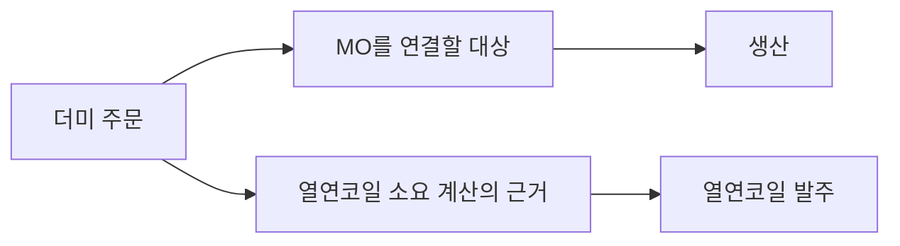
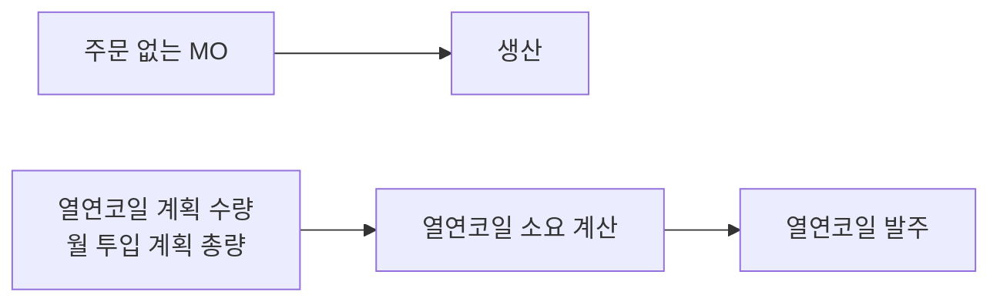
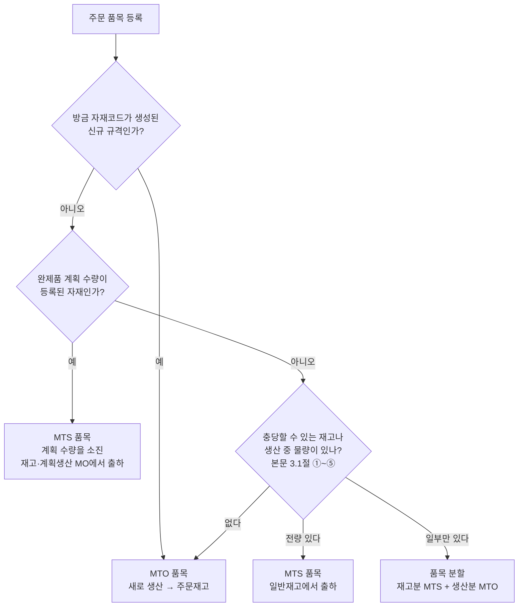
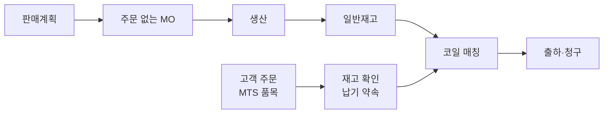
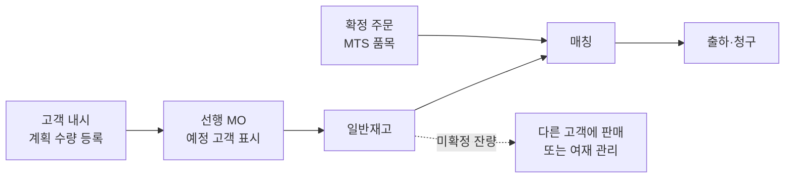
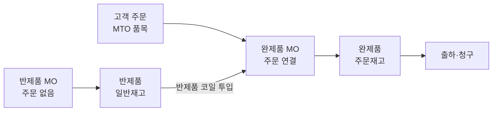
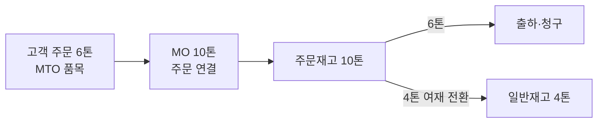
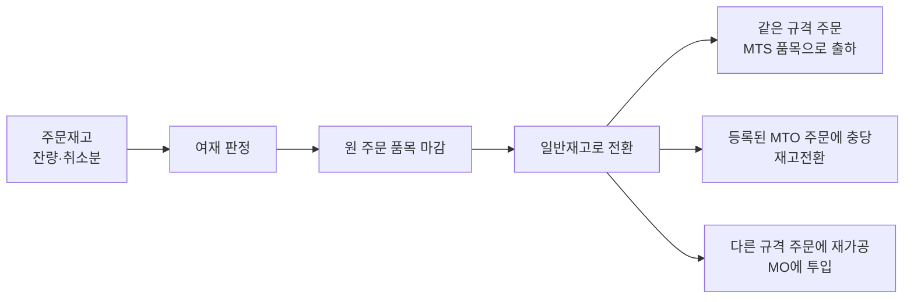
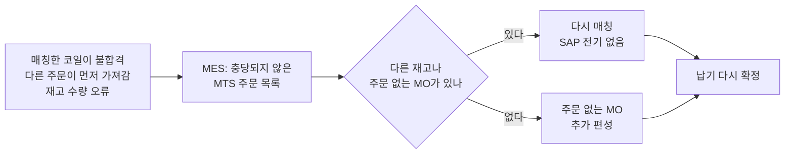

# 상세 1. 계획생산 유형별 업무 시나리오

> [본문](mto-mts-hybrid-analysis.md) 1장의 계획생산 유형과 4장의 흐름을, "누가 무엇을 하고 SAP에 무엇이 생기는가" 수준으로 풀어 쓴 문서다.
> SAP 설정 방법은 [상세 3](mto-mts-03-sap-config-conversion.md), 금액과 분개는 [상세 2](mto-mts-02-costing-examples.md)에서 다룬다.

**공통 전제**

- MO 1건 = SAP 생산오더 1건 (To-Be 설계 기준). 본문 5장의 권고안이며, 지금 MES가 생산오더를 어떻게 만드는지는 확인이 필요하다.
- 생산계획과 MO 편성은 MES가 한다. 실적(투입, 작업 확정, 입고)과 출하는 MES가 SAP로 보낸다.
- 열연코일 소요와 발주는 SAP가 계산한다.
- 표의 "재고 변화"는 SAP 기준이다.
- **[검증]** 표시는 프로토타입에서 확인해야 하는 내용이다.

---

## 1. 한 장 요약

| 유형 | To-Be에서 달라지는 핵심 | 주문 품목 | 완제품 재고 |
|---|---|---|---|
| **A. 표준 규격 상시 판매** | 더미 주문 없이 주문 없는 MO로 생산. 주문은 재고에서 출하 | MTS | 일반재고 |
| **B. 고객 확정 전 선행 생산** | 내시는 계획 수량으로 등록. 확정 주문은 MTS 품목으로 받아 선행 생산분을 매칭 | MTS | 일반재고 |
| **C. 반제품 선행 생산** | 반제품을 주문 없이 만들어 두고, 주문이 오면 반제품을 투입해 완제품 생산 | MTO | 반제품은 일반재고, 완제품은 주문재고 |
| **D. LOT 채움** | 주문 MO를 늘려 생산하면 초과분은 여재로 전환. 따로 편성하면 유형 A와 같다 | MTO 또는 없음 | 주문재고 → 일반재고 |
| **E. 여재** | 원래 주문에 묶어 두지 않고 일반재고로 돌려 다시 판다 | MTS (재판매 주문) | 주문재고 → 일반재고 |

**이 문서의 핵심 규칙 네 가지**

1. **이미 있는 재고나 주문 없이 생산 중인 물량을 파는 주문은 MTS 품목으로 받는다.** 그러면 출하까지 SAP 재고전환이 한 번도 필요 없다. 완제품 계획 수량이 있는 자재의 주문도 같다.
2. **이 주문만을 위해 새로 생산하는 주문은 MTO 품목으로 받는다.** 지금과 같은 흐름이다.
3. **완제품 계획 수량을 넣은 자재의 주문은 재고가 없어도 MTS 품목으로 받는다.** MTO로 받으면 열연코일 소요가 두 번 계산된다.
4. **더미 주문이 "열연코일 발주 근거" 역할을 하고 있다면(2장), 그 역할은 열연코일 계획 수량이 넘겨받는다.**

---

## 2. 더미 주문이 하던 두 가지 역할

지금의 더미 주문은 두 가지 일을 하고 있을 가능성이 크다.

| 역할 | 지금 | To-Be에서 대체하는 것 |
|---|---|---|
| **① 생산 근거** | MO가 연결될 주문을 만들어 준다 | **주문 없는 MO** (SAP에서는 판매오더 지정이 없는 생산오더) |
| **② 열연코일 발주 근거** | SAP가 열연코일 소요를 계산할 수요를 만들어 준다 | **열연코일에 직접 넣는 계획 수량** (계획독립소요) |

역할 ②를 놓치면 문제가 생긴다. MES가 MO를 만드는 시점이 열연코일 발주 리드타임보다 늦으면, MO가 생기기 전 구간의 수요를 SAP가 알 방법이 없기 때문이다.

**지금**: 더미 주문 하나가 두 역할을 한다.

**To-Be**: 두 역할을 서로 다른 수단이 나눠 맡는다.

**열연코일 계획 수량의 운영 방식** [검증]

- 그 달의 예상 투입 총량(MTO분 + MTS분)을 열연 규격별로 넣는다.
- MTO든 MTS든 모든 MO의 투입 예약이 이 계획 수량을 소진한다. 따라서 주문분을 미리 뺄 필요가 없고, 계획과 실제 수요가 두 번 계산되지 않는다.
- 지난 달에 소진되지 않은 계획 수량은 월 마감 때 정리한다.
- 월 단위로 넣으면 소요일이 그 달 첫 근무일로 잡혀 한 달 치를 월초까지 들여오라는 제안이 나올 수 있다. 주 단위로 나눠 넣는 것을 검토한다 [검증].
- 월중에 계획을 다시 보낼 때는 총량이 아니라 남은 양을 보낸다. 투입으로 이미 줄어든 수량이 다시 살아나 과다 발주가 될 수 있다 [검증].
- 이중 계산이 없다고 과다 발주가 없는 것은 아니다. 계획이 실제보다 크면 남은 양이 그대로 발주로 이어진다.
- 구매 원소재에서 이 동작은 프로토타입 1순위 검증 항목이다.
- 누가 등록할지(생산관리, 구매)와 어떤 도구로 만들지(MES, 엑셀, SAP 화면)를 정해야 한다. MES에서 만든다면 인터페이스가 하나 늘어난다.

---

## 3. 주문 품목을 MTO로 받을지 MTS로 받을지

### 3.1 판단 규칙 (제안)

순서도는 위에서부터 차례로 본다.

| 상황 | 품목 | 이유 |
|---|---|---|
| 방금 자재코드가 생성된 신규 규격 | MTO | 재고도 계획 물량도 있을 수 없다 |
| 기존 규격이고, 완제품 계획 수량이 등록된 자재다 | MTS | 재고 유무와 상관없다. MTO 품목은 계획을 소진하지 않아 계획과 주문이 따로 남고, 열연코일 소요가 두 번 계산된다 |
| 기존 규격이고, 매칭할 수 있는 일반재고 또는 주문 없이 생산 중인 MO가 있다 | MTS | 출하까지 SAP 재고전환이 필요 없다 |
| 기존 규격이고, 일부만 재고가 있다 | 품목 분할 | 한 품목 안에서 수량을 나눌 수 없다 [검증] |
| 기존 규격이지만 이 주문만을 위해 새로 생산한다 | MTO | 지금과 같은 흐름 |

> **계획 수량 확인이 재고 확인보다 먼저인 이유** 계획 수량이 있는 자재에서 재고가 일부만 있다고 품목을 나누면, 생산분이 MTO 품목이 되어 같은 이중 계산이 생긴다. 계획 수량이 있는 자재는 품목을 나누지 않고 전량 MTS로 받는다. 모자란 양은 계획생산 MO가 채운다.
>
> 주문별 실제 원가 때문에 이런 자재의 주문을 꼭 MTO로 받아야 한다면, 그 수량만큼 완제품 계획 수량을 직접 줄여야 이중 계산을 피할 수 있다 [검증].

> **"매칭할 수 있는 물량"의 범위** 같은 자재코드의 일반재고만이 아니다. 다른 주문에 묶인 여재 후보, 생산 중인 MO의 초과분, 대체 가능한 다른 자재코드 코일, 재가공으로 맞출 수 있는 반제품·완제품, 고객이 허용하는 2급재까지 먼저 본다. 신규 규격도 대체·재가공 물량은 먼저 본다. 충당원별 SAP 처리는 [본문](mto-mts-hybrid-analysis.md) 3.1절의 표에 있다.

### 3.2 정해야 할 것

| 결정 사항 | 선택지 | 고려할 점 |
|---|---|---|
| **누가 판단하나** | 영업이 수주 때 / 생산관리가 매칭 때 | 영업은 재고 상황을 모르고, 생산관리는 주문 등록 화면을 쓰지 않는다 |
| **어떻게 실수를 줄이나** | 수주 과정의 기능이 MES의 매칭 가능 재고와 계획 수량을 조회해 MTO/MTS를 자동 제안 | 자재코드를 자동 생성하는 기존 기능을 확장할 수 있는지 확인 (구현 방식 확인 필요) |
| **등록 후 바꿔야 하면** | 품목을 바꾸지 않고 재고전환 또는 품목 분할로 처리 | 생산오더나 재고가 생긴 뒤에는 품목의 MTO/MTS를 바꾸기 어렵다 [검증] |
| **한 주문에 섞어도 되나** | 한 주문 안에 MTO 품목과 MTS 품목을 함께 둘 수 있다 | 납품과 청구가 한 건으로 묶이는지 프로토타입에서 확인 [검증] |

> **MTS 품목으로 받으면 잃는 것** 그 주문의 원가는 "그 주문을 위해 만든 MO의 실제 원가"가 아니라 자재 표준단가로 잡힌다. 주문별 실제 원가가 꼭 필요한 주문이라면 MTO 품목으로 받고 그 주문을 위한 MO로 새로 생산해야 한다. MTO 품목이어도 일반재고를 충당한 수량은 표준단가로 잡힌다. 원가 담당과 합의가 필요하다([상세 2](mto-mts-02-costing-examples.md) 10장).

---

## 4. 유형별 시나리오

### 4.1 유형 A. 표준 규격 상시 판매

**대상** 자재코드가 고정된 표준 규격. 유통향 범용 제품.

| # | 누가 | 무엇을 | SAP에 생기는 것 | 재고 변화 |
|---|---|---|---|---|
| A-1 | 영업·생산관리 | 표준 규격별 월 판매계획 확정 | (선택) 완제품 계획 수량 | 없음 |
| A-2 | 생산관리 → MES | 재고 목표 대비 부족분을 주문 없는 MO로 편성 | 없음 | 없음 |
| A-3 | MES → SAP | 생산오더 생성 (판매오더 지정 없음) | 생산오더, 열연코일 예약 | 없음 |
| A-4 | MES → SAP | 투입, 작업 확정, 입고 | 자재문서 | 열연코일 감소 → 완제품 **일반재고** 증가 |
| A-5 | 영업 | 주문 등록, **MTS 품목** | 판매오더 | 없음 |
| A-6 | SAP 자동 | 일반재고와 입고 예정 기준으로 납기 확인 (기본안. MES 예약분 반영은 본문 D15) | 없음 | 없음 |
| A-7 | MES | 재고 코일 또는 생산 중인 MO를 주문에 매칭 | 없음 | **SAP 전기 없음** |
| A-8 | MES → SAP | 출하: 납품에 코일(배치) 지정, 출고 (납품을 누가 만드는지는 확인 필요) | 납품, 자재문서 | 완제품 일반재고 감소 |
| A-9 | SAP | 청구 | 청구문서 | 없음 |

- 완제품 계획 수량(A-1)은 선택이다. 넣지 않으면 열연코일 계획 수량만으로 운영한다.
- 완제품 계획 수량을 넣은 자재의 주문은 MTS 품목으로 받는다.
- **정할 것**: 표준 규격 목록(어느 자재코드를 재고로 가져갈지), 규격별 적정 재고와 담당자.

### 4.2 유형 B. 고객 확정 전 선행 생산 (내시)

**대상** 장기 거래처의 월 내시·예상 물량을 발주 전에 미리 생산하는 경우. 아래는 기본안이고, 다른 수단은 5장에서 비교한다.

| # | 누가 | 무엇을 | SAP에 생기는 것 | 재고 변화 |
|---|---|---|---|---|
| B-1 | 영업 | 고객 내시를 규격별·월별 수량으로 등록 | 완제품 계획 수량 | 없음 |
| B-2 | SAP 자동 | 열연코일 소요에 반영 | 구매요청 | 없음 |
| B-3 | 생산관리 → MES | 내시 기준 선행 MO 편성. 예정 고객을 MES에 기록 | 없음 | 없음 |
| B-4 | MES → SAP | 생산오더 생성 (판매오더 지정 없음), 실적 | 생산오더, 자재문서 | 완제품 **일반재고** 증가 |
| B-5 | 영업 | 확정 주문 등록, **MTS 품목** | 판매오더 | 없음. 계획 수량이 주문만큼 소진되어 겹치지 않는다 |
| B-6 | MES | 내시 생산분을 확정 주문에 매칭 | 없음 | SAP 전기 없음 |
| B-7 | MES → SAP | 출하 | 납품, 자재문서 | 일반재고 감소 |
| B-8 | 영업·생산관리 | 월말: 확정되지 않은 내시 잔량 처리 | 계획 수량 삭제 또는 이월 | 남은 재고는 일반재고 그대로 |

- SAP의 계획 수량에는 고객 정보가 거의 없다. **"어느 고객의 내시분인가"와 "내시 대비 확정 실적"은 MES 또는 영업 시스템이 관리한다.**
- 선행 생산분은 SAP에서 일반재고다. 다른 주문이 가져가지 못하게 SAP에서 막아 주지 않는다. 고객 몫을 지키는 규칙은 MES의 매칭 로직이 담당한다. SAP에는 회계 전기가 없는 배치 특성으로 예정 고객을 비춰 두는 방법을 검토한다 [검증].
- **MES 매칭만으로는 부족할 수 있다.** SAP 가용성 점검은 수주 시점에, 즉 MES 매칭보다 먼저 다른 고객 주문의 납기를 그 재고로 확정한다. 다른 고객의 MTS 주문도 같은 계획 수량을 소진한다. SAP에서도 고객 몫을 지켜야 하면 S/4HANA 제품 할당(Product Allocation)으로 고객별 확정 한도를 두거나, 내시 재고를 별도 저장위치에 두는 방안을 비교한다. 그래도 부족하면 5장의 ⑤를 쓴다 [검증].
- 신규 규격의 내시는 자재코드가 아직 없을 수 있다. 이 경우 **주문 없이도 자재코드를 만들 수 있는 절차**가 먼저 필요하다([상세 3](mto-mts-03-sap-config-conversion.md)).

### 4.3 유형 C. 반제품 선행 생산

**대상** 풀하드, 소둔재 같은 중간재를 미리 만들어 납기를 줄이는 경우.

**전제 조건** 아래가 갖춰져야 SAP에서 성립한다. 현재 구조 확인이 먼저다.

1. 반제품이 **독립된 자재코드와 재고**를 갖는다.
2. 완제품 MO의 **투입 자재가 반제품**이다. 수주 때 자동 생성되는 BOM이 "반제품에서 출발하는 BOM"을 만들 수 있어야 한다.
3. MO가 지금 "열연 투입부터 완제품까지 한 건"이라면, 반제품 지점에서 **MO를 둘로 나눠야 한다.**
4. 반제품이 주문별로 묶이지 않고 공용으로 쓰이도록 자재 설정을 한다([상세 3](mto-mts-03-sap-config-conversion.md)).
5. 같은 완제품을 열연에서도, 반제품에서도 만들게 되므로 BOM·공정 대안과 생산버전이 두 개 필요하다. 표준원가는 한 경로 기준이라 다른 경로로 만든 MO에는 경로 차이가 생산 차이로 쌓인다([상세 3](mto-mts-03-sap-config-conversion.md) 5장).

| # | 누가 | 무엇을 | SAP에 생기는 것 | 재고 변화 |
|---|---|---|---|---|
| C-1 | 생산관리 → MES | 반제품 선행 MO 편성 (주문 없음) | 없음 | 없음 |
| C-2 | MES → SAP | 생산오더 생성: 생산 품목 = 반제품, 판매오더 지정 없음 | 생산오더, 열연코일 예약 | 없음 |
| C-3 | MES → SAP | 실적 | 자재문서 | 열연코일 감소 → 반제품 **일반재고** 증가 |
| C-4 | 영업 | 고객 주문 등록, **MTO 품목** (완제품) | 판매오더 | 없음 |
| C-5 | MES | 주문용 MO 생성, 투입할 반제품 코일 지정 | 없음 | 없음 |
| C-6 | MES → SAP | 생산오더 생성: 생산 품목 = 완제품, 판매오더 지정, 투입 = 반제품 | 생산오더, 반제품 예약 | 없음 |
| C-7 | MES → SAP | 실적 | 자재문서 | 반제품 일반재고 감소 → 완제품 **주문재고** 증가 |
| C-8 | MES → SAP | 출하 | 납품, 자재문서 | 주문재고 감소 |

- 완제품 쪽은 지금의 MTO 흐름과 같다. 달라지는 것은 투입 자재가 열연코일이 아니라 반제품이라는 점이다.
- 반제품 재고에도 표준원가가 있어야 한다.
- **정할 것**: 선행 생산할 반제품 지점과 규격, 반제품 자재코드 체계, MO 분할 기준.

### 4.4 유형 D. LOT 채움·설비 효율

두 가지 방식이 있다. 어느 쪽이 많은지 확인이 필요하다.

**D-가. 주문 MO의 수량을 LOT 최소량에 맞춰 늘려 생산**

| # | 누가 | 무엇을 | SAP에 생기는 것 | 재고 변화 |
|---|---|---|---|---|
| D-1 | MES | 주문 수량보다 큰 MO 편성 | 없음 | 없음 |
| D-2 | MES → SAP | 생산오더 생성 (판매오더 지정), 수량 = MO 수량 | 생산오더 | 없음 |
| D-3 | MES → SAP | 입고. 초과분을 포함한 전량이 그 주문의 재고로 들어간다 [검증] | 자재문서 | 완제품 **주문재고** 증가 |
| D-4 | MES → SAP | 출하: 주문의 초과 납품 허용 범위까지 | 납품, 자재문서 | 주문재고 감소 |
| D-5 | MES → SAP 자동 | 남은 코일을 여재로 전환 | 자재문서 (재고전환) | 주문재고 → **일반재고** |
| D-6 | – | 이후는 유형 E와 같다 | – | – |

- 생산 차이는 전부 원래 주문에 붙는다. 초과분 몫의 차이까지 그 주문이 부담하는 것이 맞는지 원가 담당과 정해야 한다([상세 2](mto-mts-02-costing-examples.md) 예시 라).
- 확인할 설정: 생산오더의 초과 입고 허용 범위, 판매오더 품목의 초과 납품 허용 범위 [검증].

**D-나. 주문과 무관한 채움 MO를 따로 편성**

주문 없는 MO → 판매오더 지정 없는 생산오더 → 일반재고. 유형 A의 A-2~A-9와 같다. 채움 생산도 열연코일을 쓰므로, 채움 물량이 크면 열연코일 계획 수량에 반영해야 한다.

### 4.5 유형 E. 여재 처리

**지금** 여재가 원래 주문에 묶인 채 남고, 다른 주문이 생기면 수작업으로 옮긴다.
**To-Be** 여재 판정 → 일반재고로 전환 → MTS 품목으로 재판매.

| # | 누가 | 무엇을 | SAP에 생기는 것 | 재고 변화 |
|---|---|---|---|---|
| E-1 | MES 자동 또는 생산관리 | 여재 판정. 조건: 주문 완납·마감 후 남은 재고, 주문 취소·감량, 품질 판정으로 그 주문에 납품 불가 | 없음 | 없음 |
| E-2 | 영업 | 원 주문 품목 마감 (잔량 거절 또는 완료 처리) | 판매오더 변경 | 없음 |
| E-3 | MES → SAP 자동 | 여재 전환 | 자재문서 (재고전환) | 주문재고 → **일반재고** |
| E-4 | 영업 | 여재를 팔 새 주문 등록. 자재코드가 같으면 **MTS 품목** | 판매오더 | 없음 |
| E-5 | MES → SAP | 매칭, 출하 | 납품, 자재문서 | 일반재고 감소 |

**변형**

| 경우 | 처리 | 재고 변화 |
|---|---|---|
| 이미 MTO 품목으로 등록된 주문에 여재를 충당 | 재고전환 (일반재고 → 주문재고) 또는 품목 분할 | 일반재고 → 주문재고 |
| 규격이 조금 다른 주문에 그대로 사용 | 자재코드 변경 전기 후 충당 | 자재 X 재고 → 자재 Y 재고. 단가가 다르면 차액 발생 |
| 다른 규격 주문에 재가공해서 사용 | 그 주문의 MO에 여재 코일을 투입 | 여재 감소 → 새 규격 완제품 주문재고 증가 |

- **E-2를 빠뜨리면 안 된다.** 주문을 마감하지 않고 재고만 빼면 SAP가 그 주문의 미결 수량을 다시 생산하라고 제안할 수 있다 [검증].
- **정할 것**: 여재 판정을 시스템이 자동으로 해도 되는지 담당자 승인이 필요한지, 여재를 팔 때 새 주문을 내는지 기존 주문을 고치는지, 등급이 떨어진 코일의 자재코드 처리.

### 4.6 계획대로 되지 않을 때

위 시나리오는 순조로운 경우다. 병행 운영에서 새로 생기는 예외는 대부분 **MTS 품목**에서 나온다. MTO 품목은 그 주문을 위한 MO가 SAP에 보이지만, MTS 품목은 SAP에서 주문과 생산이 연결되어 있지 않기 때문이다.

**MTS 품목으로 받았는데 재고가 모자라게 된 경우**

| 항목 | 내용 |
|---|---|
| 왜 따로 봐야 하나 | SAP에는 그 주문을 위한 생산오더가 없다. 모자란다는 사실을 SAP가 생산 쪽에 알려 주지 않는다. 완제품 MRP를 돌리지 않는 자재라면 더 그렇다 |
| 누가 알아차리나 | **MES가 "충당되지 않은 MTS 주문" 목록을 상시 보여 줘야 한다.** 주문 수량 대비 매칭 수량이 모자란 품목, 매칭한 코일의 상태가 바뀐 품목이 대상이다 |
| 무엇으로 채우나 | 다른 일반재고나 주문 없는 MO를 다시 매칭한다. 없으면 주문 없는 MO를 추가 편성한다. 그 주문 전용 MO가 아니므로 SAP 생산오더에는 주문을 지정하지 않는다 |
| 납기는 누가 다시 정하나 | 납기 약속을 SAP 가용성 점검으로 하는지 MES 매칭 결과로 하는지(본문 D15)에 따라 다르다. 어느 쪽이든 영업에 알리는 절차가 필요하다 |

**주문이 바뀔 때**

| 변경 | MTO 품목 | MTS 품목 |
|---|---|---|
| 수량 증가 | 생산 전이면 MO 수량을 늘린다. 생산 뒤면 추가 MO를 만들거나 재고를 충당한다 | 재고와 주문 없는 MO에서 추가 매칭. 모자라면 위 절차 |
| 수량 감소 | 생산 전이면 MO 수량을 줄인다. 생산 중·생산 뒤면 남는 코일을 여재로 전환한다 (4.5절) | 매칭을 일부 해제한다. SAP 전기 없음 |
| 취소 | 생산 전이면 MO를 취소하거나 주문 없는 MO로 다시 만든다. 생산 중이면 MES에서 매칭을 풀고, 입고 뒤 일반재고로 전환한다 | 매칭 해제. SAP 전기 없음. 완제품 계획 수량이 있었다면 소진이 되돌아간다 [검증] |
| 납기 변경 | MO 일정을 조정한다 | 매칭 우선순위가 바뀐다. 다른 주문과 코일을 맞바꿀 수 있다 |
| 규격 변경 | 자재코드가 바뀌므로 품목을 새로 등록한다. 기존 MO의 물량은 여재가 된다 | 품목을 새로 등록한다. 재고는 영향이 없다 |

**품질 판정으로 납품할 수 없게 된 경우**

| 상황 | MTO 품목 | MTS 품목 |
|---|---|---|
| 코일이 그 주문 규격에 불합격 | 그 코일을 일반재고로 전환(다른 주문에 쓸 수 있으면)하거나 2급으로 전환한다. 모자란 양은 같은 주문을 지정한 MO로 다시 만든다 | 다른 코일을 매칭한다. 불합격 코일은 2급으로 전환한다 |
| 다른 주문에는 합격 | 그 주문으로 전용한다 (주문 → 주문, 또는 일반재고를 거쳐) | 매칭만 바꾼다 |

- 반품은 이 문서에서 다루지 않았다. 반품된 코일이 원래 주문의 재고로 돌아오는지 일반재고가 되는지, 등급을 다시 판정하는지는 현행 처리를 확인한 뒤 정한다(7장 17번).
- **공통 원칙**: 주문 품목은 지우지 않고 마감한다. 지우면 그 주문에 묶인 재고와 MO의 근거가 사라진다.

---

## 5. 유형 B에 쓸 수 있는 수단 비교

| 수단 | SAP에서의 모습 | 열연코일 소요 반영 | 선행 생산분의 재고 | 강점 | 약점 |
|---|---|---|---|---|---|
| **① 완제품 계획 수량 + MTS 주문** (4.2절의 기본안) | 규격별 계획 수량. 고객 정보는 MES가 보유 | 된다 | 일반재고 | 더미 주문이 없다. SAP 전기가 가장 적다 | SAP에서 재고가 고객에 묶이지 않는다. 주문별 실제 원가가 없다 |
| **② 열연코일만 선행 확보** | 열연코일 계획 수량만 | 된다 | 선행 생산 없음 | 가장 단순 | 선행 "생산"이 아니라 선행 "소재 확보"다. 납기 단축 효과가 작다 |
| **③ 납품일정계약** | 고객 × 규격별 장기 문서 하나에 내시 일정과 확정 일정을 함께 관리 | 된다 | 일반재고 [검증] | 내시와 확정이 한 문서에 있다. 내시 대비 납품 누계가 남는다 | 고객 × 규격 조합이 안정적이어야 한다. MES 인터페이스와 수주 실적 집계를 새로 설계해야 한다 |
| **④ 수량 계약** | 기간·총량·가격 약정 | **안 된다.** 계약을 참조한 주문이 있어야 소요가 생긴다 | 해당 없음 | 가격·약정 관리 | 생산·발주 근거가 되지 못한다. ①과 함께 써야 한다 |
| **⑤ 내시 전용 주문 유형** | 지금의 더미 주문을 별도 주문 유형으로 정식화. MTO 품목 | 된다 | 주문재고 | 지금과 가장 비슷하다. 주문별 원가가 유지된다 | 수주 실적 왜곡을 주문 유형으로 걸러내야 한다. 더미 주문의 불편이 남는다 |

**고르는 기준**

| 조건 | 맞는 수단 |
|---|---|
| 내시 규격이 반복 규격이고, 확정되지 않아도 다른 고객에게 팔 수 있다 | ① |
| 내시 고객이 소수이고 규격이 고정이며, 내시를 정기 문서로 받는다 | ③ |
| 선행 생산분이 SAP에서도 반드시 그 고객에 묶여 보여야 하고 주문별 원가가 필요하다 | ⑤ |
| 소재만 미리 확보하면 충분하다 | ② |

현재 정보로는 ①을 기본안으로 둔다. 아래 7장의 유형 B 질문에 대한 답에 따라 ③ 또는 ⑤로 바꿀 수 있다.

---

## 6. 역할별로 무엇이 달라지나

| 역할 | 없어지는 일 | 새로 생기는 일 |
|---|---|---|
| **영업** | 더미 주문 등록과 취소·변경 | 주문 품목의 MTO/MTS 선택(또는 시스템 제안 확인), 일부 재고 충당 시 품목 분할, 여재 발생 시 원 주문 마감, 내시의 계획 수량 등록 |
| **생산관리** | 더미 주문에 MO를 붙이는 작업, 여재의 수작업 이동 | 주문 없는 MO 편성, 열연코일 계획 수량 등록과 월말 정리(등록 주체는 2장에서 결정), 표준 규격의 적정 재고 관리, 여재 판정 기준 운영 |
| **구매** | – | 열연코일 계획 수량을 기준으로 한 발주 검토 |
| **원가·회계** | – | 신규 자재의 표준원가 확정 관리, 재고전환 전표 점검, 주문 없는 MO의 차이 분석, 여재·장기 재고 평가 |
| **기준정보** | – | 주문 없이 자재코드를 만드는 절차, 표준 규격 목록과 반제품 코드 관리 |
| **MES 운영** | – | 매칭 변경에 따른 SAP 전기 오류 모니터링, 재고 대사(재고 종류와 귀속 주문까지) |

---

## 7. 업무 측에 확인할 질문

**열연코일 발주**

1. 열연코일은 발주부터 입고까지 보통 얼마나 걸리나? MES가 MO를 만드는 시점은 생산 며칠(몇 주) 전인가?
2. 지금 더미 주문은 생산 또는 발주 몇 주 전에 등록하나? SAP MRP가 열연코일 소요를 계산할 때 수요로 잡는 것은 무엇인가(더미 주문, 실제 주문, 생산오더의 투입 예약)?
3. 열연코일 자재코드는 몇 개이고, 완제품 규격마다 투입할 열연 규격이 정해져 있나? 계획 때 예정한 열연 규격과 실제 투입한 열연 규격이 달라지는 일은 얼마나 잦은가?

**주문 등록**

4. 주문은 SAP 표준 화면에서 등록하나, 별도 수주 프로그램으로 들어오나? 그 프로그램이 MES의 재고를 조회하도록 확장할 수 있나?
5. 한 주문 품목의 일부만 재고로 충당하는 경우가 흔한가? 품목을 "재고분"과 "생산분" 두 줄로 나누는 것을 영업이 받아들일 수 있나?
6. 지금 납기 확정은 SAP가 하나, MES가 준 납기를 입력하나?

**자재코드와 실물**

7. 자재코드에 고객 전용 요소(포장, 공차, 고객 규격 번호 등)가 들어 있나? 같은 실물 코일이 서로 다른 자재코드의 주문에 납품될 수 있나?
8. 여재를 다른 주문으로 옮길 때 자재코드가 다르면 지금은 어떻게 처리하나?

**유형별**

9. (A) 상시 판매하는 표준 규격은 자재코드 기준으로 몇 개쯤이고 전체 물량의 어느 정도인가?
10. (B) 내시 고객은 몇 곳이고 규격은 반복 규격인가? 내시 대비 확정 비율은 어느 정도인가? 확정되지 않은 선행 생산분을 다른 고객에게 팔 수 있나?
11. (B) 내시로 선행 생산한 코일이 SAP에서도 "그 고객 몫"으로 묶여 보여야 하나, MES에서만 관리해도 되나?
12. (C) 풀하드·소둔재가 지금 SAP에 별도 자재코드와 재고로 있나? MO는 열연 투입부터 완제품까지 한 건인가, 공정 구간별로 나뉘나?
13. (D) 주문 MO의 수량을 늘려 생산하는 경우와 채움 MO를 따로 만드는 경우 중 어느 쪽이 많은가?
14. (E) 여재 판정은 시스템이 자동으로 해도 되나, 담당자 승인이 필요한가? 여재를 재가공해 다른 규격 주문에 쓰는 경우가 있나?

**더미 주문 현황**

15. 더미 주문은 별도 주문 유형이나 표시로 구분되어 있나? 실제 주문이 오면 더미 주문을 취소하고 새로 등록하나, 더미 주문을 고객 주문으로 바꾸나?
16. 유형 A~D 가운데 더미 주문이 가장 많은 유형은 무엇인가?

**예외와 범위**

17. 반품된 코일은 지금 원래 주문의 재고로 돌아오나, 여재가 되나? 등급을 다시 판정하나?
18. 주문 수량·납기 변경과 취소는 한 달에 몇 건쯤인가? 그 가운데 생산이 시작된 뒤의 변경은 어느 정도인가?
19. 고객 소유 소재를 받아 가공하는 임가공 주문, 청구는 끝났는데 출하를 기다리는 보관 재고가 있나? 재고 판매는 내수에만 하나, 수출도 하나? MTS 대상에서 뺄 범위를 정하기 위한 질문이다.
20. 더미 주문이 생산 근거와 발주 근거 말고 다른 용도로도 쓰이나? (생산 실적 집계 키, 출하 계획이나 창고 배정 기준, 영업 목표 관리 등) 세 번째 역할이 있으면 대체 수단이 하나 더 필요하다.
