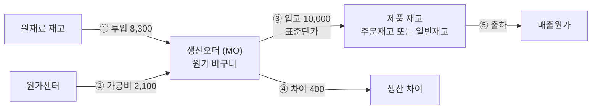
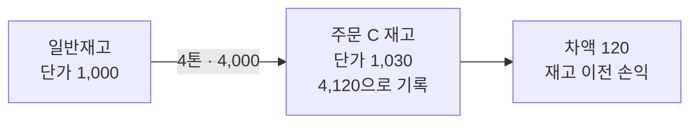

# 상세 2. 원가와 회계 처리: 숫자 예시

> [본문](mto-mts-hybrid-analysis.md) 7장(원가)과 4.4절(매칭이 바뀔 때)을 숫자로 풀어 쓴 문서다.
> 같은 조건(표준단가 톤당 1,000천원, 10톤 생산, 실제 원가 10,400천원)으로 MTO, MTS, 재고 충당, 여재 전환을 차례로 장부에 적어 본다.

**근거 표기**

| 표기 | 뜻 |
|---|---|
| **[확인]** | 공개 자료(SAP 도움말, SAP 교육 자료, SAP 지원 문서)로 확인한 내용 |
| **[검증 필요]** | SAP 표준 지식에 근거한 설명. 프로토타입 시스템에서 직접 전기해 보고 확정해야 한다 |

조사 환경에서 SAP 사이트 원문을 직접 열 수 없어 [확인] 항목도 검색 결과의 요약과 인용문에 근거한다. 원가 담당이 원문과 시스템으로 한 번 더 대조하기를 권한다.

---

## 1. 한 장 요약

| 질문 | 답 |
|---|---|
| 주문재고의 장부 단가는 언제, 무엇으로 정해지나 | 그 주문의 재고 주머니에 **처음 입고될 때 한 번** 정해진다. 설정에 따라 자재 표준단가를 쓰거나, 주문별 원가추정·생산오더 계획원가를 먼저 쓴다 |
| MTO와 MTS는 분개가 다른가 | **같다.** 다른 것은 ① 완제품이 들어가는 주머니(주문재고, 일반재고) ② 생산 차이에 고객이 붙는지 여부뿐이다 |
| 재고를 주문과 일반 사이에서 옮기면 손익이 생기나 | 두 주머니의 단가가 같으면 0이다. 다르면 차액이 "재고 이전 손익" 계정에 잡힌다 |
| 주문별 실제 원가는 계속 볼 수 있나 | MTO로 만든 주문은 "표준 매출원가 + 그 MO의 생산 차이"로 볼 수 있다. MTS 재고를 충당한 주문은 장부만으로는 표준단가까지만 보인다 |
| 고객별 수익성은 | 매출과 표준 매출원가는 출하 때 고객에 붙는다. MTS의 생산 차이는 제품까지만 붙는다 |

---

## 2. 먼저 알아둘 말

| 말 | 쉬운 뜻 |
|---|---|
| 분개, 차변, 대변 | 장부에 적는 한 줄. 왼쪽(차변)과 오른쪽(대변) 금액은 항상 같다. 재고가 늘거나 비용이 생기면 차변, 재고가 줄거나 수익이 생기면 대변 |
| 평가 주머니 | 재고 금액과 단가를 따로 관리하는 단위. 일반재고는 "자재 + 플랜트"가 한 주머니다. 주문재고는 설정에 따라 "자재 + 판매오더 품목"마다 주머니가 따로 생긴다 |
| 표준단가와 차이 | 재고는 미리 정한 표준단가로만 장부에 올린다. 실제로 든 돈과의 차액은 "차이"로 따로 적는다 |
| 생산오더 | 원가를 담는 바구니. 투입한 자재와 가공비가 들어가고, 완제품이 입고되면 표준단가만큼 빠진다. 바구니에 남은 금액이 차이다. 이 회사에서는 MO 1건 = 생산오더 1건 |
| 거래키 | SAP가 "이 재고 이동은 어느 계정에 적을지"를 찾을 때 쓰는 꼬리표(설정 화면 OBYC). 이 문서에 나오는 것: **BSX** 재고 계정, **GBB** 재고의 상대 계정, **PRD** 가격차이 계정, **AUM** 재고 이전 손익 계정 |

---

## 3. 주문재고의 단가는 어떻게 정해지나

### 3.1 평가 방식은 세 가지다

판매오더 품목의 소요클래스에 있는 **Valuation** 필드가 주문재고를 어떻게 평가할지 정한다 [확인].

| Valuation 값 | 뜻 | 금액을 관리하는 주머니 | 단가 |
|---|---|---|---|
| 공란 | 비평가. 수량만 관리 | 없음 | 없음 |
| **M** | 일반재고와 **따로** 평가 | 판매오더 품목마다 하나 | 3.2절의 순서로 정한다 |
| **A** | 일반재고와 **함께** 평가 | 자재·플랜트 공용. 수량만 주문별로 구분 | 자재 표준단가 그대로 |

현재 시스템은 주문재고가 제품 재고 금액으로 잡히므로 M 또는 A다. 어느 쪽인지는 원가 담당이 확인해야 한다.

본문의 권고는 **"M + 단가 통일"** 이다. 주머니는 주문별로 두되 단가만 자재 표준단가로 맞춘다. **A**는 주머니 자체를 합치는 방식으로, 함께 비교할 가치가 있다.

| 항목 | M + 단가 통일 (본문 권고) | A (추가 검토 대상) |
|---|---|---|
| 주문별 재고 금액을 SAP에서 조회 | 가능 | 수량만 주문별, 금액은 자재 합계 [검증 필요] |
| 주문과 일반 사이 전환 때 차액 | 보통 0. 3.4절의 ②에 해당하면 생긴다 | 구조적으로 없음 [검증 필요] |
| 실제원가를 쓸 때 실제 단가 | 주문 품목별로 계산 | 자재 단위로만 계산 [검증 필요] |
| 평가 주머니 개수 | 주문 품목 수만큼 늘어난다 | 늘지 않는다 |

> **기존 시스템 전환 시 주의** 이미 재고가 있는 소요클래스의 Valuation 값을 바꾸면 주문 쪽 값과 재고 쪽 값이 어긋나 재고 불일치가 생길 수 있다 [확인]. 기존 소요클래스는 그대로 두고 **새 소요클래스와 소요유형을 추가**하는 방식으로 설계한다.

### 3.2 Valuation = M일 때 단가를 찾는 순서

**주문별 단가 방식** (Without valuation strategy 지시자를 끈 경우). 아래 순서에서 먼저 찾은 값을 쓴다 [확인].

1. 고객 확장(Customer Exit) COPCP002가 정한 단가
2. 판매오더 원가추정 또는 오더 BOM 원가추정
3. 생산오더의 계획원가. 같은 주문 품목에 MO가 여러 개면 **먼저 입고한 MO**의 계획원가가 단가가 된다
4. 자재마스터의 표준단가

**단가 통일 방식** (지시자를 켠 경우). 1~3을 건너뛰고 일반재고의 자재 표준단가로만 평가한다 [확인].

두 방식 모두에 적용되는 규칙은 다음과 같다.

- 단가는 그 주머니에 **처음 입고될 때** 정해진다. 이후의 입고나 입고 취소로는 바뀌지 않는다 [확인].
- 나중에 바꾸려면 주문재고 가격 변경을 수동으로 해야 한다 [검증 필요].
- 어떤 방법으로 단가가 정해졌는지는 테이블 EBEW의 평가전략 필드(LBWST)에 남는다 [확인]. **현재 시스템이 어느 방식인지 이 필드로 확인할 수 있다.**
- 생산오더의 차이도 같은 잣대로 계산된다. 단가 통일 방식에서는 MTO 오더의 차이도 자재 표준원가 대비로 나오므로 MTO와 MTS를 같은 기준으로 비교할 수 있다 [확인].

> **이 회사에 주는 의미** 자재코드가 규격 조합별로 세분화되어 있으므로 "자재 표준단가"는 사실상 "그 규격의 표준원가"다. 같은 자재코드의 주문재고와 일반재고는 물리적으로 같은 규격이니 장부 단가가 같은 것이 자연스럽다. 주문별 단가 방식은 같은 규격인데 주문마다 장부 단가가 달라지는 구조다.

### 3.3 평가 정보는 어디에 저장되나

| 재고 | 테이블 | 한 줄의 단위 |
|---|---|---|
| 일반재고 | MBEW | 자재 + 플랜트 |
| 판매오더재고, Valuation = M | EBEW | 위 항목 + 판매오더 번호 + 품목 |
| 판매오더재고, Valuation = A | MBEW (별도 주머니 없음) | 일반재고와 같다 |

S/4HANA에서도 MBEW, EBEW라는 이름은 남아 있다. 다만 단가 같은 속성만 여기에 저장하고 수량과 금액은 통합분개장(ACDOCA)에서 읽어 온다 [확인]. 조회 결과는 예전과 같지만, **이 테이블을 직접 읽는 자체 개발 프로그램은 전환 때 점검해야 한다.**

### 3.4 놓치기 쉬운 세 가지

| # | 상황 | 무슨 일이 생기나 | 대응 |
|---|---|---|---|
| ① | 수주 때 **자동 생성된 자재코드**에 표준단가가 아직 없다 | 단가 통일 방식에서는 주문재고가 0원이나 잘못된 단가로 입고될 수 있다. 지금은 생산오더 계획원가로 평가되어 드러나지 않았을 가능성이 있다 [검증 필요] | 자재·BOM·공정 자동 생성 절차에 **표준원가추정 생성과 확정**을 넣고, 첫 입고 전에 끝났는지 점검한다 |
| ② | 주머니가 생긴 뒤 **자재 표준단가를 갱신**했다 | 기존 주문재고 주머니는 옛 단가로 남는다. 그 재고를 전환하면 차액이 생긴다 [검증 필요] | 표준단가 갱신 때 미결 주문재고 단가를 일괄 변경하거나, Valuation A를 검토하거나, 소액 차액을 허용한다 |
| ③ | 주문재고 주머니가 생산 입고가 아니라 **전환으로 처음** 만들어진다 | 받는 주문에 주머니가 있으면 그 단가, 없으면 표준단가로 평가된다. 주는 쪽 단가는 따라가지 않는다 [확인] | 주문별 단가 방식에서는 사건의 순서에 따라 단가가 달라진다. 단가 통일 방식에서는 문제가 없다 |

---

## 4. 표준 분개 한눈에 보기

| 단계 | 언제 | 차변 (왼쪽) | 대변 (오른쪽) | 금액 기준 | 거래키 |
|---|---|---|---|---|---|
| 원소재 투입 | 생산오더로 출고 (이동유형 261) | 원재료비. 생산오더에 쌓인다 | 원재료 재고 | 투입량 × 원소재 단가 | GBB-VBR / BSX [확인] |
| 작업 확정 | 공정 실적 확정 | 가공비. 생산오더에 쌓인다 | 가공비. 원가센터에서 빠진다 | 작업 시간 × 활동 단가 | 없음. 관리회계 안의 배부 [확인] |
| 완제품 입고 | 이동유형 101 | 제품 재고 (일반 또는 주문) | 생산 산출. 생산오더에서 빠진다 | 입고량 × 재고 표준단가 | BSX / GBB-AUF [확인] |
| 기말 재공 | 월말에 생산 중인 오더 | 재공품 | 재공품 변동 | 쌓인 실제 원가 − 입고로 빠진 금액 | 별도 설정 [검증 필요] |
| 차이 정산 | 생산이 끝난 오더, 월말 | 생산 차이 (돈이 더 들었을 때) | 생산 산출 | 생산오더에 남은 금액 | PRD / GBB-AUA [확인] |
| 출하 | 납품 출고 (이동유형 601) | 매출원가 | 제품 재고 | 출하량 × 재고 표준단가 | GBB-VAX / BSX [확인] |
| 재고 전환 | 일반 ↔ 주문, 주문 → 주문 | 받는 쪽 재고 | 주는 쪽 재고 | 각 주머니의 표준단가. 차액은 이전 손익 | BSX / BSX, 차액 AUM |
| 자재 간 이전 | 자재코드 변경 (이동유형 309) | 받는 자재 재고 | 주는 자재 재고 | 위와 같다 | BSX / BSX, 차액 AUM |

- **생산 산출 계정**은 공장이 만들어 낸 가치를 손익에 적는 상대 계정이다. 회사 계정 체계에 따라 "제조원가 대체" 같은 이름을 쓴다.
- **차이 정산은 새 비용을 만드는 전기가 아니다.** 이미 손익에 들어 있던 금액에 "생산 차이"라는 이름표를 붙이고 수익성 분석에 넘기는 절차다 [확인].
- 실제 계정 과목은 회사 설정에 따른다. 이 문서는 구조만 보여 준다.

---

## 5. 예시의 공통 가정

| 항목 | 값 (금액 단위: 천원) |
|---|---|
| 완제품 | 냉연코일 자재 P. 표준단가 톤당 1,000 |
| 생산량 | 10톤. 표준원가 10,000 = 열연코일 8,000 + 가공비 2,000 |
| 실제 원가 | 10,400 = 열연코일 8,300 + 가공비 2,100 |
| 생산 차이 | 400 = 열연코일을 더 쓴 300 + 설비 시간이 더 걸린 100 |
| 판매단가 | 톤당 1,200 (이익 계산을 위한 가정) |
| 주문별 단가 방식의 주문재고 단가 | 톤당 1,030 (그 주문 MO의 계획원가라고 가정) |
| 그 밖 | 월 안에 생산 완료(기말 재공 없음). 실제원가는 쓰지 않는 것을 기본으로 하고 9장에서 따로 설명 |

---

## 6. 예시

### (가) MTO: 주문을 받고 생산해서 출하

고객 갑의 주문 A(10톤, MTO 품목). MO-1에 주문 A가 지정되어 있다. 단가 통일 방식.

| # | 사건 | 차변 | 금액 | 대변 | 금액 |
|---|---|---|---:|---|---:|
| 1 | 열연코일 투입 | 원재료비 → MO-1 | 8,300 | 원재료 재고 | 8,300 |
| 2 | 작업 확정 | 가공비 → MO-1 | 2,100 | 가공비 ← 원가센터 | 2,100 |
| 3 | 완제품 10톤 입고 (주문재고) | 제품 재고 (주문 A) | 10,000 | 생산 산출 ← MO-1 | 10,000 |
| 4 | 월말 차이 정산 | 생산 차이 | 400 | 생산 산출 ← MO-1 | 400 |
| 5 | 10톤 출하 | 매출원가 | 10,000 | 제품 재고 (주문 A) | 10,000 |
| 6 | 청구 | 매출채권 | 12,000 | 매출 | 12,000 |
| | **합계** | | **42,800** | | **42,800** |

MO-1에 남은 금액: 8,300 + 2,100 − 10,000 − 400 = 0.

| 단계 후 | 원재료 재고 (증감) | MO-1에 남은 금액 | 제품 재고 (주문 A) |
|---|---:|---:|---:|
| 1 투입 | −8,300 | 8,300 | 0 |
| 2 작업 확정 | −8,300 | 10,400 | 0 |
| 3 입고 | −8,300 | 400 | 10,000 |
| 4 정산 | −8,300 | 0 | 10,000 |
| 5 출하 | −8,300 | 0 | 0 |

**읽는 법**

- 주문재고는 표준단가로만 올라간다(10,000). 400이 더 들었다는 사실은 재고 금액에 나타나지 않고 "생산 차이"로 간다.
- MO-1에 주문 A가 지정되어 있으므로 차이 400은 주문 A와 고객 갑에 붙일 수 있다 [검증 필요].
- **주문 A의 실제 원가 = 매출원가 10,000 + 차이 400 = 10,400. 이익 = 12,000 − 10,400 = 1,600.**

같은 주문을 주문별 단가 방식으로 전기하면 숫자의 위치만 달라진다.

| 항목 | 단가 통일 | 주문별 단가 (1,030) |
|---|---:|---:|
| 입고 때 재고 금액 | 10,000 | 10,300 |
| 정산 차이 | 400 | 100 |
| 출하 때 매출원가 | 10,000 | 10,300 |
| 주문 A 원가 합계 | 10,400 | 10,400 |
| 주문 A 이익 | 1,600 | 1,600 |

### (나) MTS: 주문 없이 생산하고 나중에 출하

MO-2에는 주문이 없다. 10톤을 만들어 일반재고로 두었다가, 고객 을의 주문 B(6톤, MTS 품목)로 6톤을 출하한다. 4톤이 남는다.

| # | 사건 | 차변 | 금액 | 대변 | 금액 |
|---|---|---|---:|---|---:|
| 1 | 열연코일 투입 | 원재료비 → MO-2 | 8,300 | 원재료 재고 | 8,300 |
| 2 | 작업 확정 | 가공비 → MO-2 | 2,100 | 가공비 ← 원가센터 | 2,100 |
| 3 | 완제품 10톤 입고 (일반재고) | 제품 재고 (일반) | 10,000 | 생산 산출 ← MO-2 | 10,000 |
| 4 | 월말 차이 정산 | 생산 차이 | 400 | 생산 산출 ← MO-2 | 400 |
| 5 | 주문 B로 6톤 출하 | 매출원가 | 6,000 | 제품 재고 (일반) | 6,000 |
| 6 | 6톤 청구 | 매출채권 | 7,200 | 매출 | 7,200 |
| | **합계** | | **34,000** | | **34,000** |

| 단계 후 | 원재료 재고 (증감) | MO-2에 남은 금액 | 제품 재고 (일반) |
|---|---:|---:|---:|
| 3 입고 | −8,300 | 400 | 10톤 · 10,000 |
| 4 정산 | −8,300 | 0 | 10톤 · 10,000 |
| 5 6톤 출하 | −8,300 | 0 | 4톤 · 4,000 |

**읽는 법**

- **1~4번 분개는 (가)와 한 줄도 다르지 않다.** 재고가 들어가는 주머니만 다르다.
- 차이 400에는 고객이 없다. 생산할 때 누구에게 팔지 몰랐기 때문이다. 제품(자재 P)까지만 붙는다.
- 고객은 5단계 출하에서 처음 붙는다. 고객 을의 이익은 표준 기준으로 7,200 − 6,000 = 1,200으로 보이고, 차이 400은 제품 P의 손익에만 나타난다.
- 남은 4톤(4,000)은 누구나 쓸 수 있는 재고다. 다음 주문이 오면 그대로 출하할 수 있다.
- 더미 주문이 필요 없다.

### (다) 남은 일반재고 4톤을 MTO 주문에 충당

출발 상태: (나)에서 남은 일반재고 4톤. 고객 병의 주문 C(10톤, MTO)는 자체 MO-3으로 6톤이 입고되어 있고, 모자란 4톤을 일반재고에서 충당한다.

**(다-1) 단가 통일 방식.** 주문 C 재고 단가 = 1,000

| # | 사건 | 차변 | 금액 | 대변 | 금액 |
|---|---|---|---:|---|---:|
| 1 | 4톤 충당 (일반 → 주문 C) | 제품 재고 (주문 C) | 4,000 | 제품 재고 (일반) | 4,000 |
| 2 | 주문 C로 10톤 출하 | 매출원가 | 10,000 | 제품 재고 (주문 C) | 10,000 |
| | **합계** | | **14,000** | | **14,000** |

| 시점 | 제품 재고 (일반) | 제품 재고 (주문 C) | 재고 합계 | 손익 |
|---|---:|---:|---:|---|
| 충당 전 | 4톤 · 4,000 | 6톤 · 6,000 | 10,000 | |
| 충당 후 | 0 | 10톤 · 10,000 | 10,000 | 없음 |
| 출하 후 | 0 | 0 | 0 | 매출원가 10,000 |

**(다-2) 주문별 단가 방식.** 주문 C 재고 단가 = 1,030 (MO-3의 계획원가로 첫 입고 때 정해짐)

| # | 사건 | 차변 | 금액 | 대변 | 금액 |
|---|---|---|---:|---|---:|
| 1 | 4톤 충당 (일반 → 주문 C) | 제품 재고 (주문 C) | 4,120 | 제품 재고 (일반) | 4,000 |
| | | | | 재고 이전 손익 | 120 |
| 2 | 주문 C로 10톤 출하 | 매출원가 | 10,300 | 제품 재고 (주문 C) | 10,300 |
| | **합계** | | **14,420** | | **14,420** |

| 시점 | 제품 재고 (일반) | 제품 재고 (주문 C) | 재고 합계 | 손익 |
|---|---:|---:|---:|---|
| 충당 전 | 4톤 · 4,000 | 6톤 · 6,180 | 10,180 | |
| 충당 후 | 0 | 10톤 · 10,300 | 10,300 | 이전 차익 120 |
| 출하 후 | 0 | 0 | 0 | 매출원가 10,300 |

**단가 통일 방식**: 옮겨도 금액이 그대로다.

**주문별 단가 방식**: 4,000이 나가서 4,120으로 들어간다.

**읽는 법**

- (다-2)에서는 재고를 옮기기만 했는데 재고 금액이 120 늘고 같은 금액이 이익으로 잡힌다. 실제로 번 돈이 아니다. 출하 때 매출원가가 120 커져서 결국 상쇄된다.
- 문제는 세 가지다. ① 손익 항목이 다르다(이전 차익과 매출원가). ② 충당한 달과 출하한 달이 다르면 월별 손익이 흔들린다. ③ 이전 손익에는 주문과 고객이 붙지 않는다 [검증 필요].
- 매칭 변경이 매일 일어나는 이 회사에서는 (다-2)의 차액이 매일 쌓인다. **단가 통일을 권고하는 이유가 이 숫자다.**
- 더 단순한 길도 있다. 4톤을 별도 MTS 품목으로 나누어 등록하면 전환 전기 없이 일반재고에서 바로 출하한다.

### (라) MTO 주문의 잔량 2톤을 여재로 전환

(가)의 주문 A로 10톤을 만들었는데 고객은 8톤만 인수한다. 남은 2톤을 일반재고로 돌린다. 단가 통일 방식.

| # | 사건 | 차변 | 금액 | 대변 | 금액 |
|---|---|---|---:|---|---:|
| 1 | 열연코일 투입 | 원재료비 → MO-1 | 8,300 | 원재료 재고 | 8,300 |
| 2 | 작업 확정 | 가공비 → MO-1 | 2,100 | 가공비 ← 원가센터 | 2,100 |
| 3 | 완제품 10톤 입고 (주문재고) | 제품 재고 (주문 A) | 10,000 | 생산 산출 ← MO-1 | 10,000 |
| 4 | 월말 차이 정산 | 생산 차이 | 400 | 생산 산출 ← MO-1 | 400 |
| 5 | 8톤 출하 | 매출원가 | 8,000 | 제품 재고 (주문 A) | 8,000 |
| 6 | 2톤 여재 전환 (주문 A → 일반) | 제품 재고 (일반) | 2,000 | 제품 재고 (주문 A) | 2,000 |
| 7 | 8톤 청구 | 매출채권 | 9,600 | 매출 | 9,600 |
| | **합계** | | **40,400** | | **40,400** |

| 단계 후 | 제품 재고 (주문 A) | 제품 재고 (일반) |
|---|---:|---:|
| 3 입고 | 10톤 · 10,000 | 0 |
| 5 8톤 출하 | 2톤 · 2,000 | 0 |
| 6 여재 전환 | 0 | 2톤 · 2,000 |

**읽는 법**

- 전환 자체는 차액이 없다. 여재 2톤은 표준단가 2,000으로 일반재고가 되어 어느 주문에든 쓸 수 있다.
- 지금 방식(여재를 원래 주문에 묶어 둠)에서는 6단계가 없다. 장부상 "이미 팔린 재고"로 남는다.
- **차이 400은 전부 주문 A에 남는다.** 주문 A의 원가는 8,000 + 400 = 8,400, 이익은 9,600 − 8,400 = 1,200이다. 여재 2톤 몫의 차이 80(400 × 2/10)까지 주문 A가 부담한다. 이것이 맞는지는 업무 결정이 필요하다.
- LOT 채움으로 주문량보다 많이 만든 경우도 MO 전체를 주문에 지정했다면 같은 구조다.
- 주문별 단가 방식(주문재고 1,030)이었다면 6단계는 **차변 제품 재고 (일반) 2,000 + 재고 이전 손익 60 / 대변 제품 재고 (주문 A) 2,060**이 된다. 여재로 돌릴 때마다 손실 60이 잡힌다.

---

## 7. 재고 전환에 쓰는 이동유형

| 이동유형 | 뜻 | 본문 4.4절의 시나리오 | 근거 |
|---|---|---|---|
| **411 + 특수재고 E** | 판매오더재고 → 일반재고. 자재 번호도 함께 바꿀 수 있다 | ④ 여재화 | [확인] |
| **413** (주는 쪽 특수재고 표시 없음) | 일반재고 → 판매오더재고 | ③ 재고를 주문에 충당 | [확인] 표준 설명과 다수 자료. 상반된 글도 있어 시험 전기로 확정 |
| **413 + 특수재고 E** | 판매오더 A 재고 → 판매오더 B 재고 | ⑤ 주문 간 전용 | [확인] |
| **412 + 특수재고 E** | 411 E의 **취소**. 수량 결과는 일반재고 → 판매오더재고지만 취소 유형이다 | 정상 업무에는 쓰지 않는다 | [검증 필요] |
| **309** | 자재 간 이전 (자재코드 변경) | 규격이 다른 재고 충당 (8장) | [확인] |

- **단가는 수량을 따라가지 않는다** [확인]. 받는 주문에 주머니가 있으면 그 단가, 없으면 표준단가다. 주는 쪽과 다르면 차액은 재고 이전 손익(AUM) 계정으로 간다.
- 정상적인 전환 전표는 재고 계정 두 줄이다. 다른 계정이 나오면 계정 설정이 빠진 것이다 [확인].
- 주문재고를 일반재고와 다른 계정으로 보고 싶으면 자재마스터의 판매오더재고용 평가클래스 필드로 분리할 수 있다 [확인].

---

## 8. 규격이 조금 다른 재고를 충당할 때

자재코드가 규격 조합별이므로 "규격이 조금 다른 재고"는 **자재코드가 다른 재고**다. 경우를 둘로 나눈다.

| 경우 | SAP 처리 | 원가 차액이 가는 곳 |
|---|---|---|
| 가공 없이 그대로 쓴다 (주문 허용 범위 안) | 자재 간 이전 (이동유형 309). 두 자재의 기본 단위가 같아야 한다 | 재고 이전 손익 |
| 추가 가공이 따른다 (슬리팅, 재조질 등) | 생산오더. 재고 코일을 투입하고 새 자재로 입고 | 그 생산오더의 생산 차이 |

자재 X 4톤(표준단가 1,000, 금액 4,000)을 다른 자재로 바꾸는 예:

| 받는 자재 | 차변 | 대변 | 결과 |
|---|---|---|---|
| 자재 Y, 표준단가 1,050 | 제품 재고 (Y) 4,200 | 제품 재고 (X) 4,000 + 재고 이전 손익 200 | 차익 200 |
| 자재 Y, 표준단가 950 | 제품 재고 (Y) 3,800 + 재고 이전 손익 200 | 제품 재고 (X) 4,000 | 손실 200 |
| 2급 자재 Z, 표준단가 800 | 제품 재고 (Z) 3,200 + 재고 이전 손익 800 | 제품 재고 (X) 4,000 | 손실 800 |

- 등급 하락(2급 전환)도 같은 구조다. 전환하는 순간 손실이 잡힌다.
- 주문재고에서 일반재고로 돌리면서 자재도 바꾸는 것은 411 E 전기 안에서 가능하다 [확인]. 주문재고 안에서의 자재 간 이전은 [검증 필요].
- **규격이 다른 재고의 충당이 얼마나 잦은지, 지금은 어떻게 처리하는지 확인이 필요하다.** 잦다면 재고 이전 손익이 상시 발생하는 구조가 되므로 회계 방침을 미리 정해야 한다.

---

## 9. 실제원가를 켜면 무엇이 달라지나

표준단가로 일단 다 적어 두고, 월말에 차이를 모아 "이번 달 실제 단가"를 계산한 뒤 **남은 재고와 팔린 수량에 나눠 붙이는** 기능이다. S/4HANA에서 자재원장은 필수이고 실제원가는 선택이다.

MTS 10톤을 만들어(차이 400) 같은 달에 6톤을 팔고 4톤이 남은 경우: 실제 단가 = (10,000 + 400) ÷ 10 = 1,040

| 월말 결산 분개 | 차변 | 금액 | 대변 | 금액 |
|---|---|---:|---|---:|
| 남은 재고 4톤 | 제품 재고 | 160 | 자재원장 차이 정산 | 400 |
| 팔린 6톤 | 매출원가 | 240 | | |
| **합계** | | **400** | | **400** |

- 판매오더재고도 실제원가 대상이다 [확인]. Valuation = M이면 주문 품목 주머니마다 실제 단가가 계산된다.
- (라)에 적용하면 주문 A의 차이 400 가운데 출하 8톤 몫 320은 주문 A의 매출원가로, 전환 2톤 몫 80은 여재로 넘어간다. 주문 A 이익은 9,600 − 8,000 − 320 = 1,280, 여재 2톤의 장부가는 2,080이 된다 [검증 필요].
- 매출원가 재평가는 두 방식이 있다 [확인]. 한 계정에 모아 적는 방식과 **원래 매출원가 계정에 되돌려 적는 방식**이다. 고객별 수익성에 실제 원가를 반영하려면 뒤의 방식이어야 한다.
- 생산 차이를 수익성 분석에 정산하면서 매출원가 재평가도 넣으면 같은 400이 두 번 보일 수 있다. 보고서 설계 때 확인한다 [검증 필요].
- 반제품(풀하드, 소둔재)을 미리 만들어 두는 경우, 반제품의 생산 차이는 완제품 주문 원가에 들어가지 않는다. 실제원가를 켜야 다음 단계로 올라간다 [검증 필요].

### 만든 달과 판 달이 다를 때

MTS로 1월에 10톤을 만들어 2월에 전량 판 경우:

| | 표준원가만 | 실제원가 사용 |
|---|---:|---:|
| 1월 손익 (생산, 판매 없음) | −400 | 0 (차이가 재고에 붙어 재고 10,400) |
| 2월 손익 (10톤 판매) | +2,000 | +1,600 |
| 합계 | +1,600 | +1,600 |

**MTS 비중이 커질수록 표준원가만으로는 "만든 달에 손실, 판 달에 이익"이 반복된다.** 실제원가 도입을 검토해야 하는 가장 직접적인 이유다.

---

## 10. 주문별 실제 원가를 지금처럼 보려면

현재는 주문별 실제 원가를 집계하고 있다. MTS가 추가되면 어떤 수단으로 이어 갈지 정해야 한다.

| 수단 | 무엇을 보여 주나 | MTO로 만든 주문 | MTS 재고를 충당한 주문 | 부담 |
|---|---|---|---|---|
| ① MO(생산오더) 원가 조회 | MO별 투입, 가공비, 차이 | MO에 지정된 주문으로 합산 | MO에 주문이 없다. 코일과 MO의 연결로 추적해야 한다 | 낮음 |
| ② 차이 정산 → 수익성 분석 | 표준 매출원가 + 생산 차이를 주문·고객별로 | 주문·고객까지 [검증 필요] | 차이는 제품까지만 | 낮음 |
| ③ 판매오더 품목을 원가 대상으로 | 매출원가, 차이, 매출이 주문 품목에 쌓인다 | 가능 | 충당분은 표준단가로만 | 중간. 차이가 두 번 정산되지 않게 주의 [확인] |
| ④ 실제원가 | 주머니별 실제 단가, 매출원가 재평가 | 주문 품목별 실제 단가 | 일반재고의 평균 실제 단가를 이어받는다 [검증 필요] | 높음. 월말 결산 작업 |
| ⑤ 코일–MO 추적 리포트 | 주문에 출하된 코일마다 그 코일을 만든 MO의 실제 단가 | 가능 | **가능. 그 코일의 실제 원가를 주문에 붙이는 유일한 수단** | 개발 필요. 장부 밖 |

- **먼저 정할 것**: MTS 재고를 충당한 주문의 실제 원가를 "그 코일을 만든 MO의 원가"로 볼지, 표준단가로 충분한지. 앞의 것이라면 ⑤가 필요하다.
- 기본 조합은 ② + ①이다. 열연 가격 변동을 재고와 매출원가에 반영해야 하면 ④를 더한다.
- ③은 현재 시스템이 이 방식인지에 따라 유지 여부를 판단한다.

### 고객별·제품별 수익성

수익성 관리 단위가 고객별·제품별이므로 둘을 나눠 본다.

- **제품별**: 문제없다. MTO든 MTS든 생산 차이는 자재에 붙는다. 자재코드가 규격 단위라 이미 충분히 세밀하다.
- **고객별**: 매출과 표준 매출원가는 출하 때 고객에 붙는다 [확인]. MTS의 생산 차이만 고객이 없다.

| MTS의 생산 차이를 고객까지 내리는 방법 | 내용 | 평가 |
|---|---|---|
| 내리지 않는다 | 고객 이익은 표준원가 기준, 차이는 제품 단위로 따로 본다 | 가장 단순. 경영진 합의 필요 |
| 하향 배분 | 제품에 쌓인 차이를 판매 수량이나 표준 매출원가 비율로 고객에 나눈다 [확인] | 월말 작업 추가. 배분 기준 합의 필요 |
| 실제원가의 매출원가 재평가 | 차이가 팔린 수량을 따라 고객의 매출원가로 간다 | 가장 정확. 운영 부담이 크다 |

---

## 11. 프로토타입에서 전기해 볼 것

| # | 전기 | 확인할 것 |
|---|---|---|
| 1 | 단가 통일 방식의 소요클래스로 MTO 입고 | 주문재고 단가 = 자재 표준단가인지, EBEW의 LBWST 값 |
| 2 | 표준단가가 없는 신규 자재로 MTO 입고 | 오류가 나는지, 0원으로 입고되는지 |
| 3 | 자재 표준단가 변경 후 기존 주문재고를 411 E로 전환 | 재고 이전 손익 발생 여부와 금액 |
| 4 | 413과 412 E로 각각 일반 → 주문 전환 | 전기 가능 여부, 회계 전표, 금액 기준 |
| 5 | 413 E 주문 간 전환. 받는 주문에 주머니가 있는 경우와 없는 경우 | 받는 쪽 단가 |
| 6 | Valuation A 소요클래스로 1, 3, 4를 반복 | 전환 때 회계 전표 유무, 주문별 금액 조회 가능 여부 |
| 7 | 단가가 다른 두 자재로 309 | 차액 계정과 금액, 주문재고 안에서의 가능 여부 |
| 8 | MTO MO와 MTS MO의 차이 정산 | 정산 전표에 판매오더와 고객이 들어가는지 |
| 9 | 실제원가 결산 (켠다면) | 주문재고 주머니별 실제 단가, 전환 수량으로 차이가 넘어가는지, 매출원가 재평가가 고객까지 가는지 |
| 10 | 차이 정산과 매출원가 재평가를 함께 사용 | 수익성 보고서의 이중 계상 여부 |

각 전기 뒤에 이 문서의 분개표와 실제 회계 전표를 원가 담당이 나란히 놓고 대조한다.

---

## 12. 원가 담당에게 확인할 질문

1. 지금 주문에 묶인 완제품 재고는 어떤 단가로 장부에 올라가 있나? (자재 표준단가 / 주문별 원가추정 / 생산오더 계획원가) 소요클래스의 Valuation 값과 EBEW의 평가전략 필드로 확인할 수 있다.
2. "주문별 실제 원가"를 지금 어느 화면이나 리포트에서 보나? SAP 표준인가, 자체 개발인가, MES인가? 판매오더 품목이 원가를 직접 받는 대상으로 설정되어 있나?
3. 주문별 실제 원가는 주로 어디에 쓰나? (재무 결산 / 영업·고객 평가 / 가격 결정 / 원가 절감)
4. MTS 재고를 충당해 출하한 주문의 실제 원가는 "그 코일을 실제로 만든 MO의 원가"여야 하나, 자재 표준단가면 충분한가?
5. 현재 실제원가를 쓰고 있나? 쓰지 않는다면 이번 전환 범위에 넣을 의향이 있나?
6. 수주 때 자재코드·BOM·공정이 자동 생성될 때 표준원가추정도 자동으로 만들어지고 확정되나? 표준단가는 얼마나 자주 갱신하나?
7. 열연코일은 표준단가로 관리하나, 이동평균으로 관리하나?
8. 주문 잔량이 여재로 넘어갈 때 원래 주문에서 생긴 생산 차이는 누가 부담하는 것이 맞나? (원래 주문 / 여재를 나중에 사 간 고객 / 제품 공통)
9. 2급으로 떨어진 재고나 오래 묵은 여재의 장부가를 지금 낮추고 있나?
10. 지금도 매칭 변경이나 여재 이동 때 SAP 회계 전표가 생기고 차이 계정에 금액이 쌓이고 있나?
11. MO는 공정별로 따로 만들어지나, 여러 공정이 한 MO인가? 반제품은 지금 자재코드와 재고 금액이 따로 있나?
12. 스크랩 회수분은 지금 생산오더 원가에서 어떻게 빼고 있나?

---

## 13. 출처

**주문재고 평가**

- [Standard Price with Valuated Sales Order Stocks (SAP Help)](https://help.sap.com/saphelp_470/helpdata/en/90/ba6cc7446711d189420000e829fbbd/content.htm)
- [Valuated Sales Order Stock (SAP Help, S/4HANA)](https://help.sap.com/docs/SAP_S4HANA_ON-PREMISE/5e23dc8fe9be4fd496f8ab556667ea05/bba4b9537cceb44ce10000000a174cb4.html)
- [Update of Valuated Sales Order Stock (SAP Help, S/4HANA)](https://help.sap.com/docs/SAP_S4HANA_ON-PREMISE/5e23dc8fe9be4fd496f8ab556667ea05/0316ba538c95b54ce10000000a174cb4.html)
- [Controlling Product Costs by Sales Order (SAP Learning)](https://learning.sap.com/courses/cost-object-controlling-in-sap-s-4hana/controlling-product-costs-by-sales-order)
- [Posting Goods Receipt for Production Order (SAP Learning)](https://learning.sap.com/courses/detailing-production-accounting-by-order-in-sales-order-related-production/posting-goods-receipt-for-production-order)
- [Calculation of Target Costs (SAP Help)](https://help.sap.com/docs/SAP_ERP/6fe2dad9dab7486fb4469d13552824f2/ebd0d7531a4d414de10000000a174cb4-330.html)
- [Inconsistency in Material Management - Inventory Management (SAP 지원 콘텐츠)](https://help.sap.com/docs/SUPPORT_CONTENT/spmm/3362168380.html)

**분개와 거래키**

- [Setting Up Account Determination for Specific Transactions (SAP Learning)](https://learning.sap.com/courses/cross-functional-customizing-in-sap-s-4hana-materials-management/setting-up-account-determination-for-specific-transactions)
- [Settlement in Product Cost by Order or Period (SAP Help, S/4HANA)](https://help.sap.com/docs/SAP_S4HANA_ON-PREMISE/5e23dc8fe9be4fd496f8ab556667ea05/5c35d85275c8d142e10000000a4450e5.html)
- [Primary and Secondary Costs in SAP S/4HANA (SAP Press)](https://blog.sap-press.com/primary-and-secondary-costs-in-sap-s4hana)

**재고 전환과 자재 간 이전**

- [Sales Order Stock (SAP Help)](https://help.sap.com/docs/SAP_ERP/b704a8db767040a08100adc846218964/6362bd534f22b44ce10000000a174cb4.html)
- [KBA 3709815: 판매오더재고 간 전환의 단가 (SAP Support)](https://userapps.support.sap.com/sap/support/knowledge/en/3709815)
- [KBA 2624573: 이동유형 412와 특수재고의 재고 전기 (SAP Support)](https://userapps.support.sap.com/sap/support/knowledge/en/2624573)
- [mov.type 413 and 413 E (SAP Community)](https://community.sap.com/t5/enterprise-resource-planning-q-a/mov-type-413-and-413-e/qaq-p/4155397)
- [Performing Transfer Postings (SAP Learning)](https://learning.sap.com/courses/inventory-management-and-physical-inventory-in-sap-s-4hana/performing-transfer-postings)

**자재원장, 실제원가, 수익성**

- [Valuated Sales Order Stock and Actual Costing (SAP Help, S/4HANA)](https://help.sap.com/docs/SAP_S4HANA_ON-PREMISE/af9ef57f504840d2b81be8667206d485/74f0d353ca9f4408e10000000a174cb4.html)
- [Actual Costing - Revaluation of Consumption in SAP S/4HANA (SAP Blogs)](https://blogs.sap.com/2020/06/16/actual-costing-revaluation-of-consumption-in-sap-s-4hana/)
- [S/4HANA Account based COPA and Actual Costing (SAP Blogs)](https://blogs.sap.com/2018/05/11/s4hana-account-based-copa-and-actual-costing/)
- [Margin Analysis 4 Sell from stock in S/4HANA (SAP Community)](https://community.sap.com/t5/enterprise-resource-planning-blog-posts-by-sap/margin-analysis-4-sell-from-stock-in-s-4hana/ba-p/13535855)
- [Top-Down Distribution in SAP S/4HANA (SAP Blogs)](https://blogs.sap.com/2021/11/09/top-down-distribution-in-sap-s-4hana/)
- [MTO - Settlement of variances to CO-PA (SAP Community)](https://community.sap.com/t5/enterprise-resource-planning-q-a/mto-settlement-of-variances-to-co-pa/qaq-p/10779289)
