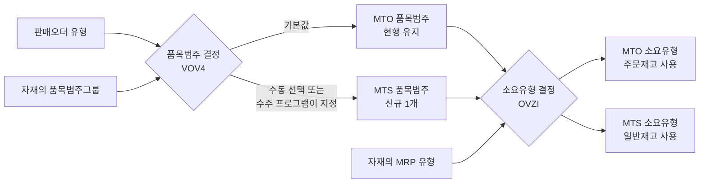
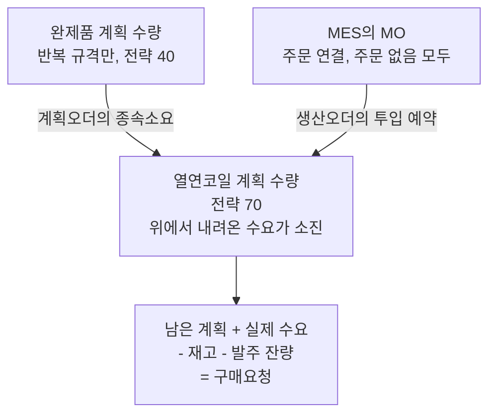
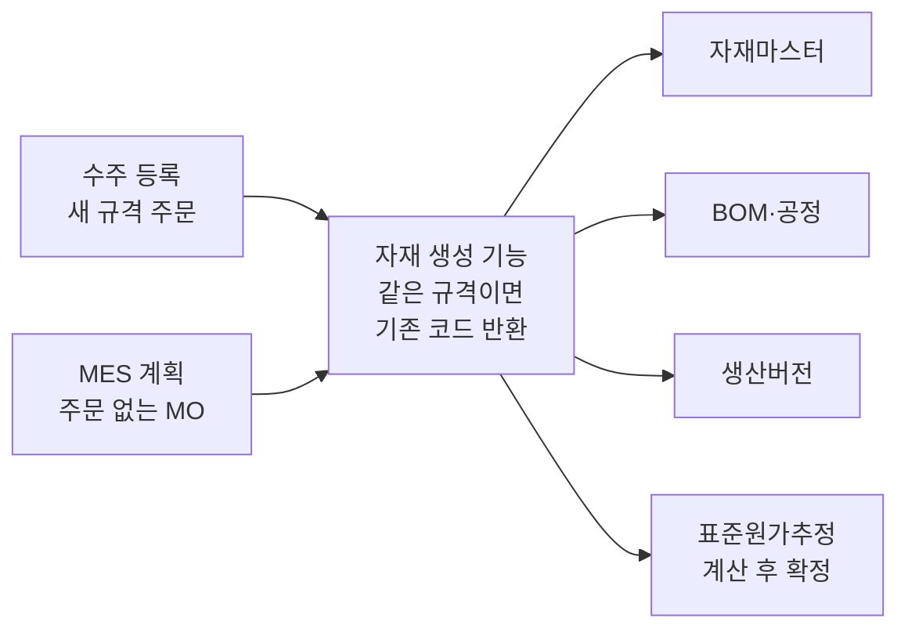

# 상세 3. SAP 설정과 S/4HANA 전환

> [본문](mto-mts-hybrid-analysis.md)의 권고를 SAP 설정 수준으로 풀고, 기존 시스템을 S/4HANA로 전환하면서 MTS를 추가할 때의 영향과 순서를 정리한 문서다.
> SAP 담당자와 설계자를 위한 참고 문서이므로 SAP 용어, 거래 코드, 필드명을 함께 적었다.

**근거 표기**

| 표기 | 뜻 |
|---|---|
| **[확인]** | 공개 자료(SAP 도움말, SAP 교육 자료, SAP 지원 문서)의 검색 결과로 확인한 내용 |
| **[검증]** | SAP 표준 지식에 근거한 설명. 프로토타입 시스템에서 확인해야 한다 |

조사 환경에서 SAP 사이트 원문을 직접 열 수 없었고, 오래된 릴리스 문서가 많다. [확인] 항목도 대상 릴리스에서 다시 본다.

**목차**

- 1부. MTO/MTS를 가르는 설정 (1~6장)
- 2부. S/4HANA 전환과 MTS 도입 순서 (7~12장)
- 3부. 검증과 결정 (13~16장)

---

# 1부. MTO/MTS를 가르는 설정

## 1. 한 장 요약

| 질문 | 결론 |
|---|---|
| 품목 단위 MTO/MTS는 무엇으로 가르나 | **품목범주(item category) 하나로 가른다.** 품목범주가 소요유형을 정하도록 설정하면 영업은 품목 줄에서 품목범주만 고르면 된다 |
| 수주 때 자동 생성되는 자재마스터를 바꿔야 하나 | 권고 방식으로 설정하면 **바꾸지 않아도 된다** [검증]. 완제품에 계획 수량을 넣을 반복 규격만 전략그룹을 바꾼다 |
| 현재 MTO 설정을 고쳐야 하나 | **고치지 않는다.** MTS용 설정을 새 키로 덧붙인다 |
| 한 판매오더에 MTO 품목과 MTS 품목을 섞을 수 있나 | 섞을 수 있다 [확인]. 한 품목의 일부 수량만 MTS로 할 수는 없어 품목을 나눈다 [검증] |
| 더미 주문을 없애면 열연코일 발주 근거는 | **열연코일에 직접 넣는 계획 수량**(계획독립소요, 전략 70)이 넘겨받는다 [검증] |
| 완제품 계획 수량은 언제 쓰나 | 코드가 고정된 반복 규격에만. **계획 수량이 있는 자재의 주문은 MTS 품목으로 받아야 한다** |

## 2. 설정 객체

### 2.1 결정 경로

품목범주가 정해지면 소요유형, 소요클래스 순으로 따라간다. 실제 스위치는 소요클래스다.

### 2.2 객체 목록

| # | 객체 | 하는 일 | 거래 코드 | MTO용 | MTS용 |
|---|---|---|---|---|---|
| 1 | 판매오더 유형 | 주문서의 종류 | VOV8 | 공용 1개로 충분 | 같은 유형 |
| 2 | 품목범주그룹 | 자재에 붙는 판매 품목 성격 | 자재마스터 판매 뷰 | 공용 값 유지 | 같음 |
| 3 | **품목범주** | 주문 품목 한 줄의 성격 | VOV7 | 현행 유지 | **신규 1개** (표준 TAN 계열 복사) |
| 4 | 품목범주 결정 | 주문 유형 + 품목범주그룹 → 기본 품목범주와 수동 대안 [확인] | VOV4 | 기본값 | 수동 대안으로 등록 |
| 5 | 일정라인범주와 결정 | 납품 일정 한 줄의 성격 | VOV6, VOV5 | 현행 | 신규 품목범주 × MRP 유형 조합 추가 |
| 6 | 소요유형 | 소요클래스로 가는 이름표 | OVZH | 현행 (표준 KE 계열) | 표준 KSV 계열 |
| 7 | **소요클래스** | MTO/MTS의 실제 스위치 | OVZG | 특수재고 E | 특수재고 없음 |
| 8 | **소요유형 결정 제어** | 품목범주 + MRP 유형 → 소요유형 | OVZI | MTO 품목범주 → MTO 소요유형 | MTS 품목범주 → MTS 소요유형 |
| 9 | 계획전략, 전략그룹 | 계획 수량의 소요유형과 주문 소요유형의 짝 | OPPS, OPPT | 전략 20 | 전략 40 (계획 수량을 쓸 자재만) |
| 10 | 가용성 점검 그룹·범위 | 납기 확인 때 어떤 재고와 입고 예정을 볼지 | OVZ2, OVZ9 | 그 주문의 재고만 | 일반재고. 주문 없는 생산오더의 입고 예정을 넣을지 결정 |

품목범주를 새로 만들면 따라오는 설정도 있다. 납품용 품목범주, 판매 → 납품 → 청구 복사 제어, 일정라인범주 결정이 빠지면 납품이나 청구 단계에서 막힌다 [검증].

### 2.3 소요클래스에서 MTO와 MTS가 갈리는 지점

| 필드 | 뜻 | MTO용 | MTS용 |
|---|---|---|---|
| Special stock | 특수재고 | **E (주문재고)** | **공란** |
| Account assignment category | 재고·원가 귀속 방식 | E 또는 M | 공란 |
| Valuation | 주문재고 평가 방식 | M 또는 A ([상세 2](mto-mts-02-costing-examples.md) 3장) | 해당 없음 |
| Without valuation strategy | 주문재고를 자재 표준단가로 평가 | 단가 통일 방식이면 설정 | 해당 없음 |
| Availability | 가용성 점검 | 현행 유지 | 켠다 |
| Req. transfer | 소요를 MRP에 전달 | 켠다 | 켠다 |
| Allocation indicator | 계획 수량을 소진하는 방식 | 공란 (소진 안 함) | 전략 40형 (계획을 소진) |

> **계정지정범주 E와 M** 주문재고를 쓰는 소요클래스의 계정지정범주는 두 가지다. E는 판매오더 품목이 원가와 수익을 직접 갖는 방식, M은 판매오더 품목이 원가 대상이 아닌 방식이다 [확인]. 본문이 권하는 구조(생산오더가 원가 대상)는 M 쪽이다. 현재 시스템이 어느 값인지 확인해야 한다.

## 3. 스위치 방식의 선택

### 3.1 SAP가 소요유형을 찾는 순서

표준 순서는 ① 자재의 전략그룹 → ② MRP 그룹 → ③ 자재유형 → ④ 품목범주 + MRP 유형 → ⑤ 품목범주 단독이다 [확인]. 이 순서를 소요유형 결정 제어(OVZI)의 **Source** 값이 바꾼다 [확인].

| Source | 동작 |
|---|---|
| 0 | 자재마스터의 전략이 먼저. 못 찾을 때만 품목범주 + MRP 유형을 쓴다 |
| 1 | 품목범주 + MRP 유형 항목의 소요유형을 쓴다. 자재의 전략그룹에 없는 소요유형이어도 쓴다 |
| 2 | 1과 같되, 그 소요유형이 자재 전략그룹에 들어 있을 때만 쓴다 |

### 3.2 두 방식의 비교

| 항목 | 방식 1: 전략그룹에서 수동 변경 | 방식 2: 품목범주로 결정 |
|---|---|---|
| 내용 | 자재 전략그룹에 MTS와 MTO 전략을 함께 넣고, 주문 품목에서 소요유형을 바꾼다 | 품목범주 + MRP 유형 → 소요유형을 등록하고 Source를 1 또는 2로 둔다 |
| 스위치 위치 | 품목의 소요유형 필드 | 품목 줄의 품목범주 |
| 자재마스터 변경 | 대상 자재 전부 | Source 1이면 없음 |
| 수주 프로그램·인터페이스 | 소요유형을 직접 다뤄야 한다 | 품목범주만 지정 |
| MTO/MTS 구분의 가시성 | 낮음 | 높음 |
| 주된 위험 | 수동 변경 누락 | 부수 설정 누락 |

**권고: 방식 2, Source 1.**

- 새 규격 주문마다 자재코드가 자동 생성되는 구조이므로, 자재마스터에 의존하지 않는 스위치가 유지하기 쉽다.
- 수주 과정에 이미 자동 생성 프로그램이 있으므로 품목범주까지 그 프로그램이 정해 줄 수 있다.
- MES로 보내는 MTO/MTS 구분을 품목범주 하나로 전달할 수 있다.

전략그룹은 스위치가 아니라 **계획 수량을 넣기 위한 설정**으로만 쓴다.

### 3.3 이 프로젝트의 최소 변경안

1. **현행 MTO 경로는 건드리지 않는다.**
2. **MTS용 품목범주를 1개 만든다.** 현행 주문 유형 + 품목범주그룹 조합의 수동 대안으로 등록한다.
3. **MTS용 소요유형·소요클래스**는 표준 KSV 계열을 쓰거나 복사한다.
4. **소요유형 결정 제어에 두 줄을 넣는다.** MTO 품목범주 → MTO 소요유형, MTS 품목범주 → MTS 소요유형. Source는 1.
5. **자재마스터는 일괄 변경하지 않는다.** 완제품 계획 수량을 넣을 반복 규격만 전략그룹을 "주 전략 40 + 대체 전략 20"으로 바꾼다.
6. **열연코일**에 전략그룹 70과 소진 설정을 넣고, 개별/일괄 지시자가 2인지 확인한다 (4장, 5장).
7. **가용성 점검**은 MTS 품목이 쓰는 점검 범위를 새로 정한다.
8. **주문재고 평가 방식을 바꾸는 경우**에는 기존 소요클래스를 고치지 말고 새 소요유형·소요클래스를 추가해 기준일부터 새 주문에만 적용한다 [검증].

### 3.4 주의할 동작

- **한 주문 안의 혼합**: 가능하다. 납품이 한 건으로 묶이는지, 출고가 일반재고 출고와 주문재고 출고로 나뉘어 정상 전기되는지는 프로토타입에서 본다.
- **등록 후 변경**: 생산오더, 납품, 주문재고가 생긴 뒤 품목범주를 바꾸는 것은 제약이 있다. 등록 후에는 품목범주를 바꾸지 않고 재고전환이나 품목 분할로 처리한다.
- **계획 수량의 차감**: 출고에 의한 계획 수량 차감은 전략그룹의 주 전략에만 일어난다 [확인]. 완제품 계획 수량을 쓸 자재는 MTS 전략이 주 전략이어야 한다.

## 4. 계획 수량을 SAP에 넣는 방법

### 4.1 방식별 동작

| 방식 | 무엇이 계획 수량을 소진하나 | 차감되는 때 | 주문 없는 생산오더와의 관계 | MTO 주문과의 관계 |
|---|---|---|---|---|
| 완제품, 전략 10 | 없음 | 납품 출고 | 공급으로 계획을 덮는다. 이중 계산 없음 | 주문별로 따로 잡힌다 |
| 완제품, 전략 40 | MTS 판매오더. 계획을 넘는 주문은 추가 수요 | 납품 출고 | 공급으로 계획과 주문을 덮는다. 이중 계산 없음 | **MTO 소요유형은 소진하지 않는다. 둘 다 남는다** |
| 반제품, 전략 70 | 반제품을 투입하는 오더의 예약 | 반제품을 생산오더로 출고할 때 | 예약이 계획을 소진 | MTO 생산오더의 예약도 소진 |
| **열연코일, 전략 70** | 모든 생산오더의 열연코일 예약 | 열연코일을 생산오더로 출고할 때 | 예약이 계획을 소진 | MTO 생산오더의 예약도 소진 |
| 열연코일에 전략 없이 계획 수량 | 소진되지 않는다 | – | **계획과 예약이 합산된다. 이중 계산** | 같음 |

차감 시점과 전략 70의 요건은 [확인]. 구매 자재인 열연코일에 전략 70이 기대대로 동작하는지는 공식 자료로 확인하지 못했다. **프로토타입 1순위 검증 항목이다.**

핵심은 두 가지다.

- **MES가 만든 생산오더와 계획 수량은 이중 계산되지 않는다.** 생산오더는 공급이고 계획 수량은 수요이기 때문이다.
- **이중 계산은 수요끼리 겹칠 때 생긴다.** ① 완제품 계획 수량이 있는데 주문을 MTO로 받을 때 ② 원소재 계획 수량에 소진 설정이 없을 때.

### 4.2 숫자로 보는 이중 계산

**완제품 계획 수량이 있는 자재** (표준 규격 F, 6월 계획 100톤, 전략 40)

| 시점 | 수요 | 열연코일로 내려가는 소요 |
|---|---|---|
| MES가 주문 없는 MO 60톤 생성 | 계획 100 | 100톤분 (정상) |
| 주문 30톤을 **MTS 품목**으로 등록 | 주문 30 + 남은 계획 70 = 100 | 100톤분 (정상) |
| 주문 30톤을 **MTO 품목**으로 등록 | 계획 100 + 주문 30 = 130 | **130톤분 (30톤분 과다)** |

**열연코일 계획 수량** (열연 규격 H, 6월 계획 1,000톤, 전략 70)

| 시점 | 열연코일 H의 수요 |
|---|---|
| 아직 MO 없음 | 남은 계획 1,000 |
| MTO·MTS MO의 투입 예약 합계 600톤 | 예약 600 + 남은 계획 400 = 1,000 |
| 예약이 1,100톤으로 늘어남 | 예약 1,100 + 남은 계획 0 = 1,100 (초과분만큼 추가 발주 제안) |

### 4.3 권고 구조

| 자재코드가 규격별로 세분화된 상황에서 | 판단 |
|---|---|
| 완제품 계획 수량 | 새 규격은 수주 때 코드가 생기므로 미리 넣을 수 없다. 반복 규격에 한정 |
| 반제품 계획 수량 | 반제품 자재코드와 BOM이 있어야 한다. 반제품 선행 생산 범위에 한정 |
| **열연코일 계획 수량** | 코드 수가 적고 구매 단위와 같다. 주문 방식과 상관없이 모든 MO가 소진한다. **기본 수단으로 권고** |

**운영 규칙**

| # | 규칙 | 이유 |
|---|---|---|
| 1 | 열연코일 계획 수량에는 그 달의 예상 투입 총량(MTO분 + MTS분)을 넣는다 | 모든 MO의 예약이 소진하므로 주문분을 미리 뺄 필요가 없다 |
| 2 | 소진 기간은 계획 수량의 기간 단위(월 또는 주) 이상으로 잡는다 | 예약 일자와 계획 일자가 달라도 같은 달 안에서 소진되게 한다 |
| 3 | 지난 달의 미소진 계획 수량은 월 마감 때 정리한다 | 남겨 두면 과거 계획이 계속 발주 근거가 된다 |
| 4 | 완제품 계획 수량은 반복 규격에만 넣고, 그 자재의 주문은 MTS 품목으로 받는다 | 4.2절의 이중 계산 |
| 5 | 계획한 열연 규격과 실제 투입 규격이 다른 경우를 주기적으로 본다 | 한쪽 계획은 남고 다른 쪽에 추가 수요가 생긴다 |

등록 수단: MD61/MD62, Fiori 앱(Maintain PIRs), OData 서비스 [확인]. 계획을 MES나 엑셀에서 만든다면 인터페이스 대상이 하나 늘어난다.

## 5. 개별/일괄 지시자와 반제품 선행 생산

자재마스터 MRP4 뷰의 개별/일괄 지시자는 **그 자재가 다른 품목의 투입 자재로 쓰일 때** 어느 재고에서 계획되고 투입되는지를 정한다 [확인].

| 값 | 뜻 | MTO 완제품의 투입 자재일 때 |
|---|---|---|
| 공란 | 개별·일괄 모두 | 상위를 따라 주문별로 계획된다. 일반재고가 있어도 보지 않는다 |
| 1 | 개별만 | 같음 |
| **2** | 일괄만 | **일반재고에서 계획되고 일반재고에서 투입된다** |

| 자재 | 권고 값 | 이유 |
|---|---|---|
| 열연코일 | 2 | 공용 원소재. 열연코일 계획 수량이 MTO 생산오더의 예약으로 소진되려면 필요하다 |
| 선행 생산 반제품 | 2 | MTO 완제품의 MO가 반제품 일반재고를 투입하게 한다 |
| 완제품 | 확인 필요 | 여재 코일을 다른 주문의 MO에 재투입(재가공)한다면 2가 아닐 때 일반재고에서 바로 투입되지 않는다 [검증] |

**완제품 MTO + 반제품 MTS의 설정 요건**

1. 반제품이 독립된 자재코드와 재고를 갖는다.
2. 완제품 생산오더의 투입 자재가 반제품이다. 수주 때 BOM·공정을 자동 생성하는 로직이 "반제품에서 출발하는 BOM"을 만들 수 있어야 한다.
3. 반제품의 개별/일괄 지시자 = 2.
4. 반제품 선행 생산은 생산 품목이 반제품인 주문 없는 생산오더로 처리한다. MO가 지금 "열연 투입부터 완제품까지 한 건"이라면 MO를 둘로 나눠야 한다.
5. 반제품의 표준원가추정이 있어야 한다.

## 6. 재고전환 이동유형

| 상황 | 이동유형 | 근거 |
|---|---|---|
| 주문재고 → 일반재고 (여재화) | 411 + 특수재고 E | [확인] |
| 일반재고 → 주문재고 (충당) | 413 | [확인] 표준 설명. 시험 전기로 확정 |
| 주문 A 재고 → 주문 B 재고 (전용) | 413 + 특수재고 E | [확인] |
| 자재코드 변경 | 309 | [확인] |
| 412 + 특수재고 E | 411 E의 취소. 정상 업무에는 쓰지 않는다 | [검증] |

1차 문서는 일반재고 → 주문재고를 "412 E 계열"로 적었다. 정방향 유형은 413이다. 금액 처리는 [상세 2](mto-mts-02-costing-examples.md) 7장, 인터페이스 필드는 [상세 4](mto-mts-04-mes-requirements.md) 4장에서 다룬다.

---

# 2부. S/4HANA 전환과 MTS 도입 순서

## 7. 한 장 요약

| 질문 | 결론 |
|---|---|
| MTS는 S/4HANA가 되어야 할 수 있나 | **아니다.** MTS에 쓰는 SAP 기능은 지금 ERP에도 있는 표준이다 [확인]. MTS가 실제로 기다려야 하는 것은 **MES**(주문 없는 MO, 매칭 변경 연계)다 |
| 전환과 MTS 도입을 한 번에 하나 | **설계·개발은 한 번에, 가동은 나눠서.** MTS용 설정과 인터페이스는 전환 프로젝트에서 함께 만들고 테스트한다. 업무 적용은 전환 가동이 안정된 뒤 단계적으로 켠다 |
| 진행 중인 주문과 재고는 옮겨야 하나 | **옮기지 않는다.** 제자리 전환이라 그대로 넘어간다. 따로 정리할 것은 더미 주문과 여재이고, 정리 시점은 전환일이 아니라 MTS를 켜는 날이다 |
| 가장 큰 숨은 위험은 | **표준단가가 없는(0원) 자재.** 일반재고로 들어오는 순간 재고 금액 0원과 손익 왜곡이 된다 |

## 8. 제자리 전환이 하는 일과 하지 않는 일

| 구분 | 내용 | 병행 설계에 주는 의미 |
|---|---|---|
| 하는 일 | 소프트웨어와 데이터 저장 구조를 바꾼다 (재고 문서, 재고 평가, 회계 전표) | 재고와 평가를 직접 읽는 인터페이스·자체 프로그램은 수정 대상이다 |
| 하지 않는 일 | 주문·생산오더·재고를 새로 올리지 않는다. 설정도 그대로 남는다 [검증] | 전환 직후에는 "전부 MTO + 더미 주문"인 지금 방식이 그대로 돌아간다 |
| 전환 주말 | SAP는 멈추지만 공장은 돌아간다 | MES가 실적을 쌓아 두었다가 SAP가 열리면 순서대로 다시 보낼 수 있어야 한다 |
| 전환 검증 기준 | "전환 전과 후의 재고 수량과 금액이 같다" | **금액을 바꾸는 작업을 전환 주말에 섞으면 이 검증을 할 수 없게 된다** |

## 9. 전환 항목별 영향

| # | 전환 항목 | S/4HANA에서 달라지는 것 | 병행 설계에 주는 영향 | 관련도 |
|---|---|---|---|---|
| 1 | **자재원장 필수화** | 재고 금액 관리가 반드시 자재원장을 거친다. 실제원가 사용은 여전히 선택이다 [확인] | 주문재고는 주문 품목마다 가진 평가 주머니째로 넘어간다. 끝난 주문을 전환 전에 정리해 두면 대상이 줄어든다. 실제원가 사용 여부는 전환과 같은 날 정할 필요가 없다 | **직접** |
| 2 | **생산버전 필수화** | 생산오더·MRP가 BOM과 공정을 "생산버전"으로만 찾는다 [확인] | 수주 때 자동으로 만드는 "자재코드 + BOM + 공정" 묶음에 **생산버전이 추가되어야 한다.** 빠지면 MES가 올린 MO가 생산오더로 만들어지지 않을 수 있다 | **직접** |
| 3 | **저장위치 MRP 폐지** | 특정 저장위치를 MRP에서 빼던 설정이 없어지고 MRP 영역으로 바뀐다 [확인] | 팔 수 없는 여재·격외품을 계획·가용 수량에서 빼려면 MRP 영역으로 만들어야 한다 | **직접** |
| 4 | **재고 데이터 구조** | 재고 이동 문서가 한 테이블(MATDOC)에 모이고 재고 수량 테이블은 계산값이 된다 [확인] | 재고 테이블을 직접 읽는 대사·여재 프로그램은 점검 대상이다. 새 재고전환 연계는 처음부터 새 구조 기준으로 개발한다 | **직접** |
| 5 | **가용성 점검 데이터** | 소요를 합쳐 저장하던 테이블(VBBS)이 없어진다 [확인] | MTS 품목은 일반재고 기준 가용성 점검을 처음 쓰게 된다. 점검 설정을 새로 잡는다 | 직접 |
| 6 | **수익성 분석** | SAP 권장 방식이 계정 기반(Margin Analysis)으로 바뀐다 [확인] | 고객별·제품별 수익성을 어느 방식으로 볼지 정한다. MTS의 생산 차이는 제품까지만 내려간다 | **직접** |
| 7 | MRP Live | HANA에서 도는 새 MRP가 생긴다 [확인] | 열연코일 소요가 전환 전후로 같은지 비교한다 | 간접 |
| 8 | 조달처 결정 단순화 | 구매 자재가 소스리스트 없이 공급업체를 정할 수 있다 [확인] | 열연코일 발주 제안의 공급업체가 달라질 수 있어 전후 비교가 필요하다 | 간접 |
| 9 | 여신관리 변경 | 예전 여신관리를 못 쓰고 새 여신관리로 옮긴다 [확인] | 여신으로 막힌 주문이 MES로 넘어가 생산되지 않는지 다시 확인한다 | 간접 |
| 10 | 자재번호 길이 | 18자리에서 40자리로 늘지만 따로 켜야 한다 [확인] | 켜지 않으면 영향이 없다. 켠다면 MES·라벨·바코드까지 대상이다 | 간접 |
| 11 | 판매 문서 상태·가격 조건 테이블 | 테이블 구조가 바뀐다 (VBUK·VBUP 폐지, KONV → PRCD_ELEMENTS) [확인] | 기능은 같다. 이 테이블을 읽는 자체 프로그램만 수정한다 | 무관 |
| 12 | 비즈니스 파트너 통합 | 고객·공급업체를 비즈니스 파트너로 관리한다 [확인] | 기능상 무관하다. 더미 주문용 가짜 고객도 전환 대상이 된다 | 무관 |
| 13 | 산업 솔루션 통합 | Mill Products 기능이 기본 포함된다 [확인] | 자체 MES가 LOT 편성과 매칭을 맡으므로 새로 쓸 필요는 없다. 지금 쓰고 있다면 전환 절차가 달라진다 | 조건부 |

> **무관한 항목도 MES 재구축과는 엮인다.** 인터페이스를 어차피 다시 만든다면 처음부터 S/4HANA 데이터 구조를 기준으로 만들어야 두 번 일하지 않는다.

## 10. 한 번에 할 것인가, 나눠서 할 것인가

### 10.1 세 가지 변화

| 기호 | 변화 | 성격 |
|---|---|---|
| **T** | 기술 전환 (ERP → S/4HANA) | 기능은 그대로, 기반이 바뀐다. 외부 기한이 있다. SAP ERP 6.0의 일반 유지보수는 2027년 말에 끝난다 [확인] |
| **M** | 신 MES 가동 | 공장 운영 시스템이 바뀐다 |
| **P** | MTS 업무 적용 (더미 주문 폐지, 주문 없는 MO, 재고전환) | 일하는 방식과 재고·원가 흐름이 바뀐다 |

판단의 출발점이 되는 사실은 두 가지다.

1. **P는 T를 기다릴 필요가 없다. P가 기다리는 것은 M이다.** "주문 없는 MO"와 "매칭 변경을 SAP로 보내는 연계"는 MES가 해 줘야 한다.
2. **신 MES에게 더미 주문은 그냥 주문이다.** 가동 초기에 더미 주문 방식을 잠시 유지하는 데 추가 개발이 들지 않는다 [검증]. 더미 방식과 주문 없는 MO 방식이 한동안 함께 있어도 된다.

### 10.2 네 가지 방식

| 방식 | 내용 | 장점 | 단점·위험 |
|---|---|---|---|
| ① 일괄 | T + M + P를 같은 날 | 가동과 교육이 한 번 | 문제가 생겼을 때 원인을 가를 수 없다. 전환 전후 재고 금액 대사에 평가 변경이 섞인다 |
| ② 전환 먼저 | T를 끝낸 뒤 M + P | 단계마다 원인이 분명하다 | 기존 MES 연계를 한 번 손봐야 한다. 전체 기간이 길어진다 |
| ③ 전환과 MES 동시, MTS는 나중 | T + M을 같은 날, P는 안정화 뒤 | 인터페이스를 한 번만 만든다. P를 작게 나눠 켤 수 있다 | 전환 주말에 MES 교체까지 겹쳐 부담이 크다 |
| ④ MES와 MTS 먼저 | 현 ERP 위에서 M + P, T는 나중 | MTS 효과를 빨리 본다 | 전환 때 다시 검증해야 한다. 2027년 말 기한까지 여유가 적다 |

### 10.3 권고: 설계·개발은 한 번에, 가동은 나눠서

①은 피한다. T와 M의 일정에 따라 ② 또는 ③으로 가되, 어느 경우든 **P의 업무 적용은 전환 가동 뒤 월 결산을 한두 번 넘긴 다음**에 시작한다.

| 구분 | 해당 작업 | 이유 |
|---|---|---|
| **전환 프로젝트 범위에 미리 넣는다** | MTS용 품목범주·소요유형·소요클래스, 재고전환 연계, 자재 생성 묶음에 생산버전·원가추정 추가, 자재 생성 기능을 주문 없이 부를 수 있게 분리 | 새 키로 추가하는 설정이라 기존 MTO 흐름을 건드리지 않는다 [검증]. 테스트를 두 번 하지 않는다 |
| **전환 주말에는 하지 않는다** | 더미·여재 재고의 일반재고 전환, 기존 소요클래스의 평가 설정 변경, 표준단가 대량 변경 | 재고 금액을 바꾸는 작업이다. 전환 전후 금액 대사를 흐린다 |
| **안정화 뒤 단계적으로 켠다** | 더미 주문 신규 등록 중단, 주문 없는 MO 사용, 재고 판매, 여재 정리 | 유형별로 작게 시작해 원가 담당이 숫자를 직접 확인한다 |

### 10.4 MTS를 켜는 순서

쉬운 것, 되돌리기 쉬운 것부터 켠다.

| 순서 | 대상 유형 | 새로 쓰게 되는 것 | 먼저 갖춰야 할 것 |
|---|---|---|---|
| 1 | 여재 (E) | 주문재고 → 일반재고 전환, 일반재고를 MTS 품목으로 판매 | 대상 자재의 표준단가, MTS 품목범주, 재고전환 연계 |
| 2 | LOT 채움 (D), 표준 규격 (A) | 주문 없는 MO, 일반재고 입고 | 자재 생성의 주문 없는 호출, 생산버전, 원가추정 |
| 3 | 내시 물량 (B) | 계획 수량 등록, 주문이 계획을 소진 | 더미 주문 폐지, 열연코일 소요가 유지되는지 확인 |
| 4 | 반제품 선행 (C) | 반제품 자재코드와 재고, 공용 사용 설정 | BOM 단계 구조 변경, 반제품 표준단가 |

여재를 첫 번째로 두는 이유: 생산 흐름은 건드리지 않고, 재고전환과 표준단가 평가라는 **병행 구조의 핵심 동작**을 적은 금액으로 먼저 검증할 수 있다.

## 11. 기존 데이터의 정리

제자리 전환이므로 시스템 간 이관이 아니라 **상태를 To-Be 구조로 정리하는 일**이다.

| 대상 | 기술 전환 때 | To-Be로 가려면 | 시점 |
|---|---|---|---|
| 진행 중인 MTO 주문과 주문재고 | 그대로 넘어간다 | 없다. 전후 대사만 한다 | 전환 시 |
| 더미 주문과 묶인 재고 | 그대로 넘어간다 | 상태별로 정리한다 | MTS를 켜는 시점 |
| 원래 주문에 묶인 여재 | 그대로 넘어간다 | 분류한 뒤 일반재고로 전환한다 | MTS 1차 |

### 11.1 더미 주문

| 더미 주문 품목의 상태 | 처리 | 원가·회계 영향 |
|---|---|---|
| 아직 생산 전 | 열연코일 계획 수량을 먼저 등록한 뒤 더미 품목을 거절 처리 | 없음 |
| 생산 중 | 그대로 끝낸다. 주문재고로 입고한 뒤 일반재고로 전환하고 품목을 종료 | 전환 때 단가 차이 |
| 완제품 재고 보유 | 표준단가를 확인한 뒤 일반재고로 전환하고 품목을 종료 | 전환 때 단가 차이 |

**순서**

1. 살아 있는 더미 주문 품목을 상태별로 분류한다.
2. **신규 더미 등록 중단일**을 정한다. 그날부터 계획생산은 주문 없는 MO로만 등록한다.
3. 생산 전 품목: 계획 수량 등록 → 더미 거절 → MRP 재실행 → **열연코일 소요가 전후로 같은지 비교**한다.
4. 생산 중 품목: 입고와 전환이 끝난 뒤에 종료한다. 먼저 거절하지 않는다.
5. 재고 보유 품목: 표준단가가 0인 자재가 없는지 확인한 뒤 전환한다.

> **3번이 중요한 이유** 더미 주문은 지금 열연코일 발주 계산의 수요 역할도 하고 있을 가능성이 높다. 대체 수요 없이 더미 주문을 없애면 다음 MRP에서 열연코일 소요가 사라진다 [검증].

**함께 달라지는 지표**: 더미 주문이 빠지면 수주 실적과 수주잔고가 그만큼 줄어든다. 지표가 끊기는 시점을 영업·경영 보고에 미리 알린다.

### 11.2 여재

1. **식별**: 어느 주문재고가 "출하 대기"가 아니라 "여재"인지 목록을 만든다.
2. **분류**: 다시 팔 수 있는 양품 / 등급이 떨어진 것 / 오래 묵은 것.
3. **표준단가 확인**: 해당 자재코드의 표준단가가 있는지, 0이 아닌지 본다.
4. **전환**: 양품은 일반재고로 전환한다.
5. **보관 위치**: 바로 팔 수 없는 여재는 계획·가용 수량에서 빠지는 위치에 둔다.

별도 이관 프로그램을 만들기보다 **To-Be의 재고전환 연계를 그대로 쓴다.** 새 연계의 첫 대량 사용이자 부하 시험이 된다.

### 11.3 일반재고로 돌릴 때의 금액 영향

예: 여재 코일 10톤, 주문재고 단가 톤당 1,050 (장부가 10,500, 금액 단위 천원)

| 일반재고 쪽 상태 | 전환 후 일반재고 금액 | 손익 |
|---|---:|---|
| 표준단가가 같다 (1,050) | 10,500 | 0 |
| 표준단가가 더 낮다 (1,000) | 10,000 | 손실 500 |
| **표준단가가 없다 (0)** | **0** | **손실 10,500** |

**그 밖의 회계 영향**

- **과도기에는 두 종류의 주문재고가 함께 있다.** 옛 방식(주문별 단가)으로 평가된 재고와 새 방식으로 평가된 재고다. 옛 재고가 소진될 때까지 두고 전환분의 차이만 감수할지, 기준일에 한 번에 재평가할지 회계팀과 감사인이 정해야 한다.
- **재고 계정 분류**: 주문재고를 별도 계정으로 잡고 있다면 전환은 계정 간 이동이 된다 [확인].
- **재고 평가 기준**: 주문에 묶여 보이던 재고가 "계약 없는 재고"로 드러난다. 재고 평가손실을 따지는 기준이 달라질 수 있다 [검증: 회계팀·감사인 확인].

## 12. 자재마스터와 자재 생성 기능

### 12.1 대량 변경은 대상을 줄이는 것이 먼저다

1. **활성 자재만 바꾼다.** 재고가 있거나, 미결 주문이 있거나, 최근에 쓰인 코드로 한정한다.
2. **설정으로 대신한다.** MTS 품목을 고를 수 있게 하는 일은 품목범주 결정 설정으로 할 수 있다 (3장).
3. **앞으로 생기는 코드는 자동으로 맞춘다.** 자재 자동 생성 로직에 To-Be 값을 넣는다.

| # | 바꿀 것 | 왜 필요한가 | 대상 |
|---|---|---|---|
| 1 | 생산버전 | S/4HANA에서 생산오더가 BOM·공정을 찾는 길 [확인] | 자체 생산하는 활성 자재 전부 |
| 2 | 표준원가추정 | 일반재고 평가의 유일한 기준 | 일반재고로 들어올 수 있는 자재 전부. 단가 통일 방식이면 생산하는 자재 전부 |
| 3 | 가용성 점검 그룹 | MTS 품목은 일반재고 기준으로 납기를 확인한다 | 재고 판매 대상 자재 |
| 4 | 전략그룹과 소진 설정 | 계획 수량과 실제 주문이 이중으로 잡히지 않게 한다 | 계획 수량을 등록하는 자재만 |
| 5 | 개별/일괄 지시자 | 공용 자재가 주문별로 묶이지 않게 한다 | 열연코일, 선행 생산 반제품 |
| 6 | 판매 뷰·저장위치 추가 | 재고를 팔 유통경로, 보관할 위치 | 재고 판매 대상 자재 |

**주의할 점**

- **원가추정 확정은 한 달에 한 번**: 한 자재는 같은 회계기간 안에 다시 확정할 수 없다 [확인]. 월초에 한 번에 잡는다.
- **확정하면 일반재고가 재평가된다.** 기존 주문재고는 따라 바뀌지 않는다 [확인].
- **MES로의 재전송 폭주**: 자재마스터 변경분을 MES로 보내는 연계가 있으면 대량 변경한 자재 전체가 한꺼번에 넘어간다 [검증].

### 12.2 자재코드·BOM·공정 자동 생성을 주문 없이 호출하기

지금은 새 규격 주문이 들어오면 수주 과정에서 자재코드, BOM, 공정이 만들어진다. 계획생산은 주문이 없으므로 **같은 기능을 MES 계획 쪽에서도 부를 수 있어야 한다.**

| # | 항목 | 주문 없이 부를 때 달라지는 점 |
|---|---|---|
| 1 | 부르는 주체 | MES 계획 화면이나 계획 담당자. 수주 과정에 묻혀 있는 로직을 **따로 부를 수 있는 공통 기능**으로 떼어낸다 |
| 2 | 입력값 | 주문이 없으므로 규격 속성만으로 만들 수 있어야 한다 |
| 3 | 코드를 가르는 속성 | 고객 고유 요구가 코드를 가르는 기준에 들어 있으면 계획생산 재고가 사실상 특정 고객 전용이 된다. 속성 목록을 다시 본다 |
| 4 | 중복 방지 | 같은 규격이면 반드시 같은 코드를 돌려준다 |
| 5 | 만드는 묶음 | **생산버전 추가, 표준원가추정 계산·확정 추가** |
| 6 | 반제품 | 반제품 선행 생산을 하려면 반제품 코드와 그 BOM·공정도 만들 수 있어야 한다 |
| 7 | 통제 | 계획 담당이 임의 규격으로 코드를 늘릴 수 있다. 누가 만들 수 있는지, 쓰이지 않은 코드를 언제 정리하는지 정한다 |
| 8 | 구현 방식 | 화면 입력을 흉내 내는 방식이면 S/4HANA 화면 변경으로 멈출 수 있다 [검증] |

### 12.3 표준단가가 없는 자재가 일반재고로 입고되면

**지금 문제가 드러나지 않는 이유**: 주문재고의 단가는 정해진 순서로 찾는다. 자재 표준단가가 없어도 생산오더의 계획원가로 평가될 수 있다. 일반재고에는 이런 대체 경로가 없다.

예: 주문 없는 MO로 20톤 생산, 실제 투입 원가 19,000 (천원)

| 시점 | 표준단가 톤당 950이 있을 때 | 표준단가가 0일 때 |
|---|---|---|
| 입고 | 재고 +19,000 | 재고 0. 회계 전표가 생기지 않는다 [확인] |
| 월말 정산 | 차이 0 | 19,000 전액이 차이(손실)로 잡힌다 [검증] |
| 출하 | 매출원가 19,000 | 매출원가 0. 그 주문의 이익이 부풀려진다 [검증] |
| 나중에 표준단가 입력 | 해당 없음 | 남은 재고만큼 재평가 이익. 손실과 다른 달이면 월별 손익이 왜곡된다 [검증] |

**막는 방법**

1. 자재 생성 묶음에 원가추정 계산과 확정을 넣는다.
2. MES가 생산오더 생성을 요청할 때 표준단가가 0인 자재면 SAP가 거절한다.
3. "표준단가 0인데 재고나 미결 오더가 있는 자재"를 매일 뽑는 점검 목록을 둔다.
4. 자동으로 만들어지는 BOM·공정의 수율과 작업시간이 현실적인지 본다. 형식적인 값이면 표준단가가 실제와 멀어진다.

---

# 3부. 검증과 결정

## 13. 검증 시나리오

**A. 전환 직후: 현행 MTO가 그대로 되는가**

| # | 시나리오 | 확인할 것 |
|---|---|---|
| A1 | MTO 수주 → MO → 생산오더 → 입고 → 출하 → 청구 | 문서 흐름, 주문재고 금액, 매출원가 |
| A2 | 새 규격 주문 등록 | 자재·BOM·공정·생산버전이 만들어지고 바로 생산오더를 만들 수 있는가 |
| A3 | 전환 전에 만든 미결 주문·생산오더를 이어서 처리 | 입고, 출하, 정산이 끊기지 않는가 |
| A4 | 열연코일 MRP | 같은 데이터로 전환 전과 같은 소요·발주 제안이 나오는가 |
| A5 | 첫 월 결산 | 재공, 차이, 정산, 수익성 보고서 |

**B. 전환 대사**

| # | 대상 | 확인할 것 |
|---|---|---|
| B1 | 일반재고, 주문재고 | 수량과 금액이 전후로 같은가 (주문재고는 판매오더 품목 단위) |
| B2 | 재공 | 미결 생산오더별 재공 금액이 같은가 |
| B3 | MES 대 SAP | 코일 단위로, 재고 종류와 귀속 주문까지 맞는가 |
| B4 | 정지 중 실적 | MES가 쌓아 둔 실적이 순서대로, 중복 없이 반영되었는가 |

**C. MTS 새 흐름**

| # | 시나리오 | 확인할 것 |
|---|---|---|
| C1 | 주문 없는 MO → 생산오더 → 입고 | 일반재고로 들어가는가, 표준단가로 평가되는가 |
| C2 | MTS 품목 주문 → 가용성 점검 → 출하 → 청구 | 납기 제안, 코일 지정, 매출원가 |
| C3 | 한 주문에 MTO 품목과 MTS 품목 | 품목별로 재고 종류가 갈리는가. 납품과 청구 |
| C4 | 기존 자재(전략그룹 미변경)에 MTS 품목범주 | MTS 소요유형이 잡히는가 (Source 1) |
| C5 | 완제품 계획 수량이 있는 자재에 MTS 주문, MTO 주문 | MTS는 소진, MTO는 이중 계산 (재현 확인) |
| C6 | **열연코일 전략 70** | MTO 오더 예약, 주문 없는 오더 예약이 모두 계획 수량을 소진하는가 |
| C7 | 반제품을 투입하는 MTO 생산오더 | 반제품이 일반재고에서 투입되는가 |
| C8 | 주문 수량을 넘는 입고 → 여재 전환 → MTS 품목으로 재판매 | 전 과정 전기 가능 여부 |

**D. 재고전환과 평가**: [상세 2](mto-mts-02-costing-examples.md) 11장의 10개 항목.

**E. 마스터와 원가**

| # | 시나리오 | 확인할 것 |
|---|---|---|
| E1 | 주문 없이 자재 생성 호출 | 뷰, BOM, 공정, 생산버전, 표준단가가 모두 갖춰지는가 |
| E2 | 같은 규격으로 중복 호출 | 같은 코드가 돌아오는가 |
| E3 | 표준단가 없는 자재로 생산오더 생성·입고 시도 | 막히는가 (실패해야 정상인 시험) |

**F. 정리 작업 리허설**

| # | 시나리오 | 확인할 것 |
|---|---|---|
| F1 | 더미 주문 정리 | 생산 전, 생산 중, 재고 보유 각각의 절차 |
| F2 | 더미 거절 전후 | 열연코일 MRP 결과가 유지되는가 |
| F3 | 여재 일괄 전환 | 건수, 걸리는 시간, 차이 금액의 사전 산출값과 실제값 |

> **프로토타입 환경에 대한 제안** 전환 프로젝트는 운영 데이터 복사본을 시험 전환해 보는 단계를 거친다. 그 첫 전환본을 프로토타입 환경으로 쓰면 실제 자재와 실제 주문재고로 재고전환의 평가 결과를 확인할 수 있다.

## 14. 추가로 결정할 사항

본문 10장의 체크리스트에 이어서 붙인다.

| # | 결정 사항 | 선택지 | 권고 | 주관 |
|---|---|---|---|---|
| D17 | 전환, 신 MES, MTS의 가동 순서 | 일괄 / 전환 먼저 / 전환 + MES 동시 / MES + MTS 먼저 | MTS 업무 적용은 전환 안정화 뒤 | PMO |
| D18 | MTS를 켜는 순서 | 유형별, 제품군별 | 여재 → LOT 채움·표준 규격 → 내시 → 반제품 | 생산관리·영업 |
| D19 | 주문재고 평가 방식의 전환 기준일과 옛 재고 처리 | 소진될 때까지 둔다 / 기준일에 재평가 | 회계 협의 | 원가·회계 |
| D20 | 신규 더미 등록 중단일과 정리 방식 | 한 번에 / 제품군별 | 제품군별 | 생산관리·영업 |
| D21 | 자재 생성 기능의 범위 | 생산버전·원가추정 포함 여부, 주문 없는 호출 권한 | 모두 포함, 권한 통제 | 기준정보·원가 |
| D22 | 스위치 방식 | 전략그룹 수동 변경 / 품목범주 결정 | 품목범주 결정 (Source 1) | 영업·SD |
| D23 | 계획 수량의 위치 | 완제품 / 반제품 / 열연코일 | 열연코일 기본, 완제품은 반복 규격만 | 생산관리·PP |
| D24 | 주문재고의 평가 구조 | 주문별 주머니 + 단가 통일 / 일반재고와 한 주머니 | 프로토타입에서 비교 | 원가 |

## 15. SAP 담당에게 확인할 질문

**일정**

1. S/4HANA 전환 가동일과 신 MES 가동일은 같은 날인가? 다르다면 어느 쪽이 먼저인가?
2. MTS는 가동 첫날부터 전 제품이어야 하나, 제품군별로 나누어 켜도 되나?
3. 전환 주말에 SAP가 멈추는 동안 MES가 실적을 쌓아 두었다가 다시 보내는 것이 가능한가?

**현행 설정**

4. 지금 판매오더의 주문 유형, 품목범주, 소요유형, 소요클래스(계정지정범주, Valuation, 특수재고) 값은 무엇인가?
5. 자동 생성되는 완제품 자재의 전략그룹, 품목범주그룹, 가용성 점검 그룹, 개별/일괄 지시자, MRP 유형은 어떤 값으로 들어가나?
6. 열연코일의 MRP 유형과 개별/일괄 지시자는 무엇인가? 열연코일 재고는 주문별로 묶여 있나, 공용 일반재고인가?
7. 지금 SAP MRP는 완제품까지 돌려서 열연코일 소요를 계산하나, MES가 만든 생산오더의 투입 예약만으로 계산하나?

**마스터**

8. 완제품 자재코드는 전체 몇 개이고, 최근 12개월에 실제로 쓰인 코드는 몇 개, 한 달에 새로 생기는 코드는 몇 개인가?
9. 완제품 자재코드마다 표준단가가 들어 있나? 0이거나 몇 년째 갱신되지 않은 자재가 얼마나 되나?
10. 자재코드·BOM·공정 자동 생성은 어떻게 구현되어 있나? 판매오더 저장 과정 안에 있나, 별도 프로그램인가? 원가추정도 같이 만드나?
11. SAP에서 코일을 배치로 관리하나? 여재·격외품 전용 저장위치가 있나?

**기술**

12. S/4HANA 목표 릴리스와 운영 형태는 무엇인가? 현재 Mill Products 기능을 쓰나?
13. 현재 MES와 SAP 사이의 인터페이스는 몇 종이고 어떤 방식인가?
14. 신 MES 가동 전까지 기존 MES를 고칠 수 있나?

## 16. 출처

**판매·계획 설정**

- [Control of Requirements Type Determination (SAP Help)](https://help.sap.com/saphelp_470/helpdata/en/90/ba6d49446711d189420000e829fbbd/content.htm)
- [Determining the Requirements Type (SCN Wiki)](https://wiki.scn.sap.com/wiki/display/ERPFI/Determining+the+Requirements+Type)
- [How to populate requirement type for MTO sales orders when using two planning strategies for same material (SAP Blogs)](https://blogs.sap.com/2014/09/17/how-to-populate-requirement-type-for-mto-sales-orders-when-using-two-planning-strategies-for-same-material/)
- [Understanding Further Functionality for Demand Management (SAP Learning)](https://learning.sap.com/courses/exploring-production-planning-in-sap-s-4hana/understanding-further-functionality-for-demand-management)
- [Table of Planning Strategy Assignments (SAP Help)](https://help.sap.com/saphelp_46c/helpdata/en/1e/bb3f966fa211d191820000e8a5f6e6/content.htm)
- [Planning at Assembly Level (70) (SAP Help)](https://help.sap.com/saphelp_46c/helpdata/EN/cb/7f940d43b711d189410000e829fbbd/content.htm)
- [KBA 3704214: 종속소요가 계획 수량을 소진하지 않는 경우 (SAP Support)](https://userapps.support.sap.com/sap/support/knowledge/en/3704214)
- [Outlining Make-to-Order Production (SAP Learning)](https://learning.sap.com/courses/exploring-production-planning-in-sap-s-4hana/outlining-make-to-order-production)
- [Controlling Product Costs by Sales Order (SAP Learning)](https://learning.sap.com/courses/cost-object-controlling-in-sap-s-4hana/controlling-product-costs-by-sales-order)
- [Sales Order Stock (SAP Help)](https://help.sap.com/doc/0065bd534f22b44ce10000000a174cb4/2.6/en-US/6362bd534f22b44ce10000000a174cb4.html)

**S/4HANA 전환**

- [Material Ledger and Actual Costing with SAP S/4HANA (SAP PRESS)](https://blog.sap-press.com/the-material-ledger-and-actual-costing-with-sap-s4hana)
- [New report to create production versions during the migration (SAP Blogs)](https://blogs.sap.com/2017/05/22/s4-hana-new-report-to-create-production-versions-with-routing-during-the-migration)
- [Simplification item: Storage Location MRP (SAP Blogs)](https://blogs.sap.com/2016/05/18/simplification-item-storage-location-mrp/)
- [Comparing ATP in SAP ERP and SAP S/4HANA (SAP PRESS)](https://blog.sap-press.com/comparing-atp-in-sap-erp-and-sap-s4hana)
- [Inventory management tables: new simplified data model (SAP Community)](https://community.sap.com/t5/enterprise-resource-planning-blog-posts-by-sap/sap-s-4hana-inventory-management-tables-new-simplified-data-model-nsdm/ba-p/13497469)
- [Simplifications to the data model for SAP S/4HANA Sales (SAP Learning)](https://learning.sap.com/learning-journeys/exploring-functions-and-innovations-in-sap-s-4hana-sales/identifying-data-model-simplifications-in-sap-s-4hana_fd1c3867-7016-40f1-9e98-3d44a5e81f25)
- [SAP Credit Management in S/4HANA (SAP Blogs)](https://blogs.sap.com/2018/11/22/sap-credit-management-in-s4hana/)
- [The long material number in SAP S/4HANA and DIMP (SAP Community)](https://community.sap.com/t5/enterprise-resource-planning-blogs-by-sap/the-long-material-number-in-sap-s-4hana-and-the-industry-specific-dimp-lama/ba-p/13308296)
- [Defining the flow of actual data: Margin Analysis (SAP Learning)](https://learning.sap.com/courses/profitability-analysis-in-sap-s-4hana/defining-the-flow-of-actual-data)
- [KBA 3019950: 금액 0인 생산오더 입고 (SAP Support)](https://userapps.support.sap.com/sap/support/knowledge/en/3019950)
- [Releasing Standard Cost Estimates (SAP Help)](https://help.sap.com/doc/6297d7531a4d414de10000000a174cb4/1610%20002/en-US/a096d7531a4d414de10000000a174cb4.html)
- [Conversion Guide for SAP S/4HANA 2023 (SAP Help)](https://help.sap.com/doc/2b87656c4eee4284a5eb8976c0fe88fc/2023/en-US/CONV_OP2023.pdf)
- [SAP announces extension of mainstream maintenance for SAP ERP 6.0 (SAPinsider)](https://sapinsider.org/blogs/sap-announces-extension-of-mainstream-maintenance-for-sap-erp-6-0/)
