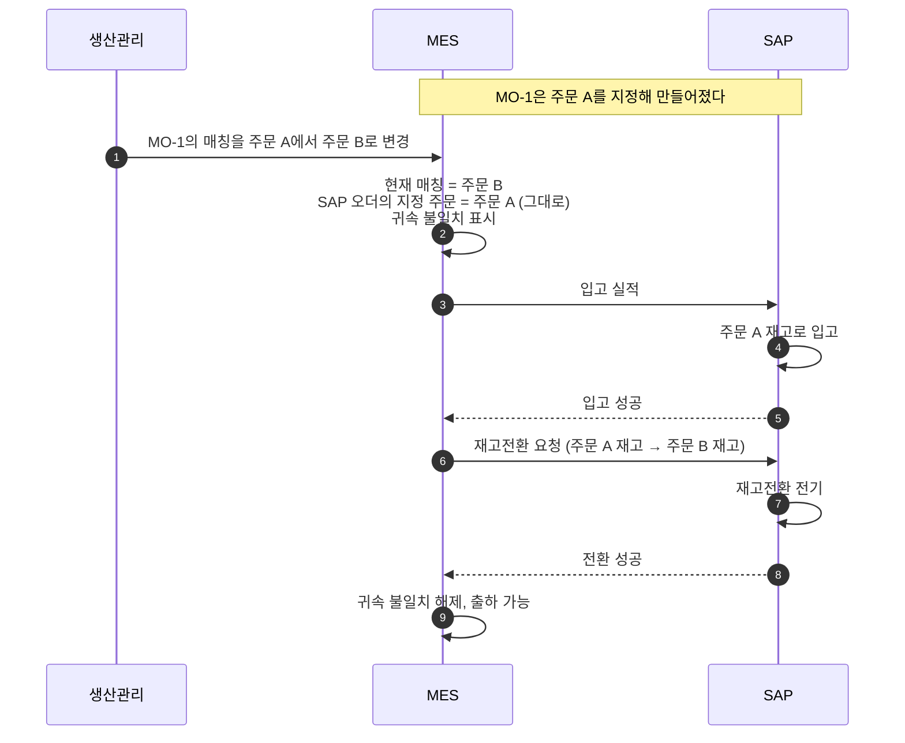
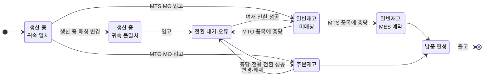

# 상세 4. MES 설계 요건과 SAP 인터페이스

> 자체 구축 MES가 MTO·MTS 병행을 지원하려면 무엇을 알고 있어야 하고, SAP에 무엇을 언제 보내야 하는지를 정리한 문서다.
> [본문](mto-mts-hybrid-analysis.md) 4.4절(매칭이 바뀔 때), 5장(MO와 SAP 오더), 9장(역할 분담)을 설계 수준으로 풀었다.

**근거 표기**

| 표기 | 뜻 |
|---|---|
| **[확인]** | 공개 자료(SAP 도움말, SAP 지원 문서, SAP 커뮤니티)의 검색 결과로 확인한 내용 |
| **[검증]** | SAP 표준 지식에 근거한 설명. 프로토타입 시스템에서 확인해야 한다 |

조사 환경에서 SAP 사이트 원문을 직접 열 수 없었다. **필드명과 이동유형은 프로토타입에서 반드시 다시 확인한다.**

---

## 1. 설계 원칙 다섯 가지

| # | 원칙 | 이유 |
|---|---|---|
| 1 | **재고의 주인은 MO를 만들 때 정해진다** | SAP는 생산오더에 판매오더가 지정되어 있으면 주문재고로, 없으면 일반재고로 입고한다 [확인]. 입고할 때 고르는 것이 아니다. MES는 MO 생성 시점에 MTO/MTS를 확정해 SAP에 넘긴다 |
| 2 | **생산 중의 매칭 변경은 MES만 안다** | SAP 생산오더의 주문 지정은 바꾸지 않는다. 바꿀 수 있는지에 대한 공개 자료가 엇갈려 의존할 수 없다 [확인] |
| 3 | **입고 후의 귀속 변경은 MES 이벤트가 SAP 재고전환을 자동 전기한다** | 사람이 SAP 화면에서 옮기는 구조가 되면 재고 불일치가 반드시 생긴다 |
| 4 | **자재코드가 같을 때만 전환 한 번으로 끝난다** | 자재코드가 규격별로 세분화되어 있으므로, 자재코드가 다른 코일을 충당하면 자재코드 변경 전기가 먼저 필요하고 표준단가 차이만큼 손익이 생긴다 [검증] |
| 5 | **SAP 전기가 필요 없는 충당을 구분한다** | ① MTS 주문 품목에 일반재고 코일을 충당 ② 반제품 코일을 완제품 MO의 투입재로 지정. 둘 다 MES 안의 예약일 뿐이며 SAP에는 출하나 투입 때 반영된다 |

---

## 2. MO 생성과 입고 재고 종류

| MO 유형 | SAP 생산오더 | 입고 결과 | 해당 계획생산 유형 |
|---|---|---|---|
| **MTO MO** (주문 품목 1건에 귀속) | 판매오더 번호·품목 지정 | 그 주문의 주문재고 | – |
| **MTS MO** (완제품) | 지정 없음 | 일반재고 | 표준 규격, 내시 선행, LOT 채움(별도 MO일 때) |
| **MTS MO** (반제품) | 지정 없음, 생산 품목 = 반제품 | 일반재고 → 완제품 MO가 투입 | 반제품 선행 |
| MO 1개가 주문 여러 건에 걸침 (예외) | 지정 없음 (권고) | 일반재고 → 코일별로 주문재고 전환 | – |

- **주문이 지정되려면 그 주문 품목이 MTO 품목이어야 한다.** MTS 품목을 지정하면 오류가 날 수 있다 [검증]. MES는 SAP에서 받은 품목의 MTO/MTS 구분을 보고 생성 방식을 고른다.
- LOT 채움 물량이 MTO MO 안에 섞여 있으면 전량이 주문재고로 입고된다. 초과분 코일은 입고 직후 여재 전환을 자동 전기한다.
- 생성 수단은 RFC 함수 `BAPI_PRODORD_CREATE`를 기준안으로 한다. 판매오더 지정 필드는 [검증]. S/4HANA의 OData 서비스는 생성은 되지만 주문 지정 생성 가능 여부를 확인하지 못했다.
- S/4HANA에서는 자재에 **생산버전**이 없으면 생산오더가 만들어지지 않을 수 있다([상세 3](mto-mts-03-sap-config-conversion.md) 9장).

---

## 3. 매칭이 바뀔 때의 처리

### 3.1 시점에 따라 처리가 다르다

| 매칭 변경 시점 | MES | SAP |
|---|---|---|
| **생산 전·생산 중** | 현재 매칭 주문을 바꾼다 | **전기 없음.** 입고 후 전환을 예약해 둔다 |
| **입고 후, 출하 전** | 코일의 귀속을 바꾼다 | **재고전환 전기** (자동) |
| **납품 편성 후** | 변경을 막는다 | – |

### 3.2 생산 중 매칭 변경의 절차

1. MES가 MO의 **현재 매칭 주문**을 바꾼다. **SAP 오더에 지정된 주문**(생성 시 값)은 별도 속성으로 그대로 둔다.
2. 두 값이 다르면 MO와 산출 예정 코일에 **귀속 불일치** 표시를 건다.
3. SAP는 원래 주문의 재고(또는 일반재고)로 입고한다.
4. 입고 성공 응답을 받은 직후, MES가 코일별 전환 전기를 자동으로 보낸다.
5. 전환 성공 후 불일치 표시를 해제한다. **전환 전에는 출하 지시를 막는다.**

### 3.3 이 방식의 부작용 (의사결정 필요)

| 영향 | 내용 | 대응 |
|---|---|---|
| 주문별 공급 가시성 | 변경부터 전환까지 SAP는 원래 주문에 공급이 있다고 본다 | 납기 조회는 MES 기준으로 통일 |
| 열연코일 소요 | 새로 매칭된 주문은 SAP에서 공급이 없어 MRP가 추가 소요를 만들 수 있다 [검증] | MRP 산출 구조 확인 후 영향 평가 |
| 원가 차이 귀속 | 생산오더 차이가 원래 주문·고객 쪽으로 정산될 수 있다 [검증] | 원가 담당과 귀속 기준 합의 |

> **부담을 줄이는 방법** 주문 없는 MO(MTS)로 만든 물량에 주문을 붙일 때, 그 주문을 MTS 품목으로 받으면 SAP에는 아무 전기가 필요 없다. 입고는 일반재고로 들어가고 출하 때 코일만 지정하면 된다([상세 1](mto-mts-01-scenarios.md) 3장).

---

## 4. 재고전환 전기 명세

수단은 RFC 함수 `BAPI_GOODSMVT_CREATE`(재고전환)를 기준안으로 한다.

| 상황 | 이동유형 | 판매오더 정보 | 상태 |
|---|---|---|---|
| 일반재고 → 주문 B (충당) | 413 | 받는 주문 = B | 이동유형 [확인], 필드 배치 시험 필요 |
| 주문 A → 일반재고 (여재화) | 411 + 특수재고 E | 주는 주문 = A | [확인] |
| 주문 A → 주문 B (전용) | 413 + 특수재고 E | 주는 주문 = A, 받는 주문 = B | **필드 배치 미확정.** 안 되면 여재화 후 충당 두 단계 |
| 자재코드 X → Y (규격 변경) | 309 | – | 주문재고 상태에서 가능한지 [검증] |
| 잘못된 전환의 취소 | 412, 414 계열 | – | 취소 전용으로만 사용 [검증] |

**알아둘 점**

- 공통 항목: 자재, 플랜트, 저장위치, 배치(코일), 수량(중량), 전기일.
- 주문재고의 판매오더 번호는 "평가된 판매오더재고용" 필드(`VAL_SALES_ORD`, `VAL_S_ORD_ITEM`)에 넣어야 한다. 일반 판매오더 필드에 넣으면 오류가 난다 [확인: 커뮤니티 사례].
- 전환은 가용 상태의 재고만 대상으로 본다. 품질검사 중인 코일은 판정 완료 후 전기한다 [검증].
- **단가는 수량을 따라가지 않는다.** 주문재고를 자재 표준단가로 통일해야 자동 전환이 손익을 흔들지 않는다([상세 2](mto-mts-02-costing-examples.md)).
- S/4HANA의 OData 자재문서 서비스는 판매오더 특수재고 필드가 거부된 사례가 있다 [확인]. RFC 함수를 기준안으로 한다.
- SAP 재고 전기는 주문 품목의 자재와 다른 자재를 그 주문의 재고로 넣는 것을 항상 막아 주지는 않는다 [검증]. **인터페이스가 자재코드 일치를 사전에 검증해야 한다.** 그렇지 않으면 납품할 수 없는 주문재고가 생긴다.

---

## 5. 출하: 납품에 코일 넣기

| 구분 | MTS 주문 품목 | MTO 주문 품목 |
|---|---|---|
| 출고되는 재고 | 일반재고 | 그 주문 품목의 주문재고만 |
| 코일 선택 | MES 매칭 결과를 납품에 지정 | 주문재고 안의 코일을 납품에 지정 |
| 출하 전 조건 | 코일이 SAP에서 일반재고일 것 | 코일이 SAP에서 해당 주문의 재고일 것 |
| 조건이 안 맞으면 | 주문재고에 남아 있으면 여재 전환 먼저 | 일반재고나 다른 주문재고면 충당·전용 전환 먼저 |

- 납품의 재고 종류는 판매오더 품목에서 복사되어 납품에서 바꿀 수 없다 [확인: 커뮤니티 답변]. 그래서 출하 전에 코일이 맞는 재고 종류에 있어야 한다.
- 판매오더 품목에는 배치를 1개만 지정할 수 있고, 여러 코일로 나누는 것은 납품에서만 된다 [확인]. **주문–코일 연결은 MES가 갖고, SAP에는 납품 시점에 코일을 지정한다.**
- 납품에 코일을 넣는 수단은 세 가지다 [확인]. ① OData 서비스(납품) ② RFC 함수(납품 변경) ③ 출하 확인 전문(IDoc). 세 경로 모두 알려진 제약이 있으므로 프로토타입에서 "코일 여러 개, 부분 출하, 출하 취소"를 시험해 하나를 고른다.
- 납품에 코일이 편성되면 그 코일의 매칭 변경을 MES에서 잠근다.

---

## 6. MES 데이터 모델 요건

| 대상 | 필요한 속성 |
|---|---|
| **MO** | MO 유형(MTO/MTS), 계획생산 사유(표준 규격·내시·반제품·LOT 채움), 자재코드, SAP 생산오더 번호, **SAP 오더에 지정된 주문 품목**(변경 불가), **현재 매칭 주문 품목**, 귀속 불일치 여부 |
| **주문 품목** | 판매오더 번호·품목, 자재코드, **MTO/MTS 구분**(SAP에서 수신), 수량, 과부족 허용 범위, 납기, 고객 등급, 충당 완료 수량, 취소·종결 상태 |
| **코일** | MES 코일 번호, **SAP 배치 번호**, 자재코드, 저장위치, 중량, 품질 상태, 산출 MO, **MES가 의도한 귀속**(주문 품목 또는 없음), **SAP에 전기된 귀속**(일반재고 또는 어느 주문의 재고), 동기화 상태, 여재 여부·사유·발생일 |
| **매칭** | 대상(MO 또는 코일), 주문 품목, 수량, 매칭 종류(생산 중 예약 / MES 예약 / SAP 확정), 대체 충당 여부와 승인자 |
| **매칭 이력** | 이벤트 ID(중복 방지 키), 종류(설정·변경·해제), 변경 전후 귀속, 발생 시각, 전기일, SAP 자재문서 번호, 처리 상태, 오류 내용, 재시도 횟수 |

> **핵심** 코일은 "MES가 의도한 귀속"과 "SAP에 실제 전기된 귀속"을 **따로** 가진다. 두 값의 차이가 곧 미처리 전환 건이다.

> **코일 번호 확인** SAP 배치 번호는 10자리로 고정이다 [확인]. MES 코일 번호가 10자리를 넘으면 배치 번호와의 대응 키를 따로 두어야 한다.

---

## 7. MES 이벤트와 SAP 전기의 대응

| MES 이벤트 | SAP에서 일어나야 하는 일 | SAP 전기 |
|---|---|---|
| MO 생성 | 생산오더 생성. MTO는 주문 품목 지정 | 있음 |
| 투입 | 생산오더로 출고. 열연코일·선행 반제품은 일반재고에서 | 있음 |
| 공정 실적 | 작업 확정 (수량, 스크랩, 작업시간) | 있음 |
| 입고 | 오더 입고. 코일을 배치로 생성 | 있음 |
| 매칭 설정·변경·해제 (**생산 중**) | 없음. 입고 후 전환 예약 | **없음** |
| 매칭 설정 (입고 후, **MTS 품목**) | 없음 | **없음** |
| 매칭 설정 (입고 후, **MTO 품목**) | 일반재고 → 주문재고 | 있음 |
| 매칭 변경 (입고 후) | 주문 → 주문 | 있음 |
| 매칭 해제·여재화 | 주문재고 → 일반재고 | 있음 |
| 등급 변경 | 등급을 무엇으로 구분하느냐에 따라 다르다. 배치 특성이면 특성 변경만, 자재코드면 자재코드 변경 | 미정 |
| 규격 변경 (자재코드 변경) | 자재코드 변경. 주문재고에 있으면 여재 전환 → 자재코드 변경 → 충당 순서가 안전 [검증] | 있음 |
| 출하 | 납품에 코일 지정, 출고 | 있음 |

- 작업 확정에 자재 이동을 한 건이라도 실어 보내면 SAP가 자동 투입·자동 입고를 하지 않는다 [확인]. 투입·입고를 확정과 묶을지 따로 보낼지 **한 가지로 통일한다.**
- 생산 중 규격 변경: 생산오더의 생산 품목은 생성 후 바꿀 수 없다고 본다 [검증]. 원래 자재로 입고한 뒤 자재코드를 바꾸거나, 오더를 닫고 새로 만드는 규칙이 필요하다.

---

## 8. 인터페이스 품질 요건

| 요건 | 내용 |
|---|---|
| **중복 전송 방지** | 모든 전송에 MES 이벤트 ID를 붙인다. SAP 쪽 수신 프로그램이 "이 ID를 이미 처리했는가"를 먼저 확인한다. SAP 표준 함수 자체에는 이 기능이 없어, 같은 내용을 다시 보내면 한 번 더 전기된다 [검증]. 응답을 못 받았을 때는 재전송 전에 ID로 처리 여부를 조회한다 |
| **순서 보장** | 코일 단위로 순번을 매겨 순서대로 처리한다. 입고 → 전환 → 납품 편성 → 출고 순서가 깨지면 뒤 건을 보류한다. 같은 자재의 동시 전기는 잠금 충돌이 날 수 있어 자동 재시도한다 [확인] |
| **오류 재처리** | 업무 오류(기간 마감, 재고 부족, 주문 종결)와 기술 오류(잠금, 통신)를 구분한다. 기술 오류는 자동 재시도, 업무 오류는 담당자 화면으로 보낸다. 오류 건이 있는 코일은 후속 이벤트를 막는다 |
| **재고 대사** | 매일 코일 단위로 비교한다. 비교 항목: 자재 + 저장위치 + 배치 + 재고 종류 + 귀속 판매오더·품목 + 수량. **수량만 맞추면 안 된다.** 귀속 주문까지 맞춘다 |
| **월말 전기 기간** | SAP는 현재와 직전 기간에만 전기된다 [확인]. 전기일 규칙을 정한다. 원칙은 실적 발생일, 해당 기간이 닫혔으면 열린 기간 첫날로 바꾸고 실제 발생일은 MES 이력에 남긴다. 마감 직전의 미처리 전환 건을 0으로 만드는 점검 절차를 둔다 |
| **SAP 정지 대응** | 전환 주말이나 장애로 SAP가 멈춘 동안 MES가 실적을 쌓아 두었다가 순서대로, 중복 없이 다시 보낼 수 있어야 한다 |

---

## 9. 매칭 로직 요건

| 항목 | 요건 |
|---|---|
| **규격 일치 판정** | 1단계: **자재코드 동일** (SAP 추가 전기 없음). 2단계: 주문 사양 대비 코일 실측치(두께, 폭, 중량, 재질, 표면)의 허용 공차 판정 |
| **대체 충당** | ① 같은 자재코드: 자동 허용 ② 다른 자재코드지만 사전에 정한 대체 가능 묶음 안: 승인 후 허용, 자재코드 변경 자동 전기, 단가 차이 발생을 화면에 표시 ③ 그 밖: 충당 불가, 재가공 MO로 처리 |
| **우선순위** | 납기 → 고객 등급 → 수주일 순을 기본으로 한다. 오래된 여재 우선 소진, 이미 그 주문의 재고인 코일 유지(전환 최소화)를 보조 기준으로 둔다 |
| **부분 충당** | 코일은 쪼갤 수 없는 단위다. 주문 수량은 코일 단위로 채우고 과부족 허용 범위 안에서 완료로 본다. 한 코일을 두 주문에 나누려면 분할 가공 MO가 필요하다 |
| **충당 가능 시점** | 계획·생산 중: MES 예약만. 입고 후 가용 재고: SAP 전환 전기. 품질 판정 전: 예약만, 전기 보류. 납품 편성 후: 변경 금지 |
| **주문 취소·축소** | 주문 품목을 삭제하지 않고 마감 처리한다. 남은 코일을 여재로 전환하는 순서를 지킨다 |
| **MTO/MTS 제안** | 수주 시점에 매칭 가능한 일반재고와 주문 없는 MO를 조회해 주문 품목의 MTO/MTS를 제안하는 기능을 수주 화면에 제공한다 |
| **고객 몫 보호** | 내시로 선행 생산한 코일은 SAP에서 일반재고다. 예정 고객이 아닌 주문이 가져가지 못하게 하는 규칙은 MES가 담당한다 |

---

## 10. 프로토타입에서 반드시 시험할 것

| # | 시험 | 확인할 것 |
|---|---|---|
| 1 | 주문 지정 생산오더 생성 → 입고 | 주문재고로 들어가는가. 입고 전문에 주문 정보가 필요한가 |
| 2 | 재고전환 세 가지 (일반 → 주문, 주문 → 일반, 주문 → 주문) | 필드 배치, 전기 후 주문별 재고, 회계 전표 |
| 3 | 주문재고 상태의 코일에 자재코드 변경 | 가능 여부, 단가 차이 계정 |
| 4 | 자재코드가 다른 코일을 주문재고로 전환 시도 | SAP가 막는가 (막지 않으면 인터페이스에서 막아야 한다) |
| 5 | 납품에 코일 지정 | 세 수단 중 선택. 코일 여러 개, 부분 출하, 출하 취소 |
| 6 | 같은 이벤트 2회 전송, 응답 유실, 순서 뒤바뀜 | 한 번만 반영되는가 |
| 7 | 마감된 기간의 전기일로 전송 | 오류 처리와 전기일 조정 |
| 8 | 생산 중 매칭 변경 후 MRP 실행 | 열연코일 소요가 늘어나는가 |
| 9 | MTS 품목을 지정해 생산오더 생성 시도 | 오류가 나는가 |
| 10 | 생산버전이 없는 자재로 생산오더 생성 시도 | 오류 내용 |

---

## 11. MES·현업에 확인할 질문

**MO와 코일**

1. 현재 MES는 SAP 생산오더를 어떤 방식으로 만들고 있나? 생산오더에 판매오더 품목을 넣고 있나?
2. MO 하나의 범위는 어디까지인가? 산세부터 정정까지 한 MO인가, 공정별로 나뉘나?
3. MES 코일 번호는 몇 자리이며 SAP 배치 번호와 같은 값인가? 분할·합권 때 번호는 어떻게 바뀌나?
4. 등급(정품, 2급, 격외)은 SAP에서 무엇으로 구분하나? 자재코드, 평가유형, 배치 특성, 저장위치 중 어느 것인가?
5. 품질검사 중이거나 보류된 코일을 SAP 재고 상태로 구분하나, MES에서만 관리하나?

**매칭**

6. 매칭 변경은 하루 평균 몇 건이며, 생산 중 변경과 입고 후 변경의 비율은 어떤가?
7. 주문의 자재코드와 다른 자재코드의 코일을 충당하는 경우가 실제로 있나? 있다면 지금 SAP에서는 어떻게 처리하나?
8. LOT 채움 물량은 주문용 MO 안에 섞여 함께 생산되나, 별도 MO로 나뉘나? 생산 전에 어느 코일이 초과분인지 MES가 알 수 있나?
9. 주문이 취소되거나 수량이 줄었을 때 이미 생산 중인 MO는 보통 어떻게 하나?
10. 재작업·재가공(재압연, 슬리팅)으로 규격이 바뀌는 경우 지금은 SAP에 어떻게 반영하나?

**출하와 마감**

11. 납품 문서는 누가 만드나? 지금 코일은 납품에 어떻게 지정하고, 출고 전기는 MES 실적으로 자동 처리되나?
12. 주문별 과부족 허용 범위와 부분 출하 허용 여부는 어떤 기준으로 정해져 있나?
13. 월말 마감 일정은 어떤가? MES 실적 마감 시각, SAP 재고 기간 마감 시점, 전월 소급 전기 관행이 있나?

**인터페이스**

14. 현재 SAP–MES 인터페이스는 실시간인가, 일괄 처리인가? 오류 재처리는 누가 어떤 화면에서 하나?
15. 재고 대사를 하고 있나? 불일치는 얼마나 자주 나나?

---

## 12. 출처

- [Sales Order Stock (SAP Help)](https://help.sap.com/doc/0065bd534f22b44ce10000000a174cb4/2.6/en-US/6362bd534f22b44ce10000000a174cb4.html)
- [MTO: re-assign production order to new sales order (SAP Community)](https://community.sap.com/t5/enterprise-resource-planning-q-a/mto-re-assign-production-order-to-new-sales-order/qaq-p/353707)
- [BAPI_GOODSMVT_CREATE와 판매오더재고 필드 (SAP Community)](https://community.sap.com/t5/application-development-and-automation-discussions/bapi-goods-mvt-problem-mb1b/m-p/6778645)
- [KBA 3697265: 판매오더재고 전기 오류 (SAP Support)](https://userapps.support.sap.com/sap/support/knowledge/en/3697265)
- [KBA 3709815: 판매오더재고 간 전환의 단가 (SAP Support)](https://userapps.support.sap.com/sap/support/knowledge/en/3709815)
- [Error with special stock using API_MATERIAL_DOCUMENT_SRV (SAP Community)](https://community.sap.com/t5/enterprise-resource-planning-q-a/error-with-special-stock-using-api-material-document-srv/qaq-p/12380954)
- [Outbound Delivery OData service (SAP Help)](https://help.sap.com/doc/9dbcab0600b346c2b359a8c8978a45ba/1.0/en-US/modules/vdm_outbound_delivery_v2_service.html)
- [KBA 3083930: 배치 번호 길이 (SAP Support)](https://userapps.support.sap.com/sap/support/knowledge/en/3083930)
- [KBA 3750872: 재고 전기 기간 (SAP Support)](https://userapps.support.sap.com/sap/support/knowledge/en/3750872)
- [KBA 1977883: 주문 품목과 다른 자재의 주문재고 (SAP Support)](https://userapps.support.sap.com/sap/support/knowledge/en/1977883)
- [Inventory management tables: new simplified data model (SAP Community)](https://community.sap.com/t5/enterprise-resource-planning-blog-posts-by-sap/sap-s-4hana-inventory-management-tables-new-simplified-data-model-nsdm/ba-p/13497469)
- [Processing Batches (SAP Learning)](https://learning.sap.com/courses/processes-in-sap-s-4hana-ewm/processing-batches)
