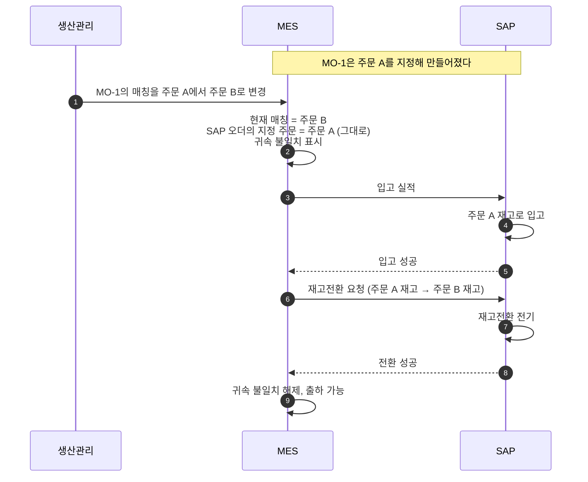
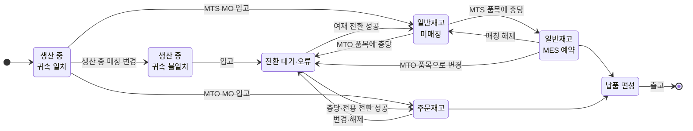

# 상세 4. MES 설계 요건과 SAP 인터페이스

> 자체 구축 MES가 MTO·MTS 병행을 지원하려면 무엇을 알고 있어야 하고, SAP에 무엇을 언제 보내야 하는지를 정리한 문서다.
> [본문](mto-mts-hybrid-analysis.md) 4.4절(매칭이 바뀔 때), 5장(MO와 SAP 오더), 9장(역할 분담)을 설계 수준으로 풀었다.

**근거 표기**

| 표기 | 뜻 |
|---|---|
| **[확인]** | 공개 자료로 확인한 내용. SAP 도움말 원문(S/4HANA 2025)을 직접 읽은 것이 기본이고, SAP 지원 문서(KBA)와 커뮤니티 글에만 근거한 것은 "검색 요약"이라고 적었다 |
| **[검증]** | SAP 표준 지식에 근거한 설명. 프로토타입 시스템에서 확인해야 한다 |

이 문서의 SAP 관련 주장 36개를 SAP 도움말 원문과 대조했다(확인 17, 부분 확인 16, 반박 1, 미확인 2. 결과는 본문에 반영). RFC 함수(BAPI)의 필드 목록은 SAP 도움말에 실려 있지 않아 대조하지 못했다. **함수의 필드명과 필드 배치는 대상 시스템의 함수 문서와 프로토타입에서 확정한다.**

이 문서의 설계는 MES가 MO를 만들어 SAP에 생산오더 생성을 요청하는 방향이다. SAP 표준 MES 연동은 반대로 SAP가 생산오더를 만들어 MES로 내려보낸다 [확인]. 그래서 표준 연동 도구를 그대로 쓰지 않으며, SAP에서 누군가 생산오더를 바꿨을 때(수량, 일정, 삭제) MES에 알리는 경로를 따로 정해야 한다.

---

## 1. 설계 원칙 다섯 가지

| # | 원칙 | 이유 |
|---|---|---|
| 1 | **재고의 주인은 MO를 만들 때 정해진다** | SAP는 생산오더에 판매오더가 지정되어 있으면 주문재고로, 없으면 일반재고로 입고한다 [확인]. 입고할 때 고르는 것이 아니다. MES는 MO 생성 시점에 MTO/MTS를 확정해 SAP에 넘긴다 |
| 2 | **생산 중의 매칭 변경은 MES만 안다** | SAP 생산오더의 주문 지정은 바꾸지 않는다. SAP가 공개한 생산오더 변경 서비스의 변경 항목에는 판매오더가 없어 인터페이스로는 바꿀 수 없다 [확인]. 화면에서 바꿀 수 있는지는 공개 자료가 엇갈린다 |
| 3 | **입고 후의 귀속 변경은 MES 이벤트가 SAP 재고전환을 자동 전기한다** | 사람이 SAP 화면에서 옮기는 구조가 되면 재고 불일치가 반드시 생긴다 |
| 4 | **자재코드가 같을 때만 전환 한 번으로 끝난다** | 자재코드가 규격별로 세분화되어 있으므로, 자재코드가 다른 코일을 충당하면 자재코드 변경 전기가 먼저 필요하고 표준단가 차이만큼 손익이 생긴다 [검증] |
| 5 | **SAP 전기가 필요 없는 충당을 구분한다** | ① MTS 주문 품목에 일반재고 코일을 충당 ② 반제품 코일을 완제품 MO의 투입재로 지정. 둘 다 MES 안의 예약일 뿐이며 SAP에는 출하나 투입 때 반영된다. ②는 반제품이 공용 자재로 설정되어 있어야 성립한다(7장 "투입") |

---

## 2. MO 생성과 입고 재고 종류

| MO 유형 | SAP 생산오더 | 입고 결과 | 해당 계획생산 유형 |
|---|---|---|---|
| **MTO MO** (주문 품목 1건에 귀속) | 판매오더 번호·품목 지정 | 그 주문의 주문재고 | – |
| **MTS MO** (완제품) | 지정 없음 | 일반재고 | 표준 규격, 내시 선행, LOT 채움(별도 MO일 때) |
| **MTS MO** (반제품) | 지정 없음, 생산 품목 = 반제품 | 일반재고 → 완제품 MO가 투입 | 반제품 선행 |
| MO 1개가 주문 여러 건에 걸침 (예외) | 지정 없음. 그 주문들은 MTS 품목으로 받는다 (권고) | 일반재고 → 출하 때 코일 지정 | – |

- **주문이 지정되려면 그 주문 품목이 MTO 품목이어야 한다.** MTS 품목을 지정하면 화면 생성에서 오류가 난다는 SAP 지원 문서가 있다 [확인: 검색 요약]. 인터페이스로 보낼 때 오류가 나는지, 지정이 무시되고 일반 오더로 만들어지는지는 프로토타입 9번으로 확인한다. MES는 SAP에서 받은 품목의 MTO/MTS 구분(품목범주가 아니라 소요유형이나 특수재고 E 여부)을 보고 생성 방식을 고른다.
- **MO 하나가 주문 여러 건에 걸칠 때** 그 주문들을 MTO로 두면, 생산 기간 내내 SAP에서 그 주문들에 공급이 없는 상태가 된다. 완제품 MRP가 돌면 주문마다 계획오더가 따로 생겨 열연코일 소요가 두 번 잡힌다([본문](mto-mts-hybrid-analysis.md) 5장, D24). 그래서 MTS 품목으로 받는 것을 기본으로 한다. 주문별 원가가 꼭 필요하면 주문별 생산오더 분할, Mill Products의 오더 결합, 한 오더의 산출물마다 다른 주문을 지정하는 기능(연산품별 계정 지정)을 비교한다. 세 기능이 있다는 것은 [확인], 이 회사에 맞는지는 [검증].
- LOT 채움 물량이 MTO MO 안에 섞여 있으면 전량이 주문재고로 입고된다. 초과분 코일은 MES가 여재로 판정한 뒤 여재 전환을 자동 전기한다. 판정 시점(입고 직후에 주문 수량을 넘는 코일을 바로 빼는가, 출하와 주문 마감 뒤 남은 코일만 빼는가)은 본문 D14에서 정한다.
- 생성 수단은 두 가지다. ① RFC 함수 `BAPI_PRODORD_CREATE`. SAP 표준 이관 도구가 이 함수로 판매오더 지정 생산오더를 만든다 [확인]. 호출 뒤 커밋을 따로 보내야 하고, 입고 허용 범위는 넣을 수 없다는 SAP 지원 문서가 있다 [확인: 검색 요약]. ② OData 서비스(API_PRODUCTION_ORDER_2_SRV). 생성 요청에 판매오더 번호와 품목을 선택 항목으로 받는다 [확인]. 어느 쪽을 쓸지는 프로토타입 1번에서 정한다.
- **MO 번호를 SAP 생산오더 번호로 쓸 수 있다.** 오더 번호를 외부에서 주는 오더유형이면 생성 요청에 번호를 넣는다 [확인]. 같은 번호로 두 번 만들 수 없으므로 중복 생성도 막힌다.
- S/4HANA에서는 BOM 전개에 **생산버전**이 필요하다 [확인]. 오더유형이 생산버전 수동 선택이면 생성 요청에 생산버전을 넣어야 한다 [확인]. 생산버전이 없을 때 요청이 거절되는지, 투입 자재와 공정 없이 만들어지는지는 프로토타입 10번으로 확인한다([상세 3](mto-mts-03-sap-config-conversion.md) 9장).

---

## 3. 매칭이 바뀔 때의 처리

### 3.1 시점에 따라 처리가 다르다

| 매칭 변경 시점 | MES | SAP |
|---|---|---|
| **생산 전·생산 중** | 현재 매칭 주문을 바꾼다 | **전기 없음.** 입고 후 전환을 예약해 둔다 |
| **입고 후, 출하 전** | 코일의 귀속을 바꾼다 | **재고전환 전기** (자동) |
| **납품 편성 후** | 변경을 막는다 | – |

### 3.2 생산 중 매칭 변경의 절차

1. MES가 MO의 **현재 매칭 주문**을 바꾼다. **SAP 오더에 지정된 주문**(생성 시 값)은 별도 속성으로 그대로 둔다.
2. 두 값이 다르면 MO와 산출 예정 코일에 **귀속 불일치** 표시를 건다.
3. SAP는 원래 주문의 재고(또는 일반재고)로 입고한다.
4. 입고 성공 응답을 받으면 MES가 코일별 전환 전기를 자동으로 보낸다. 입고검사 대상이면 품질 판정으로 가용 재고가 된 뒤에 보낸다. 품질검사 재고는 413·413 E로 옮길 수 없는 것으로 본다 [검증: 프로토타입 12번]. SAP 품질관리를 쓰고 있다면 검사 재고는 검사 건의 사용 결정으로만 풀리고, MES가 재고 전기로 풀 수 없다 [확인]. 자재에 재고이전 검사가 켜져 있으면 가용 재고의 413 전환도 실패할 수 있다 [확인: 검색 요약].
5. 전환 성공 후 불일치 표시를 해제한다. **전환 전에는 출하 지시를 막는다.**

### 3.3 이 방식의 부작용 (의사결정 필요)

| 영향 | 내용 | 대응 |
|---|---|---|
| 주문별 공급 가시성 | 변경부터 전환까지 SAP는 원래 주문에 공급이 있다고 본다 | MTO 주문의 진행과 납기 조회는 MES 기준으로 한다. MTS 주문의 납기 약속 방식은 본문 D15에서 정한다 |
| 열연코일 소요 | 새로 매칭된 주문은 SAP에서 공급이 없다. 완제품 MRP가 돌면 그 주문 몫의 계획오더와 열연코일 소요가 추가로 생긴다 [검증] | 완제품 MRP를 완제품 계획 수량이 있는 자재에만 돌린다 (D24) |
| 원가 차이 귀속 | 생산오더 차이가 원래 주문·고객 쪽으로 정산될 수 있다 [검증] | 원가 담당과 귀속 기준 합의 |

> **부담을 줄이는 방법** 주문 없는 MO(MTS)로 만든 물량에 주문을 붙일 때, 그 주문을 MTS 품목으로 받으면 SAP에는 아무 전기가 필요 없다. 입고는 일반재고로 들어가고 출하 때 코일만 지정하면 된다([상세 1](mto-mts-01-scenarios.md) 3장).

---

## 4. 재고전환 전기 명세

수단은 RFC 함수 `BAPI_GOODSMVT_CREATE`(재고전환)를 기준안으로 한다.

| 상황 | 이동유형 | 판매오더 정보 | 상태 |
|---|---|---|---|
| 일반재고 → 주문 B (충당) | 413 | 받는 주문 = B | 이동유형 [확인: SAP 도움말], 필드 배치 시험 필요 |
| 주문 A → 일반재고 (여재화) | 411 + 특수재고 E | 주는 주문 = A | [확인] |
| 주문 A → 주문 B (전용) | 413 + 특수재고 E | 주는 주문 = A, 받는 주문 = B | **필드 배치 미확정.** 안 되면 여재화 후 충당 두 단계 |
| 자재코드 X → Y (규격 변경) | 309 | 받는 자재, 받는 배치 번호 | 주문재고 상태에서도 표준으로 정의된 이동이다 [확인]. 다만 주문 품목과 다른 자재가 그 주문의 재고가 되면 납품할 수 없다 |
| 잘못된 전환의 취소 | 원 자재문서 취소 (취소 이동유형은 SAP가 정한다) | – | 412·414를 새 전표로 보내지 않는다 [검증] |

**알아둘 점**

- 공통 항목: 자재, 플랜트, 저장위치, 배치(코일), 수량(중량), 전기일, 처리 코드(재고전환·입고 같은 전기 종류 구분), MES 이벤트 ID(자재문서 헤더의 참조 항목에 남긴다).
- 재고전환 함수의 품목에는 판매오더 필드가 두 쌍 있다(`SALES_ORD`/`S_ORD_ITEM`, `VAL_SALES_ORD`/`VAL_S_ORD_ITEM`) [확인: 커뮤니티]. 같은 기능의 OData 서비스도 두 쌍을 나눠 두고, 한 쌍을 "특수재고를 식별하는 판매오더"라고 설명한다 [확인]. 재고가 들어 있는 주문은 특수재고 식별 쪽(`VAL_`)에 넣는 것으로 가정한다. 413 E는 주는 주문과 받는 주문을 함께 넘겨야 하는데 그 배치는 공개 자료로 확정하지 못했다. **411 E, 413, 413 E 각각의 필드 배치를 표로 정하고, 전기 뒤 주문별 재고와 자재문서의 주는 쪽·받는 쪽 주문을 조회해 확정한다** [검증].
- 잘못된 전환은 원 자재문서를 참조해 취소한다. 취소는 원 문서를 가리키는 새 자재문서를 만든다 [확인]. 취소 전기일을 넘기지 않으면 시스템 일자로 전기되므로 [확인] 전기일 규칙(8장)을 취소에도 적용한다. 취소 이벤트에는 원 이벤트 ID와 자재문서 번호를 함께 남긴다. 함수명(`BAPI_GOODSMVT_CANCEL`)과 필드는 시스템에서 확정한다.
- 전환은 가용 상태의 재고만 대상으로 본다. 품질검사 중인 코일은 판정 완료 후 전기한다 [검증].
- **단가는 수량을 따라가지 않는다.** 주문재고를 자재 표준단가로 통일해야 자동 전환이 손익을 흔들지 않는다([상세 2](mto-mts-02-costing-examples.md)).
- S/4HANA의 OData 자재문서 서비스는 판매오더 특수재고 항목을 요청 항목으로 두고 있으나 이동유형에 따라 쓸 수 있는 항목이 달라진다 [확인]. 2020년에 다른 이동유형에서 이 항목이 거부된 사례가 있다 [확인: 커뮤니티]. 411 E, 413, 413 E가 되는지는 대상 릴리스에서 시험하고, 그 전까지는 RFC 함수를 기준안으로 한다.
- SAP 재고 전기는 주문 품목의 자재와 다른 자재를 그 주문의 재고로 넣는 것을 항상 막아 주지는 않는다 [검증]. **인터페이스가 자재코드 일치를 사전에 검증해야 한다.** 그렇지 않으면 납품할 수 없는 주문재고가 생긴다.

---

## 5. 출하: 납품에 코일 넣기

| 구분 | MTS 주문 품목 | MTO 주문 품목 |
|---|---|---|
| 출고되는 재고 | 일반재고 | 그 주문 품목의 주문재고만 |
| 코일 선택 | MES 매칭 결과를 납품에 지정 | 주문재고 안의 코일을 납품에 지정 |
| 출하 전 조건 | 코일이 SAP에서 일반재고일 것 | 코일이 SAP에서 해당 주문의 재고일 것 |
| 조건이 안 맞으면 | 주문재고에 남아 있으면 여재 전환 먼저 | 일반재고나 다른 주문재고면 충당·전용 전환 먼저 |

- 주문재고는 그 주문 품목의 납품으로만 출고할 수 있다 [확인]. 납품의 재고 종류는 판매오더 품목에서 정해져 납품에서 바꿀 수 없다 [확인: 커뮤니티 답변]. 그래서 출하 전에 코일이 맞는 재고 종류에 있어야 한다.
- 판매오더 품목에는 배치를 1개만 지정할 수 있고, 여러 코일로 나누는 것은 납품에서만 된다 [확인]. **주문–코일 연결은 MES가 갖고, SAP에는 납품 시점에 코일을 지정한다.**
- 납품에 코일을 넣는 수단은 세 가지다. ① OData 서비스. 한 품목을 코일별로 나누고 피킹 수량을 함께 넣을 수 있다 [확인] ② RFC 함수(납품 변경) [검증] ③ 출하 확인 전문 [확인]. 확인된 제약: OData는 같은 품목을 한 요청 묶음에서 한 번만 처리할 수 있고, 출하 확인 전문은 품목의 피킹 수량을 한 번에 전량 보고해야 하며 누적 보고가 안 된다. 프로토타입에서 "코일 여러 개, 부분 출하, 출하 취소"를 시험해 하나를 고른다.
- 납품에 코일이 편성되면 그 코일의 매칭 변경을 MES에서 잠근다.
- **MTO도 코일을 지정한다.** 코일을 배치로 관리하면 MTO 출하도 납품에 코일을 지정해야 출고된다. 다른 것은 고를 범위(MTS는 일반재고 전체, MTO는 그 주문재고 안)뿐이다. 두 경우 모두 MES 상차 실적의 코일로 납품 배치를 채우고, SAP 자동 배치 결정에 맡기지 않는다.

---

## 6. MES 데이터 모델 요건

| 대상 | 필요한 속성 |
|---|---|
| **MO** | MO 유형(MTO/MTS), 계획생산 사유(표준 규격·내시·반제품·LOT 채움), 자재코드, SAP 생산오더 번호, **SAP 오더에 지정된 주문 품목**(변경 불가), **현재 매칭 주문 품목**, 귀속 불일치 여부 |
| **주문 품목** | 판매오더 번호·품목, 자재코드, **MTO/MTS 구분**(SAP에서 수신. 품목범주가 아니라 소요유형이나 특수재고 E 여부 기준), 수량, 과부족 허용 범위, 납기, 고객 등급, 충당 완료 수량, 취소·종결 상태 |
| **코일** | MES 코일 번호, **SAP 배치 번호**, 자재코드, 저장위치, 중량, 품질 상태, 산출 MO, **MES가 의도한 귀속**(주문 품목 또는 없음), **SAP에 전기된 귀속**(일반재고 또는 어느 주문의 재고), 동기화 상태, 여재 여부·사유·발생일 |
| **매칭** | 대상(MO 또는 코일), 주문 품목, 수량, 매칭 종류(생산 중 예약 / MES 예약 / SAP 확정), 대체 충당 여부와 승인자 |
| **매칭 이력** | 이벤트 ID(중복 방지 키), 종류(설정·변경·해제), 변경 전후 귀속, 발생 시각, 전기일, SAP 자재문서 번호, 처리 상태, 오류 내용, 재시도 횟수 |

> **핵심** 코일은 "MES가 의도한 귀속"과 "SAP에 실제 전기된 귀속"을 **따로** 가진다. 두 값의 차이가 곧 미처리 전환 건이다.

> **코일 번호 확인** SAP 배치 번호는 최대 10자리다 [확인]. MES 코일 번호가 10자리를 넘으면 배치 번호와의 대응 키를 따로 두어야 한다. 분할로 생기는 자식 코일 번호까지 10자리 안에 들어가는지도 본다.
>
> **배치 수준 확인** SAP는 배치 번호를 플랜트 단위, 자재 단위, 시스템 전체 단위 가운데 하나로 관리한다. 시스템 전체 단위면 같은 번호를 다른 자재에 줄 수 없어, 자재코드를 바꾸는 전기에서 코일 번호를 그대로 둘 수 없다 [확인]. 현재 설정을 확인하고 코일 번호 유지 방침을 정한다([상세 6](mto-mts-06-steel-practice.md) 4장).

---

## 7. MES 이벤트와 SAP 전기의 대응

| MES 이벤트 | SAP에서 일어나야 하는 일 | SAP 전기 |
|---|---|---|
| 신규 규격의 주문 없는 MO 편성 | 자재 생성 기능 호출(자재, BOM, 공정, 생산버전, 표준원가). 완료 응답을 받은 뒤에만 MO 생성 요청 ([상세 3](mto-mts-03-sap-config-conversion.md) 12.2절) | 있음 |
| MO 생성 | 생산오더 생성. MTO는 주문 품목 지정 | 있음 |
| MO 생성 요청이 표준단가 0으로 거절됨 | 생산오더가 만들어지지 않는다. MES는 MO를 보류하고 담당자에게 알린다 | 없음 |
| 투입 | 생산오더로 출고. 열연코일·선행 반제품은 일반재고에서 출고한다. 이를 위해 두 자재의 개별/일괄 지시자를 2(일괄만)로 둔다 [확인]. 비워 두면 MTO 생산오더의 투입 예약이 그 주문의 재고를 요구해, 일반재고가 있어도 출고가 막히고 MRP가 주문별로 열연코일을 따로 계획한다. MES 투입 전기에는 특수재고 표시를 넣지 않는다 | 있음 |
| 공정 실적 | 작업 확정 (수량, 스크랩, 작업시간) | 있음 |
| 입고 | 오더 입고. 코일 단위로 보내고 코일을 배치로 생성한다. MO의 마지막 코일에만 납품 완료 표시를 넣는다 (7.1절) | 있음 |
| MO 종료 | 생산오더를 닫는다. 미달로 끝난 MO는 남은 수량을 닫아 SAP에 공급 예정이 남지 않게 한다 | 있음 |
| 스크랩·부산물 발생 | 부산물 입고(이동유형 531) 또는 폐기. 귀속은 항상 일반재고로 한다. 주문을 지정한 오더의 부산물이 주문재고로 들어가면 납품할 수 없는 재고가 주문에 묶인다 [검증] | 있음 |
| 코일 분할·합권 | 전기 방식을 하나로 정한다 (7.1절) | 있음 |
| 매칭 설정·변경·해제 (**생산 중**) | 없음. 입고 후 전환 예약 | **없음** |
| 매칭 설정 (입고 후, **MTS 품목**) | 없음 | **없음** |
| 매칭 설정 (입고 후, **MTO 품목**) | 일반재고 → 주문재고 | 있음 |
| 매칭 변경 (입고 후, MTO 품목 → MTO 품목) | 주문 A 재고 → 주문 B 재고 | 있음 |
| 매칭 변경 (입고 후, MTO 품목 → MTS 품목) | 주문재고 → 일반재고 | 있음 |
| 매칭 변경 (입고 후, MTS 품목 → MTO 품목) | 일반재고 → 주문재고 | 있음 |
| 매칭 변경 (입고 후, MTS 품목 → MTS 품목) | 없음 | **없음** |
| 매칭 해제 (MTO 품목)·여재화 | 주문재고 → 일반재고 | 있음 |
| 매칭 해제 (MTS 품목) | 없음 | **없음** |
| 열연코일 계획 수량 등록 (계획을 MES에서 만드는 경우) | 계획 수량 등록·변경. 총량이 아니라 남은 양을 보낸다 ([상세 3](mto-mts-03-sap-config-conversion.md) 4.3절) | 있음 |
| 등급 변경 | 등급을 무엇으로 구분하느냐에 따라 다르다. 자재코드나 평가유형이면 변경 전기, 배치 특성이면 특성 변경만. 배치 특성에만 두면 2급 코일이 정품 가용 재고와 정품 단가로 잡히므로 MTS 전에 정한다 | 미정 |
| 규격 변경 (자재코드 변경) | 자재코드 변경. 주문재고에 있으면 여재 전환 → 자재코드 변경 → 충당 순서가 안전하다. 여재 전환(411 E)은 자재 번호를 함께 바꿀 수 있는 이동이므로 [확인] 두 단계를 한 번에 전기할 수 있는지 프로토타입 3번에서 함께 시험한다 | 있음 |
| 출하 | 납품에 코일 지정, 출고 | 있음 |
| 반품 입고 | 반품 코일은 SAP에서 원 주문의 재고로 들어온다 [확인]. MES는 귀속을 원 주문으로 두고, 다시 팔려면 여재 전환을 탄다 | 있음 |

- 작업 확정에 자재 이동을 한 건이라도 실어 보내면 SAP가 자동 투입·자동 입고를 하지 않는다 [확인]. 투입·입고를 확정과 묶을지 따로 보낼지 **한 가지로 통일한다.** 권고는 따로 보내는 것이다(7.1절 1번).
- 생산 중 규격 변경: SAP가 공개한 생산오더 변경 서비스에는 생산 품목(자재)을 바꾸는 항목이 없다 [확인]. 규칙은 7.1절 6번.

### 7.1 정상 흐름 밖의 이벤트

위 표는 순조로운 흐름이다. 아래는 설계에서 빠지기 쉬운 경우이고, 각각 요건으로 정해 둬야 한다.

| # | 상황 | 왜 문제가 되나 | 요건 |
|---|---|---|---|
| 1 | **SAP가 전기를 거절했는데 현장에서는 이미 일어난 일** | 투입·입고를 작업 확정에 묶어 보내면, 자재 이동이 실패해도 확정은 성공으로 돌아오고 실패 건은 SAP의 재처리 목록에 쌓인다 [확인]. MES는 입고가 됐다고 믿고 전환을 보내 오류가 이어진다 | 투입과 입고는 자재문서 번호를 응답으로 받는 재고 전기로 따로 보낸다. 실패한 코일은 "전기 실패"로 표시하고 현장 이동은 허용하되 전환, 납품 편성, 출고를 막는다. 재처리는 MES의 재전송으로만 한다. 실패 건마다 처리 담당과 기한을 정한다 |
| 2 | **입고 중량이 계획 수량과 다르다** | 코일은 중량 단위라 항상 차이가 난다. SAP는 오더 수량에 초과 입고 허용 범위를 더한 양을 넘는 입고를 오류로 막는다 [확인] | 생산오더의 초과 입고 허용 범위를 자재마스터나 오더유형 기본값으로 정한다(무제한 허용을 쓸지 결정). 넘을 것으로 보이면 MES가 입고 전에 오더 수량 변경을 먼저 보낸다. LOT 채움 물량은 처음부터 오더 수량에 넣는다 |
| 3 | **MO 하나에서 코일이 여러 개 나온다** | 입고가 여러 번이다. SAP는 허용 범위 안의 입고에서 납품 완료를 자동으로 건다 [확인]. 마지막 코일 전에 완료가 걸리거나, 미달로 끝난 MO가 열린 채 남아 공급 예정으로 계속 보인다 | 입고는 코일 단위로 보낸다. 납품 완료 표시는 MES가 마지막 코일에만 넣는다. 귀속 불일치 MO의 전환은 코일 입고마다 실행한다 |
| 4 | **코일 분할·합권** | 슬리팅(1 → 여러 개)과 합권(여러 개 → 1)은 일상이다. 부모와 자식 코일을 SAP에서 무엇으로 잇는지, 주문재고에 있는 코일을 분할하면 자식이 어느 재고로 가는지가 정해져 있지 않다 | SAP 전기 방식을 하나로 정한다(가공 MO의 투입·입고, 또는 배치 간 전환). 자식 코일은 부모의 SAP 귀속을 물려받아 입고하고, MES가 의도한 귀속이 다르면 3장의 전환을 탄다. 부모·자식 관계의 원본은 MES가 갖는다. 합권은 받는 코일을 새 번호로 만든다 |
| 5 | **자재코드를 바꿀 때의 코일 번호와 속성** | 자재 간 이전에는 주는 배치와 받는 배치가 따로 있다 [확인]. 배치 수준 설정에 따라 같은 번호를 쓸 수 없을 수 있다(6장) | 자재코드 변경 전기에 받는 자재와 받는 배치 번호를 명시한다. 받는 배치의 속성(두께, 폭, 등급)은 전환 뒤 MES가 다시 보내 맞춘다. 코일 속성에 자재코드 변경 이력(이전 자재코드, 자재문서 번호)을 둔다 |
| 6 | **생산 중인 MO의 목표 규격이 바뀐다** | 자재코드가 규격별이라 두께·폭 변경은 곧 자재코드 변경이다. SAP 생산오더의 생산 품목은 바꿀 수 없다 | 시점으로 나눈다. 투입 전이면 생산오더를 닫고 새 자재로 다시 만든다. 투입 후면 원래 자재로 입고한 뒤 자재코드 변경을 자동 전기한다. MES는 MO에 "계획 자재코드"와 "실제 산출 자재코드"를 따로 둔다. 이때 생기는 단가 차이의 귀속은 원가 담당과 정한다 |
| 7 | **실적 취소와 정정** | 입고 취소, 투입 취소, 확정 취소, 출고 취소가 전환 취소보다 흔하다. 전환까지 끝난 코일의 입고를 취소하려면 전환을 먼저 되돌려야 한다. 같은 오더의 확정 취소는 만든 순서의 역순이어야 한다 [확인] | 취소는 원 이벤트의 역순으로만 받는다(출고 취소 → 납품 편성 해제 → 전환 취소 → 입고 취소 → 투입 취소). 뒤 단계가 남아 있으면 앞 단계 취소를 거절한다. 취소는 모두 원 자재문서나 원 확정을 참조한다 |
| 8 | **품질 판정의 주인** | SAP 품질관리를 쓰면 검사 재고는 SAP의 사용 결정으로만 풀린다 [확인]. 쓰지 않으면 MES가 재고 상태 변경을 직접 보낸다 | 판정의 원본 시스템을 정한다. SAP 품질관리를 쓰면 MES 판정을 사용 결정으로 넘기는 인터페이스를 둔다. 판정 전 코일의 전환 예약은 MES가 갖고, 불합격·2급이면 예약을 풀고 매칭 담당에게 알린다 |

---

## 8. 인터페이스 품질 요건

| 요건 | 내용 |
|---|---|
| **중복 전송 방지** | 모든 전송에 MES 이벤트 ID를 붙인다. RFC 함수를 동기 호출하면 SAP가 중복을 걸러 주지 않아, 같은 내용을 다시 보내면 한 번 더 전기된다 [확인]. 대안은 둘이다. ① 트랜잭션 RFC, 큐 RFC, 전문(IDoc)으로 보내면 전송 계층이 한 번만 처리하고, 큐를 쓰면 순서도 지킨다 [확인]. ② 동기 호출을 유지하려면 SAP 쪽 수신 프로그램이 이벤트 ID로 처리 이력을 먼저 확인한다. 어느 쪽이든 이벤트 ID를 자재문서에 남겨 사후에 조회할 수 있게 한다 |
| **순서 보장** | 순번은 세 단위로 매긴다. MO 단위(생성, 투입, 확정, 입고, 종료), 코일 단위(입고, 품질 판정, 전환, 자재코드 변경), 납품 단위(코일 편성, 출고). 앞 건이 끝나지 않으면 같은 단위의 뒤 건을 보내지 않는다. 큐 RFC를 쓰면 큐 이름을 이 단위로 잡는다. 같은 자재의 동시 전기는 잠금 충돌이 날 수 있어 자동 재시도한다 [확인] |
| **오류 재처리** | 업무 오류(기간 마감, 재고 부족, 주문 종결)와 기술 오류(잠금, 통신)를 구분한다. 기술 오류는 자동 재시도, 업무 오류는 담당자 화면으로 보낸다. 오류 건이 있는 코일은 후속 이벤트를 막는다 |
| **재고 대사** | 매일 코일 단위로 비교한다. 비교 항목: 자재 + 저장위치 + 배치 + 재고 종류 + 귀속 판매오더·품목 + 수량. **수량만 맞추면 안 된다.** 귀속 주문까지 맞춘다 |
| **월말 전기 기간** | SAP는 현재와 직전 기간에만 전기된다 [확인]. 직전 기간 전기는 자재 기간의 허용 설정과 재무회계 전기 기간이 모두 열려 있을 때만 된다 [확인]. 전기일 규칙을 정한다. 원칙은 실적 발생일, 해당 기간이 닫혔으면 열린 기간 첫날로 바꾸고 실제 발생일은 MES 이력에 남긴다. 마감 직전의 미처리 전환 건을 0으로 만드는 점검 절차를 둔다 |
| **SAP 정지 대응** | 전환 주말이나 장애로 SAP가 멈춘 동안 MES가 실적을 쌓아 두었다가 순서대로, 중복 없이 다시 보낼 수 있어야 한다. 다시 보낼 때 월 경계를 넘었으면 전기일을 위 규칙으로 다시 계산하고, 바뀐 전기일과 원래 발생일을 함께 남긴다 |
| **SAP에서 바뀐 생산오더** | SAP에서 사람이 생산오더를 바꾸지 못하게 하거나(권고), 바꾼 내용을 MES에 알리는 경로를 둔다 |

---

## 9. 매칭 로직 요건

| 항목 | 요건 |
|---|---|
| **규격 일치 판정** | 1단계: **자재코드 동일** (SAP 추가 전기 없음). 2단계: 주문 사양 대비 코일 실측치(두께, 폭, 중량, 재질, 표면)의 허용 공차 판정 |
| **대체 충당** | ① 같은 자재코드: 자동 허용 ② 다른 자재코드지만 사전에 정한 대체 가능 묶음 안: 승인 후 허용, 자재코드 변경 자동 전기, 단가 차이 발생을 화면에 표시 ③ 그 밖: 충당 불가, 재가공 MO로 처리 |
| **우선순위** | 납기 → 고객 등급 → 수주일 순을 기본으로 한다. 오래된 여재 우선 소진, 이미 그 주문의 재고인 코일 유지(전환 최소화)를 보조 기준으로 둔다 |
| **부분 충당** | 코일은 쪼갤 수 없는 단위다. 주문 수량은 코일 단위로 채우고 과부족 허용 범위 안에서 완료로 본다. 한 코일을 두 주문에 나누려면 분할 가공 MO가 필요하다 |
| **충당 가능 시점** | 계획·생산 중: MES 예약만. 입고 후 가용 재고: SAP 전환 전기. 품질 판정 전: 예약만, 전기 보류. 납품 편성 후: 변경 금지 |
| **주문 취소·축소** | 주문 품목을 삭제하지 않고 마감 처리한다. 남은 코일을 여재로 전환하는 순서를 지킨다 |
| **충당원 탐색** | 새 생산을 제안하기 전에 ① 같은 자재코드의 일반재고와 주문 없는 MO ② 다른 주문에 묶인 여재 후보(완납·취소·초과분) ③ 생산 중인 MO에서 초과로 나올 코일 ④ 대체 허용 범위 안의 다른 자재코드 코일과 후공정으로 맞출 수 있는 반제품·완제품 ⑤ 고객이 허용하는 2급재를 차례로 찾는다. SAP 처리는 충당원마다 다르다([본문](mto-mts-hybrid-analysis.md) 3.1절의 표) |
| **MTO/MTS 제안** | 수주 화면에 주문 품목의 MTO/MTS를 제안하는 기능을 둔다. ① 방금 생성된 신규 규격이면 MTO(대체 가능 코일이나 재가공할 물량은 먼저 본다) ② 완제품 계획 수량이 있는 자재면 재고가 없어도 MTS ③ 그 밖에는 충당원 탐색 결과가 전량이면 MTS, 일부면 품목 분할, 없으면 MTO. 이 순서는 [상세 1](mto-mts-01-scenarios.md) 3.1절과 같다. ②를 빠뜨리면 열연코일 소요가 두 번 계산된다 |
| **고객 몫 보호** | 내시로 선행 생산한 코일은 SAP에서 일반재고다. 예정 고객이 아닌 주문이 가져가지 못하게 하는 규칙은 MES가 담당한다. 다만 SAP 가용성 점검이 MES 매칭보다 먼저 다른 고객 납기를 그 재고로 확정할 수 있으므로, SAP에서도 막아야 하면 제품 할당이나 별도 저장위치를 검토한다([상세 1](mto-mts-01-scenarios.md) 4.2절) |

---

## 10. 프로토타입에서 반드시 시험할 것

| # | 시험 | 확인할 것 |
|---|---|---|
| 1 | 주문 지정 생산오더 생성 → 입고 | 주문재고로 들어가는가. 입고 전문에 주문 정보가 필요한가 |
| 2 | 재고전환 세 가지 (일반 → 주문, 주문 → 일반, 주문 → 주문) | 필드 배치, 전기 후 주문별 재고, 회계 전표 |
| 3 | 주문재고 상태의 코일에 자재코드 변경 | 가능 여부, 단가 차이 계정 |
| 4 | 자재코드가 다른 코일을 주문재고로 전환 시도 | SAP가 막는가 (막지 않으면 인터페이스에서 막아야 한다) |
| 5 | 납품에 코일 지정 | 세 수단 중 선택. 코일 여러 개, 부분 출하, 출하 취소 |
| 6 | 같은 이벤트 2회 전송, 응답 유실, 순서 뒤바뀜 | 한 번만 반영되는가 |
| 7 | 마감된 기간의 전기일로 전송 | 오류 처리와 전기일 조정 |
| 8 | 생산 중 매칭 변경 후 MRP 실행 | 열연코일 소요가 늘어나는가 |
| 9 | MTS 품목을 지정해 생산오더 생성 시도 | 오류가 나는가 |
| 10 | 생산버전이 없는 자재로 생산오더 생성 시도 | 오류가 나는가, 투입 자재와 공정이 들어오는가 |
| 11 | 표준단가 0인 자재로 생산오더 생성 시도 | 거절되는가, 오류 내용 |
| 12 | 입고검사 중인 코일에 재고전환 시도 | 막히는가, 판정 뒤에 전환되는가 |
| 13 | 잘못된 전환을 원 자재문서 취소로 되돌림 | 주문별 재고와 회계 전표가 원래대로 돌아오는가 |
| 14 | 허용 범위를 넘는 중량으로 입고 시도, 코일 여러 개의 부분 입고 | 막히는가. 납품 완료가 언제 걸리는가 |
| 15 | 자재코드 변경(309) 전기 | 코일 번호를 그대로 쓸 수 있는가. 배치 속성이 넘어가는가 |
| 16 | 작업 확정에 투입·입고를 묶어 보내고 자재 이동을 일부러 실패시킴 | MES가 실패를 알 수 있는가. 재처리 경로 |

---

## 11. MES·현업에 확인할 질문

**MO와 코일**

1. 현재 MES는 SAP 생산오더를 어떤 방식으로 만들고 있나? 생산오더에 판매오더 품목을 넣고 있나?
2. MO 하나의 범위는 어디까지인가? 산세부터 정정까지 한 MO인가, 공정별로 나뉘나?
3. MES 코일 번호는 몇 자리이며 SAP 배치 번호와 같은 값인가? 분할·합권 때 번호는 어떻게 바뀌나?
4. 등급(정품, 2급, 격외)은 SAP에서 무엇으로 구분하나? 자재코드, 평가유형, 배치 특성, 저장위치 중 어느 것인가?
5. 품질검사 중이거나 보류된 코일을 SAP 재고 상태로 구분하나, MES에서만 관리하나?

**매칭**

6. 매칭 변경은 하루 평균 몇 건이며, 생산 중 변경과 입고 후 변경의 비율은 어떤가?
7. 주문의 자재코드와 다른 자재코드의 코일을 충당하는 경우가 실제로 있나? 있다면 지금 SAP에서는 어떻게 처리하나?
8. LOT 채움 물량은 주문용 MO 안에 섞여 함께 생산되나, 별도 MO로 나뉘나? 생산 전에 어느 코일이 초과분인지 MES가 알 수 있나?
9. 주문이 취소되거나 수량이 줄었을 때 이미 생산 중인 MO는 보통 어떻게 하나?
10. 재작업·재가공(재압연, 슬리팅)으로 규격이 바뀌는 경우 지금은 SAP에 어떻게 반영하나?

**출하와 마감**

11. 납품 문서는 누가 만드나? 지금 코일은 납품에 어떻게 지정하고, 출고 전기는 MES 실적으로 자동 처리되나?
12. 주문별 과부족 허용 범위와 부분 출하 허용 여부는 어떤 기준으로 정해져 있나?
13. 월말 마감 일정은 어떤가? MES 실적 마감 시각, SAP 재고 기간 마감 시점, 전월 소급 전기 관행이 있나?

**인터페이스**

14. 현재 SAP–MES 인터페이스는 실시간인가, 일괄 처리인가? 오류 재처리는 누가 어떤 화면에서 하나?
15. 재고 대사를 하고 있나? 불일치는 얼마나 자주 나나?
16. MES가 SAP로 보내는 투입·입고·출고는 표준 이동유형인가, 복사한 이동유형인가?
17. 연동은 직접 RFC, 미들웨어 경유, 전문(IDoc) 가운데 무엇을 쓸 계획인가? SAP 생산오더 번호를 MES의 MO 번호와 같게 쓸 수 있나? SAP에서 생산오더를 사람이 직접 바꾸는 일이 있나?

**배치, 입고, 품질**

18. SAP의 배치 수준은 플랜트, 자재, 시스템 전체 가운데 무엇인가? 코일 속성(두께, 폭, 중량, 등급)을 SAP 배치 특성으로 관리하나, MES에만 있나? 지금 자재코드를 바꾸는 전기를 할 때 코일 번호는 그대로인가?
19. MO 하나에서 코일이 보통 몇 개 나오고, 입고는 코일마다 보내나, MO 종료 때 한 번에 보내나? 계획 수량과 실제 입고 중량의 차이는 어느 정도이고, 생산오더의 초과 입고 허용 범위는 어떻게 설정되어 있나? 미달로 끝난 생산오더는 누가 언제 닫나?
20. 열연코일과 반제품 코일은 SAP에서 코일(배치) 단위로 관리되나? 지금 MTO 생산오더에 투입할 때 일반재고에서 나가나, 주문재고에서 나가나?
21. SAP 품질관리를 쓰고 있나? 쓴다면 사용 결정은 누가 입력하나? MES 판정이 넘어가나?
22. 입고 취소, 투입 취소, 출고 취소, 반품은 한 달에 몇 건쯤이고 지금은 누가 SAP에서 처리하나? 슬리팅·분할·합권은 하루 몇 건이고 SAP에는 어떻게 올리나?

---

## 12. 출처

- [Sales Order Stock (SAP Help)](https://help.sap.com/docs/SAP_S4HANA_ON-PREMISE/91b21005dded4984bcccf4a69ae1300c/6362bd534f22b44ce10000000a174cb4.html)
- [Working With Sales Order Stock (SAP Help)](https://help.sap.com/docs/SAP_S4HANA_ON-PREMISE/7b24a64d9d0941bda1afa753263d9e39/3c66b65334e6b54ce10000000a174cb4.html)
- [Create Production Order (SAP Help)](https://help.sap.com/docs/SAP_S4HANA_ON-PREMISE/a6f0333202384ba2b48a841a4a6deb1b/d979183f4d01446d89e3fb9c56e5ca9d.html), [Update Production Order (SAP Help)](https://help.sap.com/docs/SAP_S4HANA_ON-PREMISE/a6f0333202384ba2b48a841a4a6deb1b/6d8ed32613654bd488e6d31a6ad3a96e.html). 생산오더 OData 서비스의 생성·변경 항목
- [Create Material Documents (SAP Help)](https://help.sap.com/docs/SAP_S4HANA_ON-PREMISE/eb2a39dd0c124fed8252f684002d55e1/8bb0d08295044ee3af444b4f2a6e4457.html). 판매오더 필드 두 쌍
- [Create Goods Movement (SAP Help)](https://help.sap.com/docs/SAP_S4HANA_ON-PREMISE/1dad2180e6f34b75ac77afce5cb5eda1/24fafa70cd8311dc2b8d000f20fcb6a9.html). 이동유형별 출발 재고
- [Delivering to the Warehouse (SAP Help)](https://help.sap.com/docs/SAP_S4HANA_ON-PREMISE/34de0103497c4b80a7c7fbf6952ff971/dd03b753128eb44ce10000000a174cb4.html). 초과 입고 허용 범위와 납품 완료 표시
- [Batch Level (SAP Help)](https://help.sap.com/docs/SAP_S4HANA_ON-PREMISE/4eb099dbc8a6435c9b36a854a7e05522/b6fdb753128eb44ce10000000a174cb4.html)
- [Idempotency (SAP Help)](https://help.sap.com/docs/SAP_S4HANA_ON-PREMISE/53ed66c164434d3c93bab39678435a1b/ed8ccb8d3c62430681a66dbc6511a15a.html). 동기 호출은 한 번만 처리를 보장하지 않음
- [Production Order Integration (SAP Help)](https://help.sap.com/docs/SAP_S4HANA_ON-PREMISE/21aead0c98bd4755abdacd91c99e3393/7d61c9ecd5754e8cb0e925639b5d8bb0.html). SAP 표준 MES 연동의 방향
- [MTO: re-assign production order to new sales order (SAP Community)](https://community.sap.com/t5/enterprise-resource-planning-q-a/mto-re-assign-production-order-to-new-sales-order/qaq-p/353707)
- [BAPI_GOODSMVT_CREATE와 판매오더재고 필드 (SAP Community)](https://community.sap.com/t5/application-development-and-automation-discussions/bapi-goods-mvt-problem-mb1b/m-p/6778645)
- [KBA 3697265: 판매오더재고 전기 오류 (SAP Support)](https://userapps.support.sap.com/sap/support/knowledge/en/3697265)
- [KBA 3709815: 판매오더재고 간 전환의 단가 (SAP Support)](https://userapps.support.sap.com/sap/support/knowledge/en/3709815)
- [Error with special stock using API_MATERIAL_DOCUMENT_SRV (SAP Community)](https://community.sap.com/t5/enterprise-resource-planning-q-a/error-with-special-stock-using-api-material-document-srv/qaq-p/12380954)
- [Outbound Delivery OData service (SAP Help)](https://help.sap.com/doc/9dbcab0600b346c2b359a8c8978a45ba/1.0/en-US/modules/vdm_outbound_delivery_v2_service.html)
- [KBA 3083930: 배치 번호 길이 (SAP Support)](https://userapps.support.sap.com/sap/support/knowledge/en/3083930)
- [KBA 3750872: 재고 전기 기간 (SAP Support)](https://userapps.support.sap.com/sap/support/knowledge/en/3750872)
- [KBA 1977883: 주문 품목과 다른 자재의 주문재고 (SAP Support)](https://userapps.support.sap.com/sap/support/knowledge/en/1977883)
- [Inventory management tables: new simplified data model (SAP Community)](https://community.sap.com/t5/enterprise-resource-planning-blog-posts-by-sap/sap-s-4hana-inventory-management-tables-new-simplified-data-model-nsdm/ba-p/13497469)
- [Processing Batches (SAP Learning)](https://learning.sap.com/courses/processes-in-sap-s-4hana-ewm/processing-batches)
