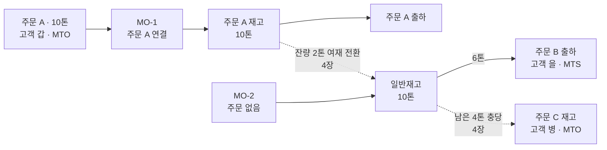
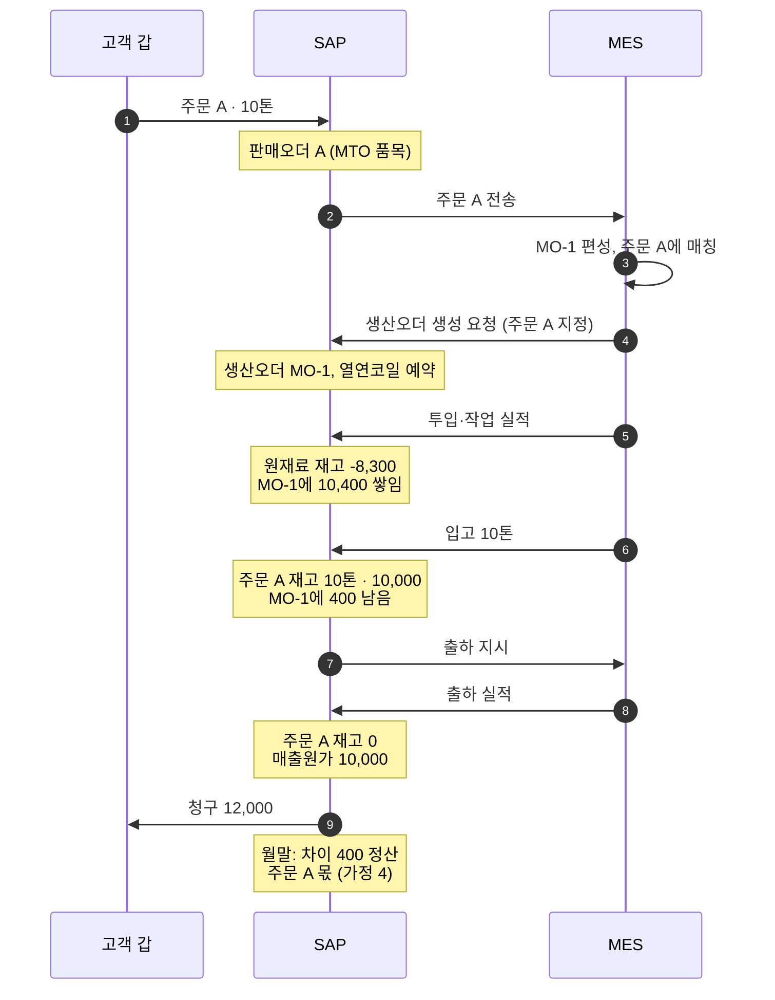
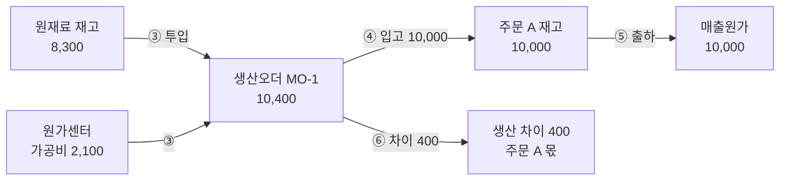
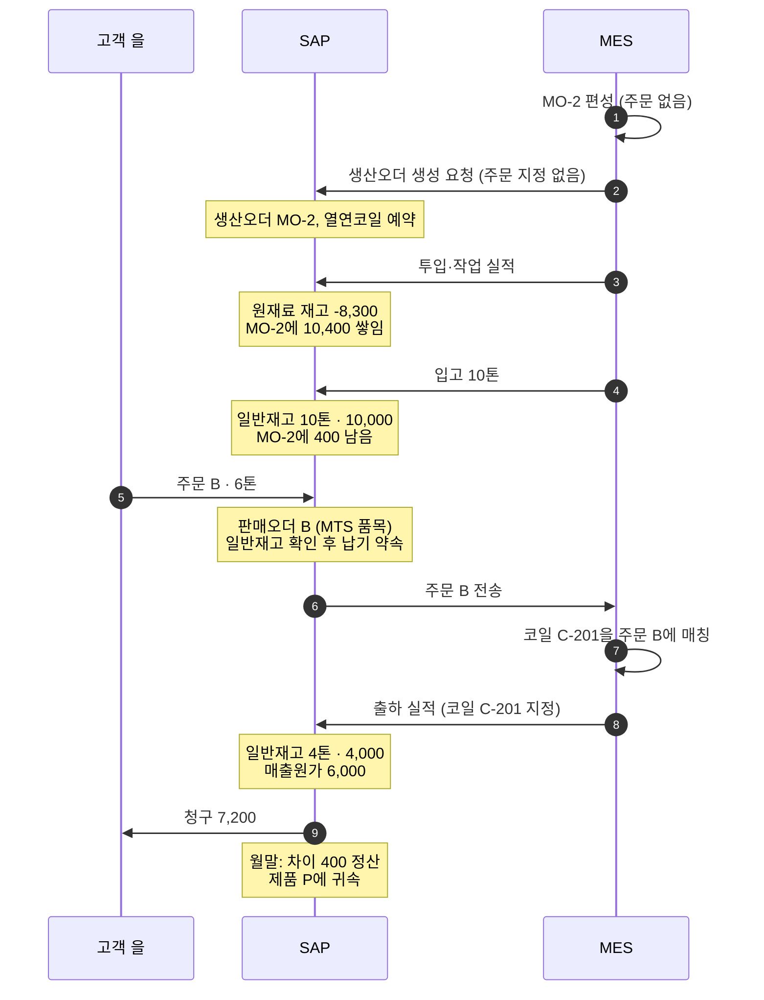
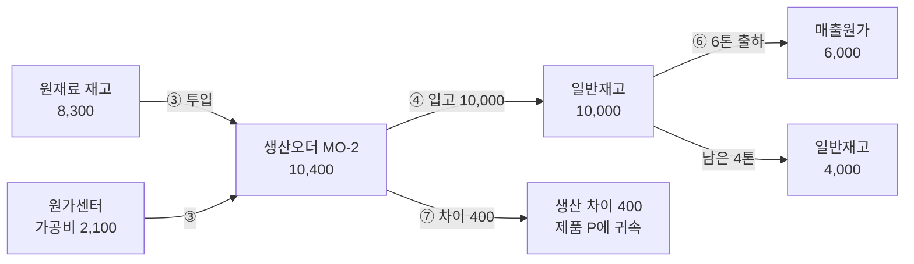

# 상세 5. MTO·MTS 프로세스 시뮬레이션

> 코일 10톤이 주문에서 출하까지 가는 과정을 MTO와 MTS 각각 단계별로 따라가 본다.
> 단계마다 **누가 무엇을 하는지, SAP에 무엇이 생기는지, 재고와 금액이 어디에 있는지, 분개가 어떻게 되는지**를 함께 본다.
> 2~5장의 내용을 슬라이드 장표로도 만들었다([장표 보기](slides/README.md)). 장표의 마지막 장은 본문 11장의 확인 사항을 추린 것이다. 숫자는 [상세 2](mto-mts-02-costing-examples.md)의 예시와 같다.

---

## 1. 시뮬레이션의 전제

### 1.1 숫자 (금액 단위: 천원)

| 항목 | 값 |
|---|---|
| 제품 | 냉연코일 자재 P |
| 표준단가 | 톤당 1,000 = 열연코일 800 + 가공비 200 |
| 생산량 | MO 1건에 10톤 |
| 실제 원가 | 10,400 = 열연코일 8,300 + 가공비 2,100 |
| 생산 차이 | 400 (표준 10,000보다 더 든 금액) |
| 판매단가 | 톤당 1,200 |
| 주문재고의 단가 | 자재 표준단가와 같다(본문이 권고하는 단가 통일 방식). 주문별 단가 방식이면 ④의 재고 금액, ⑥의 차이, 4장의 전환 금액이 달라진다(상세 2 예시 가·다·라) |

### 1.2 등장하는 주문과 MO

| 이름 | 내용 | 방식 |
|---|---|---|
| 주문 A | 고객 갑, 10톤 | MTO 품목 |
| MO-1 | 주문 A에 연결된 생산 LOT. 코일 C-101(8톤), C-102(2톤) | – |
| MO-2 | 주문 없는 생산 LOT. 코일 C-201(6톤), C-202(4톤) | – |
| 주문 B | 고객 을, 6톤 | MTS 품목 |
| 주문 C | 고객 병, 10톤. 4장에서 등장 | MTO 품목 |

### 1.3 재고의 두 종류

| 재고 | 뜻 | 누가 쓸 수 있나 |
|---|---|---|
| **주문재고** | 특정 주문에 귀속된 재고 | 그 주문만 |
| **일반재고** | 어느 주문에도 묶이지 않은 재고 | 모든 주문 |

### 1.4 가정

시뮬레이션은 아래를 전제로 한다. 아직 확인하지 않은 내용도 들어 있으므로 결과를 읽을 때 함께 본다.

| # | 가정 | 상태 |
|---|---|---|
| 1 | 주문재고는 자재 표준단가로 평가한다 (단가 통일 방식) | 본문 7.2절의 권고안 |
| 2 | MO 1건 = SAP 생산오더 1건 | 본문 5장의 권고안. 지금 MES가 생산오더를 어떻게 만드는지는 확인 필요 |
| 3 | 열연코일은 열연코일 계획 수량을 근거로 발주한다 | To-Be 설계. 더미 주문이 지금 발주 근거인지는 확인 필요 (본문 11장 5번) |
| 4 | MTO 생산오더의 차이는 주문·고객 몫으로 볼 수 있다 | SAP 도움말은 생산오더가 가리키는 판매오더 품목에서 고객·제품을 끌어온다고 적는다. 정산 전표의 실제 결과는 프로토타입에서 확인 ([상세 2](mto-mts-02-costing-examples.md) 11장 8번) |
| 5 | 한 달 안에 생산과 출하가 끝난다. 실제원가는 쓰지 않는다 | 계산을 단순하게 하기 위한 가정 |

### 1.5 전체 줄거리

---

## 2. MTO 시뮬레이션: 주문을 받고 만든다

### 2.1 전체 흐름

### 2.2 단계별 상태

#### ① 수주: 주문이 생산의 출발점

| | |
|---|---|
| **하는 일** | 영업이 고객 갑의 주문 A(자재 P, 10톤)를 **MTO 품목**으로 등록한다. 신규 규격이면 이때 자재코드, BOM, 공정이 자동 생성된다. To-Be에서는 생산버전과 표준원가도 이때 만들어져야 한다 |
| **SAP에 생기는 것** | 판매오더 A. MES로 전송된다 |
| **재고와 금액** | 변화 없음. 열연코일 8,300어치가 원재료 재고에 있다 |
| **분개** | 없음 |

#### ② MO 생성: 주문에 연결된 생산 지시

| | |
|---|---|
| **하는 일** | 생산관리가 MES에서 MO-1(10톤)을 편성하고 주문 A에 매칭한다. MES가 SAP에 생산오더 생성을 요청하면서 **주문 A를 지정**한다 |
| **SAP에 생기는 것** | 생산오더 MO-1 (판매오더 A 지정), 열연코일 투입 예약 |
| **재고와 금액** | 변화 없음 |
| **분개** | 없음 |
| **눈여겨볼 점** | 생산오더에 주문이 지정되어 있다. 그래서 나중에 입고되는 재고가 자동으로 주문 A의 것이 된다 |

#### ③ 생산: 투입한 만큼 원가가 쌓인다

| | |
|---|---|
| **하는 일** | MES가 열연코일 투입과 공정 실적을 SAP로 보낸다 |
| **SAP에 생기는 것** | 자재문서(투입), 작업 확정 |
| **재고와 금액** | 원재료 재고 8,300 → 0. 생산오더 MO-1에 10,400이 쌓인다 (열연코일 8,300 + 가공비 2,100) |
| **분개** | 원재료비 → MO-1 8,300 / 원재료 재고 8,300 가공비 → MO-1 2,100 / 가공비 ← 원가센터 2,100 |

#### ④ 입고: 주문 전용 재고가 된다

| | |
|---|---|
| **하는 일** | MES가 완제품 입고 실적을 보낸다. 코일 C-101(8톤), C-102(2톤) |
| **SAP에 생기는 것** | 자재문서(입고). 재고 종류는 자동으로 **주문 A의 주문재고** |
| **재고와 금액** | 주문 A 재고 10톤 · 10,000 (표준단가). MO-1에 400이 남는다 |
| **분개** | 제품 재고 (주문 A) 10,000 / 생산 산출 ← MO-1 10,000 |
| **눈여겨볼 점** | 이 재고는 주문 A로만 출하할 수 있다. 다른 주문에는 가용 재고로 보이지 않는다 |

#### ⑤ 출하·청구: 주문재고에서 나간다

| | |
|---|---|
| **하는 일** | SAP가 납품(출하 지시)을 만들고 MES가 상차 실적을 보낸다. SAP가 청구한다 |
| **SAP에 생기는 것** | 납품, 자재문서(출고), 청구문서 |
| **재고와 금액** | 주문 A 재고 10,000 → 0. 매출원가 10,000. 매출 12,000 |
| **분개** | 매출원가 10,000 / 제품 재고 (주문 A) 10,000 매출채권 12,000 / 매출 12,000 |
| **눈여겨볼 점** | 내보낼 코일은 주문 A 재고 안에서만 고른다. 코일을 배치로 관리하면 MTO도 납품에 코일을 지정해야 출고된다 |

#### ⑥ 월말: 차이 400을 주문 A 몫으로 정산한다

| | |
|---|---|
| **하는 일** | 원가 담당이 생산오더의 차이를 계산하고 정산한다 |
| **SAP에 생기는 것** | 정산 전표 |
| **재고와 금액** | MO-1에 남은 400 → 0. 생산 차이 400 |
| **분개** | 생산 차이 400 / 생산 산출 ← MO-1 400 |
| **눈여겨볼 점** | MO-1에 주문 A가 지정되어 있으므로 차이 400을 주문 A와 고객 갑의 수익성에 붙일 수 있다. 실제로 고객까지 내려가는지는 프로토타입에서 확인한다 (가정 4) |

### 2.3 금액의 위치 추적

이 10톤의 가치가 단계마다 어디에 있는지 보여 준다. 굵은 숫자가 그 단계에서 바뀐 곳이다.

| 단계 | 원재료 재고 | 생산오더 MO-1 | 제품 재고 (주문 A) | 매출원가 | 생산 차이 |
|---|---:|---:|---:|---:|---:|
| ① 수주 | 8,300 | 0 | 0 | 0 | 0 |
| ② MO 생성 | 8,300 | 0 | 0 | 0 | 0 |
| ③ 생산 | **0** | **10,400** | 0 | 0 | 0 |
| ④ 입고 | 0 | **400** | **10,000** | 0 | 0 |
| ⑤ 출하·청구 | 0 | 400 | **0** | **10,000** | 0 |
| ⑥ 월말 | 0 | **0** | 0 | 10,000 | **400** |

③에서 합계가 8,300에서 10,400으로 늘어나는 것은 원가센터에서 가공비 2,100이 들어오기 때문이다. 생산오더에 쌓인 금액은 회계 장부에서는 이미 손익에 들어 있다. ⑥의 정산은 남은 400에 "생산 차이"라는 이름을 붙이는 절차다.

### 2.4 결과

| 항목 | 금액 |
|---|---:|
| 매출 | 12,000 |
| 매출원가 (표준) | 10,000 |
| 생산 차이 (주문 A 몫, 가정 4) | 400 |
| **주문 A의 실제 원가** | **10,400** |
| **주문 A의 이익** | **1,600** |

주문 A의 실제 원가 10,400은 MO-1의 원가 조회로 확인할 수 있다. 이 숫자는 실제 투입량과 실제 작업 시간에 장부 단가와 계획 활동 단가를 곱한 값이다. 열연코일 구매가격 차이와 원가센터의 실제 비용 차이는 들어 있지 않다([상세 2](mto-mts-02-costing-examples.md) 5장). 수익성 보고서에 주문·고객별로 자동 집계되는지는 검증 대상이다.

---

## 3. MTS 시뮬레이션: 만들어 두고 판다

### 3.1 전체 흐름

### 3.2 단계별 상태

#### ① 계획: 주문 없이 생산을 결정한다

| | |
|---|---|
| **하는 일** | 생산관리가 표준 규격 P의 재고 보충 10톤을 결정한다. 주문은 없다. 열연코일은 발주 리드타임 전에 등록해 둔 열연코일 계획 수량을 근거로 이미 발주·입고되어 있다 |
| **SAP에 생기는 것** | 없음. **더미 주문은 만들지 않는다.** 이 예에서는 자재 P에 완제품 계획 수량도 넣지 않는다. 넣는다면 4장의 주문 C까지 P의 주문은 모두 MTS 품목으로 받아야 한다([상세 1](mto-mts-01-scenarios.md) 3.1절) |
| **재고와 금액** | 변화 없음. 열연코일 8,300어치가 원재료 재고에 있다 |
| **분개** | 없음 |

#### ② MO 생성: 주문이 없는 생산 지시

| | |
|---|---|
| **하는 일** | 생산관리가 MES에서 MO-2(10톤)를 편성한다. MES가 SAP에 생산오더 생성을 요청한다. **주문 지정이 없다** |
| **SAP에 생기는 것** | 생산오더 MO-2 (판매오더 지정 없음), 열연코일 투입 예약 |
| **재고와 금액** | 변화 없음 |
| **분개** | 없음 |
| **눈여겨볼 점** | MTO와 다른 점은 "주문 지정이 없다"는 한 가지다 |

#### ③ 생산: 원가가 쌓이는 방식은 같다

| | |
|---|---|
| **하는 일** | MES가 열연코일 투입과 공정 실적을 SAP로 보낸다 |
| **SAP에 생기는 것** | 자재문서(투입), 작업 확정 |
| **재고와 금액** | 원재료 재고 8,300 → 0. 생산오더 MO-2에 10,400이 쌓인다 |
| **분개** | 원재료비 → MO-2 8,300 / 원재료 재고 8,300 가공비 → MO-2 2,100 / 가공비 ← 원가센터 2,100 |
| **눈여겨볼 점** | MTO의 ③과 완전히 같다 |

#### ④ 입고: 누구나 쓸 수 있는 재고가 된다

| | |
|---|---|
| **하는 일** | MES가 완제품 입고 실적을 보낸다. 코일 C-201(6톤), C-202(4톤) |
| **SAP에 생기는 것** | 자재문서(입고). 재고 종류는 **일반재고** |
| **재고와 금액** | 일반재고 10톤 · 10,000 (표준단가). MO-2에 400이 남는다 |
| **분개** | 제품 재고 (일반) 10,000 / 생산 산출 ← MO-2 10,000 |
| **눈여겨볼 점** | 모든 주문에 가용 재고로 보인다. 자재 P에 표준단가가 없으면 이 입고가 잘못된 금액으로 잡힌다 |

#### ⑤ 수주: 재고를 확인하고 약속한다

| | |
|---|---|
| **하는 일** | 영업이 고객 을의 주문 B(6톤)를 **MTS 품목**으로 등록한다. SAP가 일반재고 10톤을 확인하고 납기를 약속한다(기본안. MES 예약분 반영은 본문 D15) |
| **SAP에 생기는 것** | 판매오더 B. MES로 전송된다 |
| **재고와 금액** | 변화 없음. 수량을 약속했을 뿐 재고는 여전히 일반재고다 |
| **분개** | 없음 |
| **눈여겨볼 점** | 주문이 생산보다 늦게 들어온다. MTO와 순서가 반대다 |

#### ⑥ 매칭·출하·청구: 코일을 골라서 내보낸다

| | |
|---|---|
| **하는 일** | MES가 코일 C-201(6톤)을 주문 B에 매칭한다. 그 코일을 지정해 출하하고 SAP가 청구한다 |
| **SAP에 생기는 것** | 납품(코일 C-201 지정), 자재문서(출고), 청구문서. **매칭 자체는 SAP에 아무 전기도 만들지 않는다** |
| **재고와 금액** | 일반재고 10,000 → 4,000 (코일 C-202, 4톤). 매출원가 6,000. 매출 7,200 |
| **분개** | 매출원가 6,000 / 제품 재고 (일반) 6,000 매출채권 7,200 / 매출 7,200 |
| **눈여겨볼 점** | MTO도 납품에 코일을 지정하지만 고를 범위가 그 주문의 재고 안이다. MTS는 일반재고 전체에서 고른다. MES의 매칭 결과가 납품에 들어간다 |

#### ⑦ 월말: 차이 400은 제품에 귀속된다

| | |
|---|---|
| **하는 일** | 원가 담당이 생산오더의 차이를 계산하고 정산한다 |
| **SAP에 생기는 것** | 정산 전표 |
| **재고와 금액** | MO-2에 남은 400 → 0. 생산 차이 400. 일반재고 4톤 · 4,000은 그대로 남는다 |
| **분개** | 생산 차이 400 / 생산 산출 ← MO-2 400 |
| **눈여겨볼 점** | MO-2에는 주문이 없다. 차이 400은 제품 P에만 붙고 고객 을에는 붙지 않는다 |

### 3.3 금액의 위치 추적

| 단계 | 원재료 재고 | 생산오더 MO-2 | 제품 재고 (일반) | 매출원가 | 생산 차이 |
|---|---:|---:|---:|---:|---:|
| ① 계획 | 8,300 | 0 | 0 | 0 | 0 |
| ② MO 생성 | 8,300 | 0 | 0 | 0 | 0 |
| ③ 생산 | **0** | **10,400** | 0 | 0 | 0 |
| ④ 입고 | 0 | **400** | **10,000** | 0 | 0 |
| ⑤ 수주 | 0 | 400 | 10,000 | 0 | 0 |
| ⑥ 매칭·출하·청구 | 0 | 400 | **4,000** | **6,000** | 0 |
| ⑦ 월말 | 0 | **0** | 4,000 | 6,000 | **400** |

### 3.4 결과

| 항목 | 금액 |
|---|---:|
| 매출 (6톤) | 7,200 |
| 매출원가 (표준) | 6,000 |
| **고객 을의 이익 (표준 기준)** | **1,200** |
| 생산 차이 (제품 P에 귀속, 고객 없음) | 400 |
| 남은 일반재고 | 4톤 · 4,000 |

---

## 4. 두 흐름이 만나는 지점

병행 운영에서 가장 까다로운 곳이다. 재고가 일반재고와 주문재고 사이를 오간다.

### 4.1 남은 일반재고 4톤을 MTO 주문에 충당

**상황** 고객 병의 주문 C(10톤, MTO)는 MO-3으로 6톤이 주문 C 재고로 입고되어 있다. 모자란 4톤을 3장에서 남은 일반재고(코일 C-202)로 채운다.

| | |
|---|---|
| **하는 일** | 생산관리가 MES에서 코일 C-202를 주문 C에 매칭한다. MES가 SAP에 재고전환 전기를 자동으로 보낸다 |
| **SAP에 생기는 것** | 자재문서(재고전환: 일반재고 → 주문 C 재고) |
| **재고와 금액** | 일반재고 4,000 → 0. 주문 C 재고 6,000 → 10,000 |
| **분개** | 제품 재고 (주문 C) 4,000 / 제품 재고 (일반) 4,000 |

| 주문재고 단가 방식 | 전환 금액 | 차액 |
|---|---|---|
| **단가 통일** (주문 C 재고 단가 = 1,000) | 4,000이 나가서 4,000으로 들어간다 | **0** |
| 주문별 단가 (주문 C 재고 단가 = 1,030) | 4,000이 나가서 4,120으로 들어간다 | 120 (재고 이전 손익) |

- 매칭 변경이 매일 일어나는 환경에서는 주문별 단가 방식의 차액이 매일 쌓인다. 단가 통일을 권하는 이유다.
- **더 단순한 길**: 주문 C를 6톤(MTO 품목)과 4톤(MTS 품목) 두 줄로 나누면 재고전환 없이 일반재고에서 바로 출하할 수 있다.

### 4.2 주문 잔량 2톤을 여재로 전환

**상황** 2장과 다른 경우를 가정한다. 2장에서는 주문 A 10톤을 모두 출하했다. 여기서는 고객 갑이 8톤(코일 C-101)만 인수한다고 하자. 코일 C-102(2톤)가 남는다.

| | |
|---|---|
| **하는 일** | MES 또는 생산관리가 C-102를 여재로 판정한다. 영업이 주문 A의 잔량을 마감한다. MES가 SAP에 재고전환 전기를 자동으로 보낸다 |
| **SAP에 생기는 것** | 판매오더 A 변경(잔량 마감), 자재문서(재고전환: 주문 A 재고 → 일반재고) |
| **재고와 금액** | 주문 A 재고 2,000 → 0. 일반재고 +2,000 |
| **분개** | 제품 재고 (일반) 2,000 / 제품 재고 (주문 A) 2,000 |

- 전환한 2톤은 일반재고가 되어 어느 주문에든 MTS 품목으로 다시 팔 수 있다.
- **지금 방식**에서는 이 2톤이 주문 A의 재고(2,000)로 남는다. 팔 곳이 정해진 재고처럼 보여 다른 주문의 가용 재고에 잡히지 않는다.
- 금액은 단가 통일 기준이다. 주문별 단가 방식(1,030)이었다면 2,060이 나가 2,000으로 들어오고 손실 60이 잡힌다.
- 생산 차이 400은 전부 주문 A에 남는다. 여재 2톤 몫(80)까지 주문 A가 부담하는 것이 맞는지는 원가 담당과 정해야 한다.
- 주문을 마감하지 않고 재고만 빼면 SAP가 주문 A의 잔량을 다시 생산하라고 제안할 수 있다.

---

## 5. MTO와 MTS, 단계별 차이

| 관점 | MTO | MTS |
|---|---|---|
| 생산의 출발점 | 고객 주문 | 판매계획, 재고 보충 결정 |
| 주문이 들어오는 때 | 생산 전 | 생산 후 (또는 생산 중) |
| MO | 주문에 연결 | 주문 없음 |
| SAP 생산오더 | 판매오더 지정 | 판매오더 지정 없음 |
| 생산 중의 분개 | 같다 | 같다 |
| 입고되는 재고 | 주문재고 (그 주문 전용) | 일반재고 (누구나 사용) |
| 납기 약속의 근거 | 생산 일정 | 재고와 입고 예정 |
| 출하할 코일 | 그 주문의 재고 안에서 지정 | 일반재고에서 매칭해서 지정 |
| 생산 차이가 붙는 곳 | 주문과 고객 (가정 4) | 제품 |
| 주문의 원가 | 표준 매출원가 + 그 MO의 차이 | 표준 매출원가 |
| 더미 주문 | 필요 없음 | 필요 없음 |

**같은 것**: 생산오더에 원가가 쌓이는 방식, 입고·출하·청구의 분개 구조, 금액.
**다른 것**: 주문 품목의 품목범주, 주문이 언제 등장하는가, 재고가 누구의 것인가, 차이에 고객이 붙는가.

---

## 6. 시뮬레이션이 보여 주는 설계 포인트

| # | 포인트 | 근거가 되는 단계 |
|---|---|---|
| 1 | 주문 품목의 MTO/MTS는 **수주 때 품목범주로** 정한다. 생산 쪽에서는 그 구분이 **생산오더에 주문을 지정하느냐**로 나타난다 | MTO ①②, MTS ② |
| 2 | 그 결과가 **입고 재고의 종류**로 나타난다 | MTO ④, MTS ④ |
| 3 | MTS는 주문 없이 입고되므로 **자재에 표준단가가 반드시 있어야 한다** | MTS ④ |
| 4 | **출하할 코일은 MES가 정해 납품에 넣는다.** MTS는 고를 범위가 일반재고 전체라 매칭이 핵심이다 | MTO ⑤, MTS ⑥ |
| 5 | MTS 품목으로 받은 주문은 **매칭이 바뀌어도 SAP 전기가 없다** | MTS ⑥ |
| 6 | 재고가 일반과 주문 사이를 오갈 때 **단가가 같아야 손익이 흔들리지 않는다** | 4.1 |
| 7 | 여재는 **주문 마감 → 일반재고 전환**의 순서로 처리한다 | 4.2 |
| 8 | MTS의 생산 차이는 고객에 붙지 않는다. **고객별 수익성에 넣을지 정해야 한다** | MTS ⑦ |
