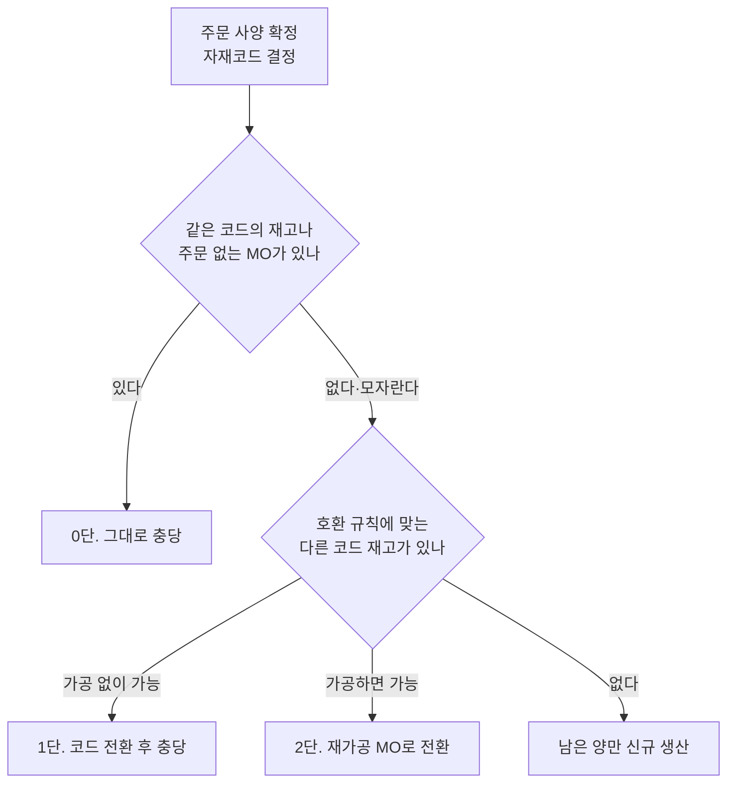

# 상세 6. 철강 업계 관행과 세분화 자재코드에서 걸리는 것

> [본문](mto-mts-hybrid-analysis.md) 3.1절(충당원)과 6장(자재코드), [상세 1](mto-mts-01-scenarios.md)의 유형 A~E를 두 가지 관점에서 보완한다.
> "철강에서는 주문과 재고를 실제로 어떻게 연결하는가", 그리고 "자재코드가 규격별로 세분화된 회사에서 MTS를 하면 무엇이 걸리는가"다.

**근거 표기**

| 표기 | 뜻 |
|---|---|
| **[확인]** | 공개 자료로 확인한 내용. SAP 관련은 SAP 도움말 원문(S/4HANA 2025)을 직접 읽었고, 논문과 철강 공정 자료는 검색 결과의 서지와 요약으로 확인했다 |
| **[검증 필요]** | 철강 공정과 SAP 표준에 대한 지식에 근거한 설명. 이 회사의 설비·시스템에서 확인해야 한다 |

표기가 없는 문장은 이 회사의 확인된 사실(본문 0.1절)에서 이끌어 낸 설계 의견이다. "여재"는 이 회사의 용어로 썼다. 국내 철강사의 주문–재고 연결 방식을 설명한 공개 자료는 찾지 못했다.

---

## 1. 한 장 요약

| 질문 | 답 |
|---|---|
| 철강에서 주문과 재고는 어떻게 연결하나 | 코일마다 "어느 주문 것인가(없으면 여재)"를 붙여 두고 수시로 바꾼다. 새 주문이 오면 **있는 재고와 재공을 먼저 충당하고 남는 양만 새로 만든다** [확인]. 철강 계획 시스템과 연구 문헌이 같은 순서를 쓴다 (11장) |
| 이 회사에서 가장 걸리는 지점은 | 자재코드가 규격별이라 "규격이 조금 다른 재고"는 곧 **다른 자재코드**다. 충당할 때마다 코드 전환이 따라온다 |
| 코드가 다른 재고를 충당해도 되나 | 전부 막으면 여재가 쌓이고, 전부 허용하면 손익과 이력이 흐려진다. **가공 유무와 단가 차이로 나눈 계단식 규칙**이 필요하다 (4장) |
| 어느 코드로 미리 만드나 | 전체 코드가 아니라 **재고 판매용 규격 목록**에 오른 소수 코드만. 나머지는 풀하드나 광폭 모재처럼 여러 주문이 함께 쓸 수 있는 지점에서 준비한다 (5, 6장) |
| 내시 물량의 고객 표시는 | MES 표시가 원본이다. SAP에는 회계 전기가 생기지 않는 코일 속성(배치 특성)으로 비추는 방안을 먼저 검토한다 (8장) |
| MTS를 시작하면 재고 지표는 | 주문에 묶여 숨어 있던 여재가 드러나 **처음에는 나빠져 보인다.** 가동 전에 기준선과 재고 구분을 정해야 한다 (9장) |

---

## 2. 재고에 "주인 표시"를 붙인다

철강은 같은 규격이라도 코일마다 상태가 다르므로 코일 단위로 주인을 관리한다. To-Be에서는 아래 구분이 필요하다.

| 재고 구분 | 뜻 | SAP에서의 모습 | MES가 가져야 할 표시 |
|---|---|---|---|
| 주문재 | 확정 주문의 것 | 주문재고 | 주문 품목 |
| 표준 재고 | 재고 판매용 규격을 계획해서 만든 것 | 일반재고 | 재고 구분 |
| 내시 예약 재고 | 고객 확정 전에 미리 만든 것 | 일반재고 (+ 예정 고객 표시) | 예정 고객, 예약 만료일 |
| 여재 | 계획하지 않았는데 남은 정품 | 일반재고 | 발생 사유, 발생일, 원래 주문 |
| 선행 반제품 | 풀하드, 소둔재 | 반제품 코드의 일반재고 | 투입할 수 있는 완제품 범위 |
| 2급·격외 | 정품 기준에 못 미치는 것 | 2급용 코드 또는 평가유형 | 등급, 결함 사유 |
| 보류 | 판정 대기 | 품질검사 재고, 보류 재고 | 보류 사유 |

- **SAP 일반재고 안에서는 표준 재고, 내시 예약, 여재가 구별되지 않는다.** 구별하려면 코일(배치) 속성에 "재고 구분"과 "발생 사유"를 넣거나, MES 보고서로만 본다. 둘 중 하나를 정해야 한다.
- 여재의 발생 사유(초과 생산, 주문 취소·감량, 품질 전환, 내시 미확정, LOT 채움, 반품)를 기록하지 않으면 9장의 지표를 만들 수 없다.

---

## 3. 충당의 순서

본문 3.1절의 충당원 ①~⑤를 "자재코드가 같은가, 가공이 필요한가"로 다시 줄 세우면 아래와 같다. **이 그림은 충당할 재고를 찾는 순서만 보여 준다.** 주문 품목을 MTO로 받을지 MTS로 받을지는 [상세 1](mto-mts-01-scenarios.md) 3.1절의 순서도가 정하고, 그 순서도는 완제품 계획 수량으로 운영하는 자재인지를 재고보다 먼저 확인한다.

예를 들어 완제품 계획 수량으로 운영하는 자재는 재고가 모자라도 품목을 나누지 않고 전량 MTS 품목으로 받는다. 이 그림의 "남은 양만 신규 생산"은 주문 없는 계획생산 MO가 채운다. 그 밖의 자재에서는 남은 양이 MTO 품목이 된다.

**호환 방향** 충당은 한 방향으로만 된다. MES의 충당 기준 마스터에 들어가야 할 규칙이다. 아래 표는 공정 일반 지식으로 적은 것이고 공개 자료로 확인하지는 못했다. 품질 부서가 강종·용도별로 확정한다 [검증 필요].

| 속성 | 가능 | 불가능 |
|---|---|---|
| 강종·품질 | 상위 등급 재고 → 하위 등급 주문 (품질을 얹어 주는 셈) | 하위 → 상위 |
| 폭 | 넓은 재고 → 좁은 주문 (슬리팅) | 좁은 → 넓은 |
| 단중 | 무거운 코일 → 가벼운 주문 (분할) | 가벼운 → 무거운 |
| 두께 | 주문 허용 공차 안 | 완제품 단계에서 두께 변경 |
| 도금량 | 많은 재고 → 적은 주문 | 적은 → 많은 |

**이 표를 그대로 충당 규칙으로 옮기면 안 된다.** 방향만 보여 주는 표다. 강도가 높은 강종이 성형성이나 용접성까지 좋은 것은 아니고, 도금량도 주문의 상한과 표면 조건을 넘으면 쓸 수 없다. 실제 규칙은 품질 부서가 강종·용도·고객 규격별로 승인한 호환표여야 하고, 물성과 치수의 최소·최대값, 검사증명서, 보관 기한을 조건으로 둔다.

상위 등급을 하위 주문에 쓰면 실물은 맞지만 원가가 더 든 재고를 싸게 파는 것이다. 허용 여부와 승인자를 규칙에 넣는다.

---

## 4. 규격이 조금 다른 재고를 충당하는 네 가지 방법

| 방법 | SAP 처리 | 재고 | 원가 | 이력 |
|---|---|---|---|---|
| **(a) 자재 간 이전** | 이동유형 309로 재고 코드를 주문 코드로 바꾼다 [확인]. 두 자재의 기본 단위가 같아야 한다. 품질검사 중이거나 보류된 재고는 옮길 수 없다 [확인]. 주문재고 안에서의 이전도 표준 이동이다([상세 4](mto-mts-04-mes-requirements.md) 4장) | 재고 코드 감소, 주문 코드 증가 | 두 코드의 표준단가 차액이 **재고 이전 손익** [확인]. 이 손익에 주문이나 고객이 붙는지는 [검증 필요] ([상세 2](mto-mts-02-costing-examples.md) 8장) | 실제로 만든 규격이 코드에서 사라진다. 코일 번호를 그대로 둘 수 있는지는 배치 수준 설정에 달렸다 (아래) |
| **(b) 주문 품목의 자재를 재고 코드로** | 수주 때 재고 코드로 등록하거나 자재 대체 기능(자재결정)을 쓴다 [확인]. 납품 같은 후속 문서가 생긴 품목은 자재를 바꾸기 어려워, 거절하고 새 품목을 추가한다 [검증 필요] | 전기 없음. 일반재고에서 바로 출하 | 차액 없음. 매출과 원가가 재고 코드에 잡힌다 | 실물 기준으로 가장 정직하다. 대신 **고객 서류에 재고 규격이 찍힌다** |
| **(c) 재가공 MO** | 투입 = 재고 코일, 산출 = 주문 자재인 생산오더. 주문을 지정한다 | 재고 코드 소비, 주문 코드가 주문재고로 바로 입고 [확인] | 차액과 가공비가 그 오더의 **생산 차이**가 되어 주문에 붙는다 [검증 필요] | 투입 코일 → 산출 코일의 계보가 생산오더에 남는다. 전표가 가장 많다 |
| **(d) 같은 코드로만 제한** | 재고전환만 | 변화 없음 | 영향 없음 | 깨끗하다. 대신 **충당률이 떨어지고 여재가 쌓인다** |

**권고: 계단식 규칙** (본문 D17의 구체안)

| 단계 | 조건 | 처리 | 승인 |
|---|---|---|---|
| 0단 | 코드가 같다 | MTS 품목 또는 재고전환 | 자동 |
| 1단 | 코드는 다르지만 실물은 그대로 쓴다 | (a) 자재 간 이전. 품질 부서가 승인한 대체 가운데 **표준단가가 같은 "호환 그룹" 안에서만** 자동으로 한다. 그러면 차액이 0이다 | 그룹 밖은 담당자 승인. 차액을 화면에 보여 준다 |
| 2단 | 슬리팅, 분할, 재조질 같은 가공이 따른다 | (c) 재가공 MO | 생산관리 |
| 3단 | 정품으로 쓸 수 없다 | 2급 코드로 전환하고 손실을 인식한다 (7장) | 품질 판정 |

- **표준단가가 같다는 것은 회계 차액이 없다는 뜻이지 품질이 호환된다는 증거가 아니다.** 호환 그룹은 품질 승인이 먼저고 단가 조건은 그다음이다. 주문별 단가 방식으로 평가된 옛 주문재고는 자재 표준단가와 장부 단가가 다를 수 있어, 그룹 안에서도 차액이 생길 수 있다.
- **1단이 잦다면 그것은 코드 체계가 보내는 신호다.** 실물도 원가도 같은데 코드만 다르게 만드는 속성(포장, 고객 규격 번호, 단중 구분 등)이 있다는 뜻이다. 그 속성을 코드에서 빼는 것이 근본 처방이다(본문 D9, [상세 3](mto-mts-03-sap-config-conversion.md) 12.2절 3번).
- (b)는 고객이 주문 규격으로 서류를 받아야 하는 거래에서는 쓰기 어렵다. 유통향 재고 판매처럼 **고객이 재고 목록을 보고 사는 경우**에 맞다.
- 어느 방법이든 **코일 번호는 코드가 바뀌어도 그대로**여야 검사증명서와 품질 이력이 이어진다.
- (a)에서 번호를 유지할 수 있는지는 SAP의 **배치 수준** 설정에 달렸다. 배치 수준은 배치 번호를 어느 범위에서 하나뿐인 값으로 관리하느냐를 정한다 [확인].
  - 자재 단위: 같은 번호를 받는 자재에 다시 쓸 수 있다.
  - 시스템 전체 단위: 같은 번호를 다른 자재에 줄 수 없다. 코일 번호가 바뀐다.
- 현재 설정이 무엇인지부터 확인한다. 실측값 같은 배치 속성이 새 배치로 넘어가는지는 프로토타입에서 확인한다([상세 4](mto-mts-04-mes-requirements.md) 10장 15번).
- 슬리팅처럼 중량이 변하고 스크랩이 나오는 경우는 (c)만 실물과 맞는다.

---

## 5. 어디까지 미리 만들 것인가 (냉연)

본문 3.2절의 그림을 지점별로 풀었다. 설비 구성에 따라 달라지므로 생산기술 부서가 확인한다 [검증 필요].

| 지점 | 이미 정해진 것 | 아직 열려 있는 것 | 재고 위험 | 맞는 경우 |
|---|---|---|---|---|
| 열연코일 | 강종, 열연 두께·폭 | 냉연 두께 이후 전부 | 가장 낮다 | 소재 확보만으로 납기가 맞을 때 |
| 풀하드 (냉간압연 직후) | 강종, **두께**, 폭 | 소둔·조질, 표면, 도금, 도유, 슬리팅 폭, 단중, 포장 | 낮다. 보관 조건과 기한은 품질 부서가 정한다 | 두께·폭이 반복되고 뒤 공정이 갈릴 때 |
| 소둔·조질 완료 | 재질, 표면 조도 | 도유, 슬리팅 폭, 단중, 포장. 전기도금 제품이면 도금도 | 중간. 시효와 녹 | 같은 재질을 폭·단중만 달리 팔 때 |
| 광폭 모재 (정정 전) | 폭·단중 외 전부 | 슬리팅 폭, 단중, 포장 | 중간 | 협폭 주문이 많을 때. 주문을 받고 슬리팅한다 |
| 완제품 | 전부 | 없음 | 가장 높다 | 재고 판매용 규격 |

**판단 기준**

1. 그 지점의 품목 하나를 **몇 개 주문·고객이 함께 쓰는가.** 많을수록 안 팔릴 위험이 줄어든다.
2. 그 지점에서 출하까지 남은 시간이 **고객이 기다려 주는 시간보다 짧은가.**
3. **병목 공정의 뒤**인가. 병목을 계획 물량으로 채워 돌릴 수 있다.
4. **보관해도 되는 상태**인가. 도유하지 않은 구간은 보관 중 녹이 슬기 쉬워, 방청 포장이나 짧은 보관 기한 같은 대책 없이는 재고 지점으로 삼기 어렵다. 도유한 강판도 방청 기간에 한도가 있다 [확인].

도금 제품이 있으면 지점이 달라진다. 용융도금 라인은 라인 안에서 소둔하므로 풀하드를 그대로 소재로 받는다 [확인]. 전기도금 라인에는 소둔로가 없어 소둔을 마친 냉연강판이 소재다 [확인]. 조질압연을 도금 앞에 두는지 뒤에 두는지는 설비에 따라 다르다.

**이 회사에서 따라오는 일**

- 수주 때 자동 생성되는 BOM이 "열연코일 → 완제품"이라면, 반제품에서 출발하는 BOM을 만들 수 있어야 하고 MO도 그 지점에서 둘로 나뉘어야 한다([상세 1](mto-mts-01-scenarios.md) 4.3절).
- 반제품 코드는 완제품처럼 세분화하지 않는다. **강종 그룹 × 두께 × 폭** 수준으로 굵게 잡아야 여러 주문이 함께 쓸 수 있다.
- 반제품 구간의 생산 차이는 주문 원가에 붙지 않는다([상세 2](mto-mts-02-costing-examples.md) 예시 마). 선행 범위를 넓힐수록 주문별 실제 원가로 보이는 범위가 좁아진다.

---

## 6. 세분화 코드에서 MTS를 할 때의 함정

| # | 함정 | 왜 생기나 | 대응 |
|---|---|---|---|
| 1 | 어느 코드로 만들지 정할 수 없다 | 주문 없는 MO도 코드 하나를 골라야 한다. 나중에 오는 주문의 코드와 다르면 4장의 전환이 따른다 | 재고용은 고객 전용 요소가 없는 **대표 규격 코드**로만 만든다 |
| 2 | 코드별 예측이 맞지 않는다 | 코드 대부분은 주문이 드문드문 온다 | 예측은 강종 그룹·두께대 묶음으로 한다. 열연코일 계획 수량에 반영한다 |
| 3 | 재고가 있는데 안 보인다 | SAP 납기 확인은 주문에 입력한 자재의 재고와 입출고 예정을 본다. 대체 자재를 미리 등록해 두면 그 자재의 가용성도 순서대로 확인하지만 [확인], 대체 관계를 자재별로 등록해야 한다 | 규격별 코드가 많으므로 호환 재고까지 본 납기는 MES가 답한다 (본문 D15) |
| 4 | 같은 실물에 코드가 여러 개 | 자동 생성 때 중복 판정이 느슨하면 생긴다 | 규격 키를 정규화해 중복 생성을 막는다 ([상세 3](mto-mts-03-sap-config-conversion.md) 12.2절 4번) |
| 5 | 표준단가 없는 코드로 입고 | 주문 없이 입고되면 단가를 줄 다른 근거가 없다 | 목록에 오르는 조건에 표준원가 확정을 넣는다 ([상세 3](mto-mts-03-sap-config-conversion.md) 12.3절) |
| 6 | LOT 채움 물량이 아무 코드로나 쌓인다 | 설비 효율이 우선이면 팔릴지 모르는 규격이 만들어진다 | 채움 생산은 목록에 있는 코드로만 허용한다 |

**재고 판매용 규격 목록의 운영** (상세 1 유형 A의 "정할 것")

| 항목 | 내용 |
|---|---|
| 올리는 기준 | 최근 12개월에 주문이 있었던 달 수, 고객 수, 물량, 물량이 들쭉날쭉한 정도, 다른 규격으로 전환할 수 있는지 |
| 내리는 기준 | 일정 기간 무실적, 장기 재고 발생 |
| 코드별로 정할 것 | 적정 재고(최소·최대), 최대 보관 기간, 담당자 |
| 검토 주기 | 분기 |
| SAP에 표시하는 방법 | 기본안은 수주 프로그램의 제안 규칙에 목록을 쓰는 것이다. 자재마스터 값으로 표시하는 선택안은 표 아래에 적었다 |

**선택안: 목록을 자재마스터 값으로 표시하기** 자재마스터 판매 뷰의 품목범주그룹은 주문 유형과 함께 품목범주의 기본값을 정한다 [확인]. 목록에 오른 코드에만 다른 그룹을 준다. 그 그룹의 기본값을 MTS 품목범주로 설정한다. 그러면 주문 등록 때 MTS가 기본으로 제안된다 [검증 필요]. 이 방법을 쓰면 [상세 3](mto-mts-03-sap-config-conversion.md) 2.2절의 "품목범주그룹은 공용 값 유지"가 바뀐다. 재고도 완제품 계획 수량도 없는 주문은 영업이 MTO로 고쳐 받아야 한다.

목록의 크기는 현재 실적으로 가늠할 수 있다. 최근 12개월의 코드별 주문 월수, 고객 수, 물량을 뽑으면 후보가 나온다.

---

## 7. 초과 생산, 2급품, 스크랩

| 대상 | 왜 생기나 | 처리 | 코드와 평가 |
|---|---|---|---|
| **초과 생산** | 소재 한 단위(열연코일)의 무게가 주문량과 맞지 않는다. 수율이 계획보다 좋았다 | 주문의 초과 납품 허용 범위까지는 그 주문으로 출하한다. 넘는 코일은 여재로 전환한다 | 같은 코드, 같은 표준단가. 차액 없음 |
| **작은 잔량 코일** | 분할하고 남은 자투리 | 최소 출하 단중 미만은 따로 표시해 관리한다 | 같은 코드. 오래 남기 쉽다 |
| **2급·격외** | 표면, 치수, 재질이 정품 기준에 못 미친다 | 품질 판정 → 2급 코드로 전환 → 묶음 판매 | **제품군 × 두께대 수준의 굵은 2급 코드.** 전환하는 시점에 손실이 잡힌다 |
| **스크랩** | 선·후단 절단, 사이드 트림, 미압연부, 시편 | MO별 중량을 MES가 보고 → 스크랩 재고로 입고 → 매각 | 스크랩 코드. BOM에 음수 수량 구성품(부산물)으로 넣고 이동유형 531로 입고한다 [확인]. 입고 금액만큼 MO 원가에서 빠지는지는 [검증 필요] |

- 허용 범위는 두 곳에 따로 있다.
  - 생산오더: 초과 입고 허용 범위가 있다. 생산오더 수량에 이 범위를 더한 양을 넘는 입고는 오류로 막힌다. 무제한 허용 지시자가 따로 있다 [확인].
  - 판매오더 품목: 미달 납품 허용 범위가 있다. 고객–자재 정보에 기본값을 둘 수 있다 [확인]. 초과 납품 허용 범위의 위치와 기본값은 프로토타입에서 확인한다 [검증 필요].
- **이 값들과 MES의 여재 판정 기준이 서로 맞아야 한다.** 어긋나면 출하할 수 있는 코일이 여재로 빠지거나, 여재여야 할 코일이 주문에 남는다.
- LOT 채움으로 주문량보다 크게 만드는 MO(상세 1의 D-가)는 생산오더 수량을 MO 수량으로 잡거나 무제한 허용을 써야 입고가 막히지 않는다.
- 2급 판정이 입고 전에 나면 "정품으로 입고한 뒤 전환"과 "2급 코드로 바로 입고" 중에서 고른다. 뒤쪽은 손실이 그 MO의 생산 차이로 남아 주문별 원가에 반영된다.
- 정품 단가로 남아 있는 2급·장기 재고는 결산 때 평가감 검토 대상이다. 재고는 원가와 순실현가능가치 중 낮은 금액으로 측정하기 때문이다(국제회계기준 IAS 2 문단 9) [확인]. 지금 기준이 있는지 확인이 필요하다([상세 2](mto-mts-02-costing-examples.md) 12장 9번).
- 2급을 별도 코드로 두지 않고 같은 자재 안에서 평가유형으로 나누는 방법(분할평가)도 있다 [확인]. 코드 수는 늘지 않지만 평가유형별 재고 관리가 따른다.
- 스크랩 회수 가치가 MO 원가에 반영되려면 자동 생성되는 BOM에 스크랩 항목이 있고 MES가 MO별 스크랩 중량을 보내야 한다. 둘 중 하나가 없으면 지금은 반영되지 않고 있을 수 있다.

---

## 8. 내시 선행 생산분에 고객을 표시하는 수단

[상세 1](mto-mts-01-scenarios.md) 5장이 "내시를 SAP에 어떻게 등록하나"의 비교라면, 여기는 "이미 만든 코일에 예정 고객을 어떻게 붙여 두나"의 비교다.

| 수단 | 묶는 강도 | SAP 전기 | 한계 |
|---|---|---|---|
| MES에만 예정 고객 표시 | 약함 (규칙으로 보호) | 없음 | SAP에서 보이지 않는다 |
| **코일(배치) 속성에 예정 고객** | 약함~중간. 출하할 코일을 찾는 기준(배치 결정)으로 쓸 수 있다 [확인] | **없음** (속성 변경) | 완제품의 배치 관리와 분류가 전제다. 코일을 직접 지정하면 막지 못한다 [검증 필요] |
| 전용 저장위치 | 중간 (고객 구분 없음) | 저장위치 이동 | 고객별로 나눌 수 없다 |
| 수량 보호 기능 (제품 할당, 공급 보호) | 중간. 코일이 아니라 자재·플랜트 단위의 수량을 고객 등 기준으로 지킨다 [확인] | 없음 | 고급 가용성 점검(aATP)의 기능이다. 별도 라이선스 대상이다([상세 3](mto-mts-03-sap-config-conversion.md) 9장 5번). 공급 보호는 S/4HANA 2020부터다 [확인]. MES 납기 약속과 겹친다 |
| 납품일정계약 | 수요 쪽에 고객이 보인다 | 없음 | 고객 × 규격이 안정적이어야 한다 |
| 내시 전용 주문 유형 (주문재고) | **강함** | 확정 때 주문 간 재고전환 | 지금의 더미 주문과 같은 구조다 |

**고르는 기준은 "고객에게 인수 책임이 있는가"다.**

- 인수 책임이 없다 → 일반재고로 두고 MES에 표시한다(필요하면 배치 속성도). 예약 만료일이 지나면 자동으로 풀어 다른 주문에 쓴다.
- 인수 책임이 있다 → 사실상 주문이므로 내시 전용 주문 유형으로 주문재고에 둘 근거가 있다.

---

## 9. MTS 재고가 늘 때의 위험과 지표

| 위험 | 내용 |
|---|---|
| 드러나는 여재 | 지금 주문에 묶여 있는 여재가 일반재고로 드러난다. 실물은 그대로인데 "주문 없는 재고" 수치가 늘어난다. **가동 전 기준선 측정이 필요하다** |
| 품질 열화 | 녹과 재질 시효. 조질압연한 저탄소 냉연강판은 보관 중 가공 때 줄무늬(스트레처 스트레인)가 생기는 성질이 되살아날 수 있다. 유럽 규격은 줄무늬가 없다는 보증 기간을 강종에 따라 3개월 또는 6개월로 둔다 [확인]. 기한을 넘긴 재고를 2급으로 내릴지 다시 판정할지는 회사가 강종별로 정한다 |
| 가격 위험 | 열연 가격이 내리면 표준단가로 잡힌 재고가 시가보다 비싸진다 |
| 꼬리 재고 | 좋은 코일부터 충당되고 자투리와 특이 규격이 남는다 |
| 이중 약속 | SAP 납기 확인과 MES 충당이 같은 재고를 따로 약속한다 (본문 D15) |
| 손익 잡음 | 코드 전환이 잦으면 재고 이전 손익이 쌓인다 |

| 지표 | 계산 | 보는 이유 |
|---|---|---|
| 여재율 | 여재 중량 ÷ 정품 재고 중량 | 주인 없는 재고의 크기 |
| 여재 발생률 (사유별) | 기간 여재 발생량 ÷ 생산량 | 원인을 잡는다 |
| 충당률 | 재고·재공으로 충당한 수주량 ÷ 전체 수주량 | 재고가 실제로 팔리고 있는가 |
| 이종 코드 충당 비율 | 1단·2단 충당량 ÷ 전체 충당량 | 코드 체계가 적절한가 |
| 장기 재고율 | 기준일 초과 재고 ÷ 전체 재고 (구간별) | 열화와 평가감 대상 |
| 내시 적중률 | 확정 주문량 ÷ 내시 선행 생산량 (고객별) | 선행 생산을 계속할지 |
| 표준 재고 즉납률 | 재고로 바로 응한 주문 ÷ 재고 판매 주문 | MTS의 효과 |
| 2급 전환율, 처분 손익 | 2급 전환량 ÷ 생산량, 판매가 − 장부가 | 재고의 실제 비용 |
| 재고 이전 손익 누계 | 월별 금액과 건수 | 코드 전환의 회계 영향 |

기준값은 업계 공통값이 없다. 현재 실적으로 기준선을 잡고 회사가 정한다. **기준선은 MTS를 켜기 전에 MES 기준으로 한 번 측정해 둔다.** 그러지 않으면 가동 뒤 늘어난 일반재고가 원래 있던 여재인지 새로 생긴 재고인지 가를 수 없다.

---

## 10. 확인할 질문

다른 상세 문서의 질문과 겹치지 않는 것만 적었다.

**자재코드**

1. 완제품 자재코드에 들어가는 속성 전체는 무엇인가? (강종, 두께, 폭, 표면, 조질, 도유, 단중 구분, 내경, 포장, 고객 규격 번호 등) 실물과 원가가 같은데 코드만 달라지게 만드는 속성이 있나?
2. 최근 12개월에 3번 이상 주문된 코드는 몇 개이고 물량 비중은 얼마인가?

**충당**

3. 매일 일어나는 매칭 변경 가운데 자재코드가 다른 재고·재공을 충당하는 건의 비율은? 그 가운데 가공 없이 그대로 쓰는 것과 슬리팅·분할 같은 가공이 따르는 것의 비율은?
4. "이 재고는 이 주문에 써도 된다"를 판정하는 기준(강종 호환표, 두께·폭 허용 범위)이 MES에 마스터로 있나, 담당자 판단인가? 고객 승인이 필요한 경우가 있나?
5. 재공 코일을 다른 규격의 주문으로 돌릴 때 MO의 목표 규격도 바꾸나? 그때 SAP 생산오더는 지금 어떻게 처리하나?

**초과 생산과 등급**

6. 여재가 생기는 원인별 비중은? (열연코일 단중이 주문량보다 큼, 수율 여유 투입, 주문 취소·감량, 품질 불합격, 내시 미확정, 반품)
7. 판매는 실중량 기준인가? 주문별 초과·미달 납품 허용 범위는 보통 몇 %이고 고객별로 다른가?
8. 2급·격외품은 지금 별도 자재코드인가, 정품 코드 그대로인가? 장부 단가는 정품과 같은가? 어떻게 파나?
9. 사이드 트림과 선·후단 절단 같은 스크랩 중량을 MES가 MO별로 집계하나? 자동 생성 BOM에 스크랩 항목이 있나?

**선행 생산과 내시**

10. 보유한 공정은 무엇인가? (산세, 냉간압연, 상자 소둔·연속 소둔, 조질압연, 용융도금, 전기도금, 정정·슬리팅) 풀하드·소둔재 선행 생산은 지금 어떤 단위로 몇 종을 하고 있나? 보관 기한 기준이 있나?
11. 내시는 규격(코드) 단위로 오나, 제품군·톤수로 오나? 확정되지 않은 선행 생산분에 고객의 인수 책임이 있나?
12. LOT 채움은 어느 제약에서 주로 생기나? (압연 최소 물량, 소둔 적재 단위, 도금 조건 전환, 열연코일 단중) 채움 물량의 규격은 누가 무엇을 기준으로 정하나?

**서류와 지표**

13. 검사증명서와 납품서에는 주문 규격이 찍혀야 하나, 실제 생산 규격이 찍혀도 되나? 고객 전용 라벨·포장은 어느 공정에서 붙이나?
14. 여재 규모(톤, 금액), 장기 재고 기준일, 여재율·충당률 같은 지표를 지금 관리하고 있나?
15. 여재는 주로 어떻게 소진되나? (기존 고객 주문에 충당, 유통사에 재고 목록으로 판매, 할인 처분)

---

## 11. 출처

**주문과 재고의 연결, 선행 생산 지점 (연구 문헌)**

논문은 일관제철소의 슬래브와 반제품을 다룬다. 냉연 코일에 그대로 맞는 사례는 아니고, "재고를 먼저 충당한다"와 "공통성이 높은 지점을 재고로 둔다"는 원리의 근거로 썼다.

- Kalagnanam, Dawande, Trumbo, Lee (2000). [The Surplus Inventory Matching Problem in the Process Industry](https://ideas.repec.org/a/inm/oropre/v48y2000i4p505-516.html). Operations Research 48(4), 505–516. 생산계획에 앞서 주문을 잉여 재고에 먼저 충당하는 문제
- Dawande 외 (2004). [The Slab-Design Problem in the Steel Industry](https://ideas.repec.org/a/inm/orinte/v34y2004i3p215-225.html). Interfaces 34(3), 215–225. 소재 단위와 주문량이 맞지 않는 문제
- Denton, Gupta, Jawahir (2003). [Managing Increasing Product Variety at Integrated Steel Mills](https://ideas.repec.org/a/inm/orinte/v33y2003i2p41-53.html). Interfaces 33(2), 41–53. 재고로 둘 규격 수를 줄여 그 규격으로 채우는 주문 비율을 높인 사례
- Kerkkänen (2007). [Determining semi-finished products to be stocked when changing the MTS-MTO policy: Case of a steel mill](https://ideas.repec.org/a/eee/proeco/v108y2007i1-2p111-118.html). International Journal of Production Economics 108(1–2), 111–118
- Olhager (2003). [Strategic positioning of the order penetration point](https://ideas.repec.org/a/eee/proeco/v85y2003i3p319-329.html). International Journal of Production Economics 85(3), 319–329
- [Dynamic Order Dressing (PSI Metals 백서)](https://psimetals.de/fileadmin/files/pictures/ALL/Anamul/ESTAD/Dynamic-Order-Dressing-whitepaper.pdf). 철강 계획 시스템의 주문–소재 충당

**SAP 도움말 (S/4HANA)**

- [Transfer Postings From Material to Material](https://help.sap.com/docs/SAP_S4HANA_ON-PREMISE/91b21005dded4984bcccf4a69ae1300c/cb64bd534f22b44ce10000000a174cb4.html). 이동유형 309의 조건
- [Batch Level](https://help.sap.com/docs/SAP_S4HANA_ON-PREMISE/4eb099dbc8a6435c9b36a854a7e05522/b6fdb753128eb44ce10000000a174cb4.html). 배치 번호를 자재 단위로 관리하는지 시스템 전체로 관리하는지
- [Definition of a Batch Search Strategy](https://help.sap.com/docs/SAP_S4HANA_ON-PREMISE/4eb099dbc8a6435c9b36a854a7e05522/16feb753128eb44ce10000000a174cb4.html). 배치 속성으로 출하할 배치를 찾는 기능
- [Determining Sales Document Item Categories](https://help.sap.com/docs/SAP_S4HANA_ON-PREMISE/7b24a64d9d0941bda1afa753263d9e39/dc89c95360267214e10000000a174cb4.html), [Item Categories](https://help.sap.com/docs/SAP_S4HANA_ON-PREMISE/7b24a64d9d0941bda1afa753263d9e39/c864b65334e6b54ce10000000a174cb4.html)
- [Material Determination](https://help.sap.com/docs/SAP_S4HANA_ON-PREMISE/7b24a64d9d0941bda1afa753263d9e39/c6caab8f62b84c93a83da06074616765.html), [Entering Materials for Substitution](https://help.sap.com/docs/SAP_S4HANA_ON-PREMISE/7b24a64d9d0941bda1afa753263d9e39/e589c95360267214e10000000a174cb4.html). 자재 대체와 대체 자재의 가용성 확인
- [Delivering to the Warehouse](https://help.sap.com/docs/SAP_S4HANA_ON-PREMISE/34de0103497c4b80a7c7fbf6952ff971/dd03b753128eb44ce10000000a174cb4.html). 생산오더 입고와 초과 입고 허용 범위
- [Underdelivery in Material Requirements Planning](https://help.sap.com/docs/SAP_S4HANA_ON-PREMISE/fe39e10a9a864a8f8dc9537704f0fa13/0b2687589a220a02e10000000a44147b.html). 미달 납품 허용 범위
- [Product Allocation (CA-ATP-PAL)](https://help.sap.com/docs/SAP_S4HANA_ON-PREMISE/f132c385e0234fe68ae9ff35b2da178c/cfc8aa5747c46c10e10000000a441470.html), [Manage Supply Protection (S/4HANA 2020 신규 기능)](https://help.sap.com/docs/SAP_S4HANA_ON-PREMISE/e296651f454c4284ade361292c633d69/8808f9ded29145c3a2e168b46453b8bf.html?version=2020.000)
- [Valuation Type](https://help.sap.com/docs/SAP_S4HANA_ON-PREMISE/af9ef57f504840d2b81be8667206d485/f95eb6531de6b64ce10000000a174cb4.html). 분할평가

**철강 공정과 회계**

- [GalvInfoNote 2.1: 용융도금 라인의 구성](https://www.galvinfo.com/wp-content/uploads/sites/8/2017/05/GalvInfoNote_2_1.pdf)
- [EN 10139 요약: 스트레처 스트레인 보증 기간](https://standards.iteh.ai/catalog/standards/cen/f0c112ae-5c5b-4c0d-ac74-00fa4923e018/en-10139-2016a1-2020). 규격 원문 대조가 필요하다
- IAS 2 재고자산 문단 9(저가법), 문단 21(표준원가법). 한국채택국제회계기준 제1002호의 문단 번호는 회계팀이 확인한다
