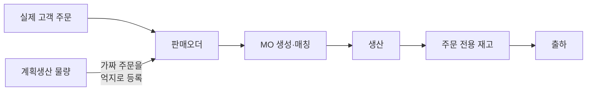
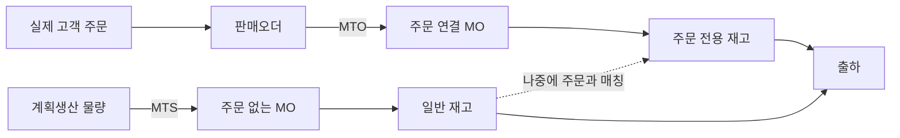
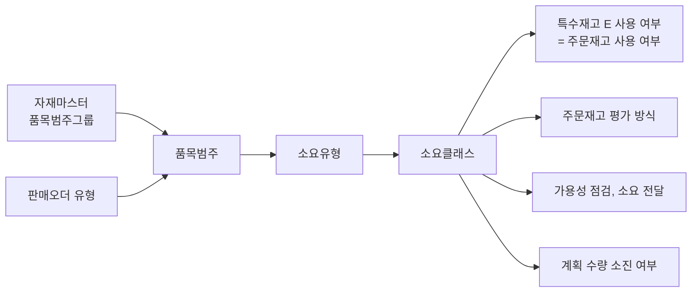
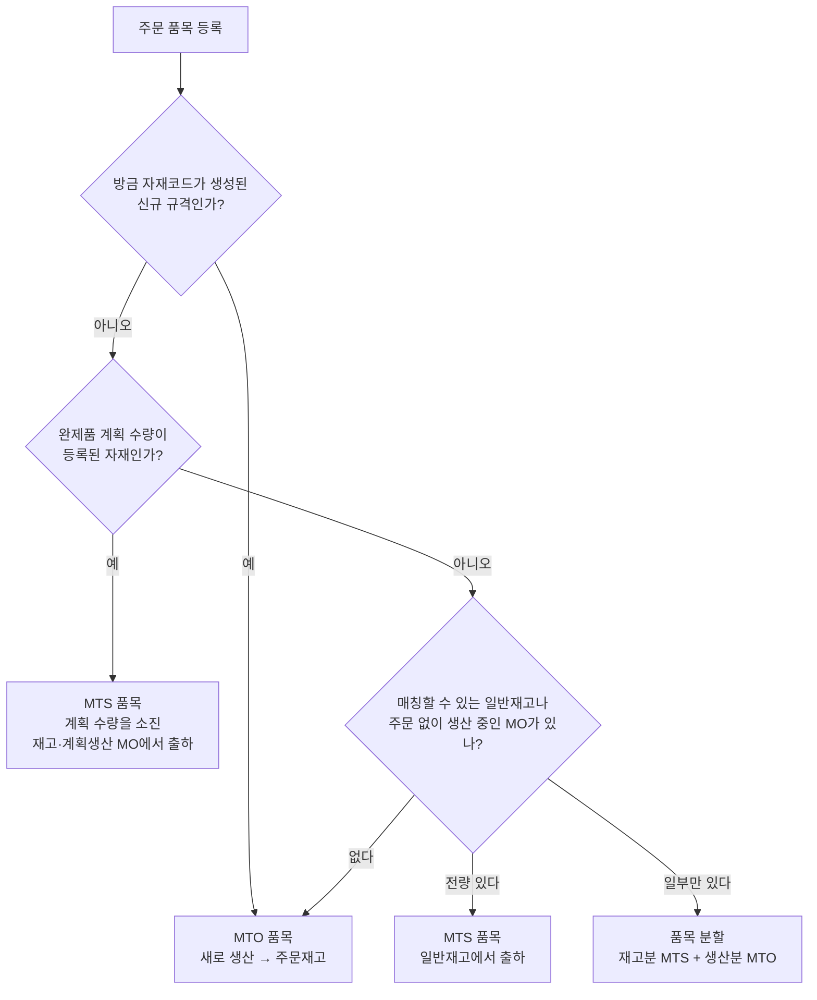
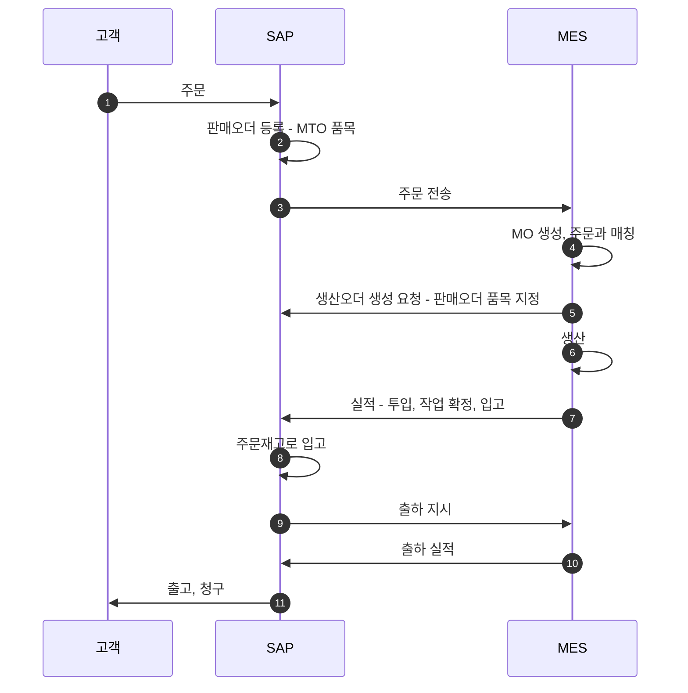
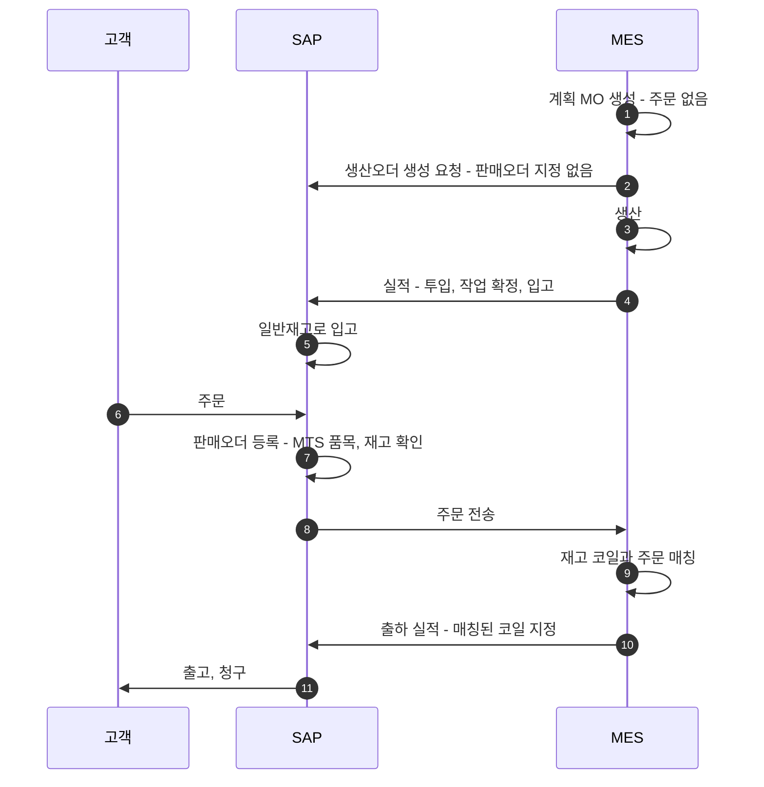
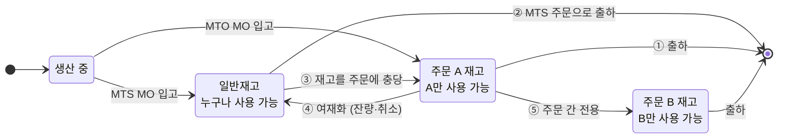
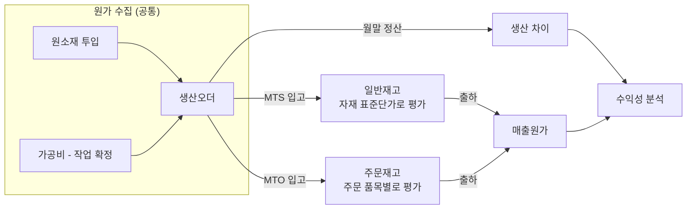
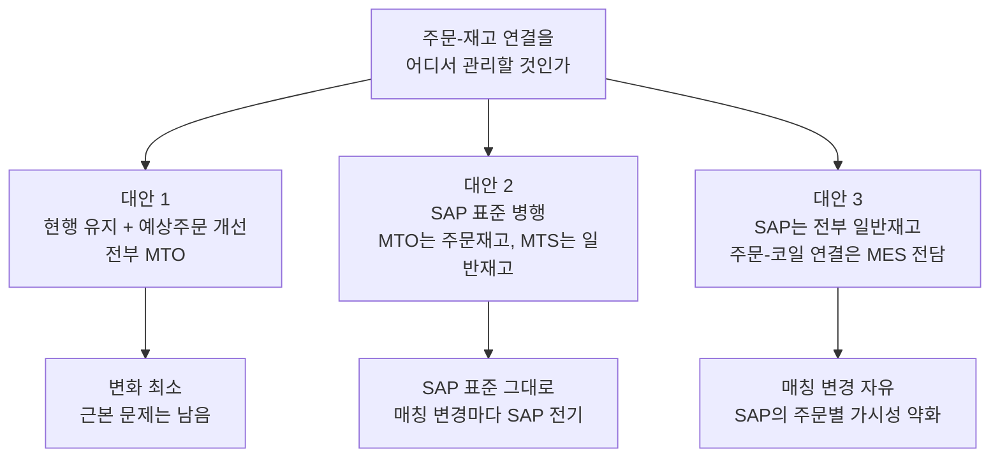

# MTO·MTS 병행 운영 분석서

> **대상** 냉연 제조 · SAP ERP를 S/4HANA로 전환 + 자체 구축 MES 재구축
> **독자** 업무 분석가, 시스템 설계자, 의사결정자
> **목적** "주문생산(MTO)만 되는 현재 구조"를 "주문생산 + 계획생산(MTS) 병행 구조"로 바꿀 때 알아야 할 것과 결정해야 할 것을 정리

**문서 구성**

| 문서 | 내용 |
|---|---|
| **본문** (이 문서) | 결론, 전체 구조, 의사결정 체크리스트 |
| [상세 1. 업무 시나리오](mto-mts-01-scenarios.md) | 계획생산 유형별로 누가 무엇을 하는지 |
| [상세 2. 원가 숫자 예시](mto-mts-02-costing-examples.md) | MTO, MTS, 재고 전환의 분개와 금액 |
| [상세 3. SAP 설정과 전환](mto-mts-03-sap-config-conversion.md) | 필요한 설정, S/4HANA 전환 영향, 도입 순서 |
| [상세 4. MES 설계 요건](mto-mts-04-mes-requirements.md) | MES 데이터 구조, 매칭 로직, SAP 인터페이스 |
| [상세 5. 프로세스 시뮬레이션](mto-mts-05-process-simulation.md) | 코일 10톤을 단계별로 따라가 보기 (슬라이드 장표로도 제공) |

---

## 0. 한 장 요약

### 0.1 확인된 전제

이 문서의 권고는 아래 사실을 전제로 한다.

| 항목 | 확인된 내용 |
|---|---|
| 재구축 형태 | 기존 SAP를 S/4HANA로 전환. 기존 설정과 데이터를 대부분 유지 |
| MO와 주문 | MO는 MES가 편성한다. MO와 주문은 대부분 1:1 |
| 매칭 변경 | 매일 발생하지만 담당자가 건별로 관리할 수 있는 수준 |
| 원소재 구매 | 열연코일 소요와 발주는 SAP가 계산 |
| 계획생산 유형 | 표준 규격 상시 판매, 고객 확정 전 선행 생산, 반제품 선행 생산, LOT 채움이 모두 있다 |
| 자재코드 | 규격 조합별로 세분화. 새 규격 주문이 오면 수주 과정에서 자재코드, BOM, 공정이 자동 생성된다 |
| 원가 | 주문별 실제 원가를 집계. 주문에 묶인 완제품은 제품 재고 금액으로 장부에 잡힌다 |
| 여재 | 원래 주문에 묶인 채 보관하고, 다른 주문이 생기면 수작업으로 옮긴다 |
| 수익성 관리 단위 | 고객별, 제품별 |

### 0.2 결론

| 질문 | 결론 |
|---|---|
| MTO·MTS를 함께 SAP에 등록할 수 있나? | **가능하다. SAP 표준 기능이다.** 같은 자재코드에서 주문 품목마다 MTO/MTS를 고를 수 있다. 현재 MTO 설정은 그대로 두고 MTS용 설정을 덧붙이면 된다 |
| 자재코드를 따로 만들어야 하나? | **아니다. 현재 코드 체계를 유지한다.** 다만 주문이 없어도 자재코드, BOM, 공정, 표준원가가 만들어지는 경로가 새로 필요하다 |
| 원가에 문제가 없나? | **구조적 문제는 없다.** 현재도 주문재고를 금액으로 관리하고 있어 MTS를 얹기만 하면 된다. 결정할 것은 ① 주문재고의 단가 기준 ② 실제원가 사용 여부 ③ 표준원가가 없는 자재의 처리다 |
| 주문은 어떻게 등록하나? | **새로 생산해야 하는 주문은 MTO 품목**, **이미 있는 재고나 주문 없이 생산 중인 물량을 파는 주문은 MTS 품목**으로 받는다. 완제품 계획 수량을 넣은 반복 규격은 재고가 없어도 MTS 품목으로 받는다. 더미 주문은 필요 없어진다 |
| 더미 주문을 없애면 놓치는 것은? | 더미 주문은 열연코일 발주 근거 역할도 하고 있을 가능성이 크다. **열연코일에 직접 넣는 계획 수량**이 이 역할을 넘겨받아야 한다 |
| 가장 어려운 설계 포인트는? | **MO–주문 매칭이 바뀔 때 SAP 재고를 어떻게 따라가게 할 것인가.** 그리고 **표준원가가 없는 자재가 일반재고로 들어오는 것을 어떻게 막을 것인가** |

**핵심 원리 한 줄**

> SAP에서 MTO/MTS는 "자재의 속성"이 아니라 **"판매오더 품목이 어떤 소요유형을 갖느냐"** 로 갈린다.
> 그 결과가 **재고의 주인**으로 나타난다. MTO 재고는 특정 주문의 것(주문재고), MTS 재고는 누구나 쓸 수 있는 것(일반재고)이다.

### 0.3 권고안

1. 같은 자재코드에서 **주문 품목 단위로 MTO/MTS를 선택**한다. 스위치는 품목범주 하나로 통일한다.
2. MTO는 **주문재고**, MTS는 **일반재고**로 관리하고, MES의 매칭 변경을 SAP 재고전환으로 **자동 연계**한다.
3. 계획생산은 **주문 없는 MO**로 처리하고, 열연코일 발주 근거는 **열연코일 계획 수량**으로 넣는다.
4. 주문재고도 **자재 표준단가로 평가**해 재고 전환 때 가격차이가 생기지 않게 한다.
5. 자재 자동 생성 기능에 **표준원가 확정**을 넣고, **주문 없이도 호출**할 수 있게 한다.
6. 설계와 개발은 S/4HANA 전환과 함께 하되, **MTS 업무 적용은 전환이 안정된 뒤 단계적으로** 켠다. 여재 정리부터 시작한다.

### 0.4 1차 문서에서 달라진 점

| 항목 | 1차 문서 | 지금 |
|---|---|---|
| 자재코드 | 그룹 코드 + 배치 특성으로 바꾸기를 권고 | **현재의 규격별 코드를 유지.** 기존 시스템 전환이고 자동 생성 체계가 있기 때문 |
| 전체 구조 | 대안 2 권고, 대안 3 검토 조건 제시 | **대안 2로 확정 가능.** MO와 주문이 대부분 1:1이고 매칭 변경이 관리 가능한 수준 |
| 일반재고 → 주문재고 전환 | 이동유형 412 E 계열 | **413.** 412 E는 411 E의 취소 유형이다 |
| 주문재고 평가 | 평가 / 비평가 두 선택지 | 일반재고와 **함께 평가하는 방식**이 세 번째 선택지로 추가 |
| 계획 수량 | 주문 없는 MO + 원소재용 계획 | **열연코일에 직접** 넣는 방식을 기본으로 구체화 |
| 스위치 방식 | 전략그룹 또는 품목범주 | **품목범주로 결정**하는 방식 권고. 자재마스터 일괄 변경이 필요 없다 |

---

## 1. 지금의 문제는 무엇인가

**현재: 전부 MTO**

**목표: MTO와 MTS 병행**

더미 주문 방식의 부작용은 불편함에서 끝나지 않는다.

- 수주 실적, 수주잔고, 납기 준수율 같은 **영업 지표가 왜곡**된다.
- 가짜 주문에 묶인 재고는 SAP가 "이미 팔린 것"으로 본다. **실제 가용 재고가 보이지 않는다.**
- 실제 주문이 들어오면 더미 주문을 취소·변경하고 재고를 옮기는 **수작업**이 생긴다.

### 계획생산이 필요한 경우는 하나가 아니다

네 가지 유형이 모두 있는 것으로 확인되었다. 유형마다 SAP 해법이 다르다. 유형별 상세 절차는 [상세 1](mto-mts-01-scenarios.md)에 있다.

| 유형 | 예시 | 주문 품목 | 완제품 재고 |
|---|---|---|---|
| **A. 표준 규격 상시 판매** | 유통향 범용 규격 | MTS | 일반재고 |
| **B. 고객 확정 전 선행 생산** | 장기 거래처의 월 내시·예상 물량 | MTS | 일반재고 |
| **C. 반제품 선행 생산** | 풀하드·소둔재를 미리 만들어 납기 단축 | MTO | 반제품은 일반재고, 완제품은 주문재고 |
| **D. LOT 채움·설비 효율** | 압연 LOT 최소량을 맞추려 추가 생산 | MTO 또는 없음 | 주문재고 → 일반재고 |
| **E. 주문 잔량·취소분(여재)** | 초과 생산, 주문 취소 | MTS (재판매) | 주문재고 → 일반재고 |

---

## 2. 기본 개념: SAP에서 MTO와 MTS는 무엇이 다른가

### 2.1 비교

| 구분 | MTO (주문생산) | MTS (계획생산) |
|---|---|---|
| 생산을 일으키는 것 | 판매오더 | 계획 또는 주문 없는 생산오더 |
| 생산오더 | 판매오더 품목이 **지정됨** | 판매오더 지정 **없음** |
| 입고되는 재고 | **주문재고** (특수재고 E) | **일반재고** |
| 재고를 쓸 수 있는 주문 | 그 주문만 | 모든 주문 |
| 재고 평가 단위 | 주문 품목별 | 자재·플랜트별 |
| 주문 등록 시 납기 확인 | 생산 일정 기준 | 재고와 입고 예정 기준 |
| 출하 | 해당 주문 재고에서만 | 일반재고에서 코일을 골라서 |
| 생산 차이의 귀속 | 주문과 고객까지 내릴 수 있다 (프로토타입 확인) | 제품까지만 |

### 2.2 MTO/MTS가 정해지는 경로

분석가와 설계자가 꼭 이해해야 하는 연결 고리다. **자재가 아니라 판매오더 품목이 최종 결정한다.**

- **소요클래스**가 실질적인 스위치다. 여기서 "이 주문은 전용 재고를 쓴다"가 켜지면 MTO가 된다.
- **품목범주**가 소요유형을 정하도록 설정하면, 영업은 주문 품목 줄에서 품목범주만 고르면 된다.

### 2.3 꼭 알아야 할 계획전략

| 전략 | 이름 | 성격 | 언제 쓰나 |
|---|---|---|---|
| **20** | 주문생산 | MTO | 주문이 들어와야 생산. 재고는 주문 전용. **계획 수량을 소진하지 않는다** |
| **40** | 최종조립 포함 계획 | MTS | 계획 수량으로 미리 생산하고, 들어온 MTS 주문이 계획을 소진 |
| **10** | 순 소요 계획 | MTS | 주문과 무관하게 계획대로만 생산 |
| **70** | 반제품 계획 | MTS(투입 자재) | 반제품이나 원소재에 직접 계획 수량을 넣는다. 생산오더의 투입 예약이 계획을 소진 |
| **50** | 최종조립 제외 계획 | 혼합 | 하위 자재까지만 계획으로 준비하고 완제품은 주문이 와야 생산 |

계획전략은 MTO/MTS의 스위치가 아니라 **계획 수량을 넣기 위한 설정**으로 쓴다. 상세는 [상세 3](mto-mts-03-sap-config-conversion.md) 4장.

---

## 3. Q1. MTO·MTS 병행 등록이 가능한가

**가능하다.** 같은 자재에서 주문 품목마다 고르는 방식을 기본으로 하고, 반제품 선행 생산을 함께 설계한다.

### 3.1 주문 품목별 선택

| 설계 요소 | 권고 |
|---|---|
| 스위치 | **품목범주 하나.** MTS용 품목범주를 1개 새로 만든다 |
| 현재 MTO 설정 | **건드리지 않는다.** MTS용 설정을 새로 덧붙인다 |
| 자재마스터 | **일괄 변경하지 않는다.** 품목범주가 소요유형을 정하도록 설정하면 자재의 전략그룹과 무관하게 동작한다 |
| 한 주문 안의 혼합 | MTO 품목과 MTS 품목을 함께 둘 수 있다 |
| 일부만 재고가 있을 때 | 품목을 재고분(MTS)과 생산분(MTO) 두 줄로 나눈다 |

> **실무 규칙** "생산을 일으키는 주문 품목 = MTO, 이미 있는(또는 주문 없이 생산 중인) 물량을 파는 주문 품목 = MTS"
> 단, **완제품 계획 수량이 있는 자재는 재고가 없어도 MTS**로 받는다. 이 확인을 재고 확인보다 먼저 한다. 재고가 일부만 있다고 품목을 나눠 생산분을 MTO로 받으면, 계획과 주문이 따로 남아 열연코일 소요가 두 번 계산된다(4.3절).
> MTS 품목으로 받으면 출하까지 SAP 재고전환이 한 번도 필요 없다. 이 규칙을 누가, 언제 적용할지가 업무 설계 과제다. 수주 프로그램이 계획 수량과 MES의 재고를 조회해 자동으로 제안하는 방식이 가장 실수가 적다.

### 3.2 반제품 선행 생산: 어디까지 미리 만들 것인가

"주문이 물리는 지점"을 공정의 어디에 둘지 정하는 문제다.

- 뒤로 갈수록 납기는 짧아지지만, 규격이 확정되므로 **안 팔릴 위험**이 커진다.
- 반제품 선행 생산이 SAP에서 성립하려면 **반제품의 독립된 자재코드와 재고**, **반제품을 투입하는 BOM**, **MO의 분할**이 필요하다. 현재 구조 확인이 먼저다.
- 공용으로 써야 하는 자재(열연코일, 선행 생산 반제품)는 주문별로 묶이지 않도록 자재 설정을 해야 한다. 빠뜨리면 MTO 주문이 이미 있는 반제품 재고를 무시하고 새로 생산을 요구한다.

---

## 4. Q3. 주문·생산·출하는 어떻게 흘러가나

단계별 상태와 금액은 [상세 5 시뮬레이션](mto-mts-05-process-simulation.md)에서 따라가 볼 수 있다.

### 4.1 MTO 흐름 (지금과 같은 구조)

### 4.2 MTS 흐름 (새로 추가되는 구조)

### 4.3 더미 주문이 하던 두 가지 역할

더미 주문은 지금 아래 두 가지 일을 하고 있을 가능성이 크다. ①은 확인된 내용이고, ②는 추정이라 11장 5번에서 확인해야 한다.

| 역할 | 지금 | To-Be에서 대체하는 것 |
|---|---|---|
| **① 생산 근거** | MO가 연결될 주문을 만들어 준다 | **주문 없는 MO** (SAP에서는 판매오더 지정이 없는 생산오더) |
| **② 열연코일 발주 근거** (추정) | SAP가 열연코일 소요를 계산할 수요를 만들어 준다 | **열연코일에 직접 넣는 계획 수량** |

역할 ②가 사실이라면, 더미 주문을 없애는 순간 열연코일 소요가 사라진다. 열연코일 계획 수량에는 그 달의 예상 투입 총량을 넣고, MTO든 MTS든 모든 MO의 투입 예약이 이 계획을 소진하게 한다. 그러면 계획과 실제 수요가 두 번 계산되지 않는다.

완제품에 계획 수량을 넣는 방식(전략 40)은 코드가 고정된 반복 규격에만 쓸 수 있다. 그리고 **완제품 계획 수량이 있는 자재의 주문은 반드시 MTS 품목으로 받아야 한다.** MTO 품목은 이 계획을 소진하지 않으므로, 계획과 주문이 따로 남아 열연코일 소요가 두 번 계산된다. 3.1절의 순서도가 이 확인을 재고 확인보다 먼저 하는 이유다.

### 4.4 매칭이 바뀔 때: 가장 중요한 시나리오

MES의 MO–주문 매칭은 살아 움직인다. 그 변화를 SAP 재고에 어떻게 반영할지가 이 프로젝트의 핵심 설계다.

| # | 상황 | SAP 처리 | 비고 |
|---|---|---|---|
| ① | MTO로 생산해 그 주문으로 출하 | 추가 처리 없음 | 기본 흐름 |
| ② | 일반재고를 MTS 주문 품목으로 출하 | 추가 처리 없음 | **가장 단순. 가능하면 이 경로로 유도** |
| ③ | 일반재고를 MTO 주문에 충당 | 재고전환 (일반 → 주문재고, 이동유형 413) | 주문 품목을 MTS로 등록·분할하면 불필요 |
| ④ | 주문재고를 여재로 돌림 | 재고전환 (주문재고 → 일반, 이동유형 411 E) | 초과 생산, 주문 취소·축소. 주문 마감이 먼저 |
| ⑤ | 주문 A 재고를 주문 B로 전용 | 재고전환 (주문 → 주문, 이동유형 413 E) | 긴급 주문 대응 |
| ⑥ | **생산 중인 MO**의 주문을 변경 | SAP 전기 없음. **입고 후 ③④⑤로 처리** | 아래 원칙 |
| ⑦ | 규격이 조금 다른 재고를 충당 | 자재코드 변경 (이동유형 309) 후 충당, 또는 재가공 MO | 표준단가가 다르면 차액 발생 |

> **설계 원칙** 생산 중의 매칭 변경은 MES에서만 관리하고, SAP는 "입고 시점의 귀속"과 "입고 후 재고전환"만 처리한다. MES가 매칭 변경 이벤트를 보내면 SAP 재고전환이 **자동 전기**되도록 인터페이스를 설계한다. 사람이 SAP 화면에서 손으로 옮기는 구조가 되면 재고 불일치가 반드시 생긴다.

⑦은 자재코드가 규격별로 세분화되어 있어서 생기는 경우다. 얼마나 잦은지, 지금은 어떻게 처리하는지 확인이 필요하다. 이동유형은 표준 기준이며 정확한 동작은 프로토타입에서 검증한다.

---

## 5. MES의 MO와 SAP 오더는 어떻게 대응시키나

**MO 1건 = SAP 생산오더 1건**으로 하기를 권고한다. MO와 주문이 대부분 1:1이므로 구조가 단순하다. 다만 지금 MES가 SAP 생산오더를 어떤 단위로 만드는지는 아직 확인하지 않았다([상세 4](mto-mts-04-mes-requirements.md) 11장 1~2번).

| MO와 주문의 관계 | SAP 처리 |
|---|---|
| MO 1 : 주문 1 (대부분) | 생산오더에 판매오더 지정 → 주문재고로 바로 입고 |
| MO 여러 개 : 주문 1 | 각 생산오더에 같은 판매오더 지정 |
| MO 1 : 주문 없음 (계획생산) | 판매오더 지정 없는 생산오더 → 일반재고로 입고 |
| MO 1 : 주문 여러 개 (예외) | SAP 생산오더 하나에는 주문 품목을 하나만 지정할 수 있다. 주문 지정 없이 만들고, 입고 후 코일별로 주문재고에 배분한다 |

S/4HANA에서는 생산오더가 BOM과 공정을 **생산버전**으로 찾는다. 생산버전이 없으면 MES가 요청한 생산오더가 만들어지지 않을 수 있으므로, 자재 자동 생성 기능에 생산버전 생성을 넣어야 한다.

---

## 6. Q2-1. 자재코드는 어떻게 해야 하나

### 6.1 결론: 현재 코드 체계를 유지한다

| 판단 | 이유 |
|---|---|
| MTO용·MTS용 코드를 **나누지 않는다** | 재고를 주문과 일반 사이에서 옮길 때마다 자재코드 변경이 되어 원가 차이와 이력 단절이 생긴다 |
| 규격별 세분화 코드를 **유지한다** | 기존 시스템 전환이고 자동 생성 체계가 이미 있다. 코드 체계를 바꾸면 전환 범위가 크게 늘어난다 |
| 세분화 코드는 MTS에 **유리한 점도 있다** | 자재코드만으로 규격이 식별되므로 SAP가 재고를 보고 납기를 확인할 수 있다. 표준원가가 규격별로 계산된다 |

1차 문서는 코드를 제품군 수준으로 묶고 상세 규격은 배치 특성으로 관리하는 안을 권고했다. 신규 구축이라면 유효한 선택지지만, 이 프로젝트의 조건에는 맞지 않아 철회한다.

### 6.2 MTS가 추가되면서 새로 필요한 것

| # | 과제 | 이유 | 대응 |
|---|---|---|---|
| 1 | **주문 없이 자재코드를 만드는 경로** | 지금은 수주 과정에서만 코드가 생긴다. 계획생산은 주문이 없다 | 자동 생성 기능을 수주 과정에서 떼어내 MES 계획 쪽에서도 호출할 수 있게 한다 |
| 2 | **표준원가 확정** | 일반재고는 자재 표준단가로만 평가된다. 표준단가가 0이면 재고 금액이 0원으로 잡힌다 | 자동 생성 묶음에 표준원가추정 계산과 확정을 넣는다 |
| 3 | **생산버전** | S/4HANA에서는 생산오더가 BOM·공정을 생산버전으로 찾는다. 없으면 생산오더를 만들지 못할 수 있다 | 자동 생성 묶음에 생산버전을 넣는다 |
| 4 | **규격이 다른 재고의 충당** | 자재코드가 다른 재고를 주문에 쓰면 자재코드 변경이 필요하고 단가 차이가 손익으로 나온다 | 충당의 1차 기준을 "자재코드 동일"로 두고, 대체 허용 범위와 회계 처리를 정한다 |
| 5 | **코드를 가르는 속성 점검** | 고객 고유 요구(포장, 공차 등)가 코드를 가르면 계획생산 재고가 사실상 특정 고객 전용이 된다 | 속성 목록을 다시 본다 |
| 6 | **표준 규격 목록** | 어느 코드를 재고로 가져갈지 정해야 한다 | 재고 판매 대상 규격과 적정 재고 기준을 정한다 |
| 7 | **반제품 코드** | 반제품 선행 생산을 하려면 반제품이 재고 관리 대상이 된다 | 반제품 코드 체계와 BOM 구조를 정한다 |
| 8 | **코드 증가 통제** | 계획 담당이 임의 규격으로 코드를 늘릴 수 있다 | 생성 권한과 미사용 코드 정리 기준을 정한다 |

상세는 [상세 3](mto-mts-03-sap-config-conversion.md) 12장.

---

## 7. Q2-2. 원가에는 문제가 없나

숫자 예시는 [상세 2](mto-mts-02-costing-examples.md)에 있다.

### 7.1 무엇이 같고 무엇이 다른가

- **원가를 모으는 방식은 같다.** 둘 다 생산오더에 투입 자재와 가공비가 쌓인다. 분개도 같다.
- **다른 점은 재고가 어느 평가 주머니에 들어가느냐**다.
- 원가에서 문제가 생긴다면 **두 주머니의 단가가 다를 때, 그리고 재고가 주머니를 옮겨 다닐 때**다.

### 7.2 결정 1: 주문재고의 평가 구조

현재 주문재고는 제품 재고 금액으로 잡히고 있다. 즉 이미 평가된 주문재고다. 선택지는 평가 구조다.

| 선택지 | 내용 | 평가 |
|---|---|---|
| **주문별 주머니 + 단가 통일** | 주문 품목마다 평가 주머니를 두되, 단가는 자재 표준단가로 맞춘다 | **권고.** 주문별 재고 금액이 보이고 재고 전환 때 차액이 생기지 않는다 |
| 주문별 주머니 + 주문별 단가 | 주문마다 재고 단가가 다르다 (원가추정이나 생산오더 계획원가) | 재고를 옮길 때마다 차액이 손익으로 나온다. 현재 방식일 가능성이 있다 |
| 일반재고와 한 주머니 | 수량만 주문별로 나누고 금액은 일반재고와 함께 평가 | 차액이 구조적으로 없다. 대신 주문별 재고 금액을 볼 수 없다. 프로토타입에서 비교 |

현재 시스템이 어느 방식인지 원가 담당이 확인해야 한다.

### 7.3 결정 2: 단가 통일의 전제와 한계

| 항목 | 내용 |
|---|---|
| 효과 | 4톤을 일반재고에서 주문재고로 옮길 때, 단가 통일이면 차액 0. 주문별 단가(예: 1,030)면 차액 120이 손익으로 잡힌다 |
| 전제 | **모든 생산 자재에 표준단가가 있어야 한다.** 지금은 생산오더 계획원가로 평가되어 표준단가가 없어도 드러나지 않았을 수 있다 |
| 한계 | 단가는 주문재고에 처음 입고될 때 정해진다. 그 뒤 자재 표준단가를 갱신하면 기존 주문재고와 다시 벌어진다 |
| 주문별 실제 원가 | 재고 단가에는 나타나지 않는다. "표준 매출원가 + 그 MO의 생산 차이"로 본다 |
| 전환 방법 | 기존 설정을 고치지 않고 새 설정을 추가해 기준일부터 새 주문에만 적용한다 |

### 7.4 결정 3: 실제원가를 쓸 것인가

S/4HANA에서 자재원장은 필수이고 **실제원가 계산은 선택**이다.

| 관점 | 표준원가만 | 실제원가 사용 |
|---|---|---|
| 원소재 가격 변동 | 차이 계정에 쌓인다 | 재고와 매출원가에 배분된다 |
| 만든 달과 판 달이 다를 때 | 만든 달에 차이가 손실로, 판 달에 표준 이익이 잡힌다 | 차이가 재고에 붙어 있다가 판 달에 반영된다 |
| 운영 부담 | 낮음 | 월말 결산 작업 추가 |

**MTS 비중이 커질수록 표준원가만으로는 "만든 달에 손실, 판 달에 이익"이 반복된다.** 전환과 같은 날 정할 필요는 없지만, MTS 확대 계획과 함께 검토해야 한다.

### 7.5 수익성은 어떻게 달라지나

수익성 관리 단위가 고객별·제품별이므로 큰 무리는 없다.

| | MTO | MTS |
|---|---|---|
| 제품별 수익성 | 문제없다 | 문제없다 |
| 고객별 매출·표준 매출원가 | 출하 때 고객에 붙는다 | 출하 때 고객에 붙는다 |
| 생산 차이 | 주문과 고객까지 내릴 수 있다. S/4HANA 수익성 분석에서 실제로 내려가는지는 프로토타입에서 확인한다 | **제품까지만.** 생산할 때 고객을 모른다 |

MTS의 생산 차이를 고객까지 내릴지(내리지 않는다 / 배분한다 / 실제원가로 반영한다)는 경영 요구에 따라 정한다.

### 7.6 원가 측면 위험 요소

| 위험 | 내용 | 대응 |
|---|---|---|
| **표준단가 없는 자재** | 일반재고로 입고되면 재고 0원, 회계 전표 없음. 여재를 일반재고로 돌리면 재고 금액이 통째로 손실 | 자재 생성 묶음에 표준원가 확정. 표준단가 0인 자재의 생산오더 생성 차단. 매일 점검 목록 |
| 재고 전환 시 가격차이 | 주문재고와 일반재고의 단가가 다르면 전환마다 차이 발생 | 단가 통일 |
| 표준단가 갱신 후 차이 | 기존 주문재고는 옛 단가로 남는다 | 갱신 때 미결 주문재고 단가 정리, 또는 소액 차이 허용 |
| 규격이 다른 재고 충당 | 자재코드 변경 때 단가 차이가 손익으로 | 대체 허용 범위와 회계 방침 |
| 과도기의 두 가지 주문재고 | 옛 방식과 새 방식으로 평가된 재고가 함께 있다 | 소진될 때까지 둘지, 기준일에 재평가할지 결정 |
| 여재 평가 | 주문에 묶여 보이던 재고가 계약 없는 재고로 드러난다 | 재고 평가손실 기준 검토 |
| 초과 생산분의 차이 | 주문량을 넘는 생산분의 차이까지 원래 주문이 부담 | 부담 주체 결정 |

---

## 8. 전체 구조 대안과 권고

세 질문의 답을 모으면 **"주문과 재고의 연결을 SAP에서 얼마나 강하게 관리할 것인가"** 라는 하나의 구조 결정이 된다.

| 기준 | 대안 1 | 대안 2 | 대안 3 |
|---|---|---|---|
| 더미 주문 제거 | ✕ | ● | ● |
| SAP에서 주문별 재고 확인 | ● | ● | ✕ (MES에서 확인) |
| SAP에서 주문별 원가 | ● | ● | △ |
| 매칭 변경의 부담 | 높음 | 중간 (자동 전기 필요) | 낮음 |
| 기존 설정·데이터와의 연속성 | 높음 | **높음** | 낮음 |
| 인터페이스 복잡도 | 낮음 | 높음 | 중간 |

### 권고: 대안 2

확인된 사실이 대안 2를 뒷받침한다.

- **MO와 주문이 대부분 1:1**이므로 생산오더에 주문을 지정하는 SAP 표준 구조와 잘 맞는다.
- **매칭 변경이 건별로 관리 가능한 수준**이므로 재고전환 자동 전기로 감당할 수 있다.
- **기존 시스템 전환**이므로 현재의 MTO 설정과 주문재고를 그대로 살리는 쪽이 안전하다.
- **주문별 원가 집계**라는 현재의 업무 방식을 MTO 주문에서는 유지할 수 있다.

전제 조건은 세 가지다. ① 매칭 변경 → SAP 재고전환의 자동 연계 ② 주문재고 단가 통일 ③ 모든 생산 자재의 표준원가 확정.

**SAP 전기를 줄이는 방법**: 주문 없이 생산한 물량과 여재는 MTS 품목으로 판다. 그러면 매칭이 바뀌어도 SAP 전기가 없다. 재고전환이 필요한 경우는 "이미 MTO로 등록된 주문"과 관련된 변경으로 좁혀진다.

---

## 9. SAP와 MES의 역할 분담

| 영역 | SAP | MES |
|---|---|---|
| 주문 | 판매오더 원본, MTO/MTS 구분, 가격·여신 | 주문 사양 상세, MTO/MTS 제안에 필요한 재고 정보 |
| 계획 | 열연코일 계획 수량, 원소재 소요·구매 | LOT 편성, 일정 계획, MO 생성 |
| 매칭 | 결과 반영 (재고 종류) | **매칭 로직과 이력의 원본** |
| 생산 | 생산오더 (원가 수집 단위) | 공정 진행, 실적 수집, 품질 판정 |
| 재고 | 수량·금액·재고 종류의 원본 | 코일별 위치·상태·상세 속성 |
| 원가 | 표준·실제 원가, 수익성 | 투입·산출 실적 제공 |
| 출하 | 납품 문서, 출고 전기, 청구 | 출하할 코일 결정, 상차 실적 |

### 필요한 인터페이스

| # | 방향 | 내용 | 병행 운영으로 달라지는 점 |
|---|---|---|---|
| 1 | SAP → MES | 자재·고객 마스터 | 반제품, 주문 없이 만든 코드 추가 |
| 2 | SAP → MES | 판매오더 | **MTO/MTS 구분** 전달 |
| 3 | MES → SAP | 자재 생성 요청 | **신규.** 주문 없는 MO를 위한 자재코드 생성 |
| 4 | MES → SAP | 생산오더 생성 | **판매오더 지정 유무** 구분 |
| 5 | MES → SAP | 투입, 작업 확정, 입고 실적 | 입고 재고 종류가 오더에 따라 결정 |
| 6 | MES → SAP | **매칭 변경 → 재고전환** | **신규. 가장 중요** |
| 7 | MES → SAP | 등급 변경, 규격 변경 | 자재코드 변경 전기 |
| 8 | 양방향 | 출하 지시와 실적 | MTS는 **코일 지정** 필요 |
| 9 | MES → SAP | 열연코일 계획 수량 | **신규.** 계획을 MES에서 만든다면 |
| 10 | 양방향 | 재고 대사 | 재고 종류와 귀속 주문까지 대사 |

MES 설계 요건은 [상세 4](mto-mts-04-mes-requirements.md).

---

## 10. 의사결정 체크리스트

| # | 결정 사항 | 권고 또는 확인된 내용 | 상태 | 주관 |
|---|---|---|---|---|
| D1 | 계획생산 유형 | 네 유형 모두 + 여재 | 확인됨 | 영업·생산관리 |
| D2 | 병행 단위 | 주문 품목별. 품목범주로 선택 | 권고 | 영업 |
| D3 | MTO/MTS 판단 주체와 시점 | 수주 프로그램이 완제품 계획 수량과 MES 재고를 차례로 보고 제안 (3.1절) | **미정** | 영업·생산관리 |
| D4 | 반제품 선행 생산 지점 | 제품군별 결정. 현재 MO·BOM 구조 확인 먼저 | **미정** | 생산관리 |
| D5 | 계획 등록 방식 | 주문 없는 MO + 열연코일 계획 수량 | 권고 | 생산관리 |
| D6 | 전체 구조 | 대안 2 | 권고 (사실로 뒷받침) | PMO |
| D7 | MO–SAP 오더 대응 | 1:1 | 권고 (현재 생산오더 생성 방식 확인 필요) | 생산·MES |
| D8 | MO 1 : 주문 여러 개 | 예외로 처리. 입고 후 배분 | 권고 | 생산·MES |
| D9 | 자재코드 체계 | 현재의 규격별 코드 유지 | 권고 | 기준정보 |
| D10 | 주문재고 평가 구조 | 주문별 주머니 + 단가 통일 | 권고 (프로토타입 비교) | 원가 |
| D11 | 표준원가 없는 자재 | 자재 생성 때 확정. 없으면 생산오더 차단 | 권고 | 원가·기준정보 |
| D12 | 실제원가 | MTS 확대 계획과 함께 검토 | **미정** | 원가·경영 |
| D13 | 생산 중 매칭 변경 | MES만 관리, 입고 후 전환 | 권고 | 생산·MES |
| D14 | 여재 관리 기준 | 판정 조건, 주문 마감, 전환 시점 | **미정** | 생산관리·영업 |
| D15 | MTS 주문의 납기 약속 | SAP 재고 확인 + MES 매칭 결과 | **미정** | 영업·MES |
| D16 | 수익성 관리 기준 | 고객별, 제품별 | 확인됨 | 원가·경영 |
| D17 | 규격이 다른 재고의 충당 | 대체 허용 범위와 회계 처리 | **미정** | 생산관리·원가 |
| D18 | 유형 B(내시)의 수단 | 완제품 계획 수량 + MTS 주문 | 권고 (확인 필요) | 영업 |
| D19 | 가동 순서 | 설계·개발은 전환과 함께, 업무 적용은 안정화 뒤 | 권고 | PMO |
| D20 | MTS를 켜는 순서 | 여재 → LOT 채움·표준 규격 → 내시 → 반제품 | 권고 | 생산관리·영업 |

전환과 SAP 설정에서 정할 결정 D21~D23은 [상세 3](mto-mts-03-sap-config-conversion.md) 14장에 이어서 적었다. 번호는 모든 문서에서 같은 결정을 가리킨다.

---

## 11. 남은 확인 사항

권고를 바꿀 수 있는 순서로 정리했다. 영역별 전체 질문은 각 상세 문서 끝에 있다.

| # | 확인할 것 | 왜 중요한가 | 누구에게 |
|---|---|---|---|
| 1 | **주문재고의 현재 단가 기준** (자재 표준단가 / 주문별 원가추정 / 생산오더 계획원가) | 단가 통일이 "변화"인지 "현행 유지"인지 갈린다 | 원가 |
| 2 | **완제품 자재코드에 표준단가가 있는가.** 0이거나 오래된 자재가 얼마나 되는가 | 일반재고 입고와 여재 전환의 전제 | 원가 |
| 3 | **자재 자동 생성 기능의 구현 방식.** 수주 과정 안에 묻혀 있는가, 원가추정도 만드는가 | 주문 없는 호출로 떼어낼 수 있는지 | IT |
| 4 | **규격이 다른 재고를 충당하는 빈도**와 지금의 처리 방법 | 자재코드 변경 전기와 손익의 규모 | 생산관리 |
| 5 | **더미 주문이 열연코일 발주 근거인가.** 열연코일 발주 리드타임과 MO 생성 시점 | 열연코일 계획 수량이 필요한 구간 | 구매·생산관리 |
| 6 | **반제품이 지금 SAP에 자재코드와 재고로 있는가.** MO는 열연 투입부터 완제품까지 한 건인가 | 반제품 선행 생산의 범위 | 생산관리 |
| 7 | **전환 가동일과 신 MES 가동일의 순서** | 도입 순서 | PMO |
| 8 | **현재 판매오더의 설정 값** (품목범주, 소요유형, 소요클래스) | MTS 설정을 덧붙이는 방법 | SAP 담당 |
| 9 | **코일 번호 자릿수**, SAP에서 코일을 배치로 관리하는가 | 인터페이스 설계 | MES |
| 10 | **주문별 실제 원가를 어디서 보고 어디에 쓰는가** | MTS 주문의 원가를 어떻게 볼지 | 원가 |
| 11 | **지금 MES가 SAP 생산오더를 어떻게 만드는가.** MO 1건이 생산오더 1건인가, 판매오더 품목을 지정하는가 | MO–생산오더 대응(D7)과 인터페이스 설계의 전제 | MES·SAP 담당 |

---

## 12. 추진 순서 제안

- **2단계의 결정은 서로 묶여 있다.** 영업, 생산, 원가, IT가 같은 자리에서 정해야 한다.
- **4단계 프로토타입을 건너뛰지 말 것.** 재고전환의 평가 동작, 열연코일 계획 수량의 소진, 표준단가 없는 자재의 입고는 문서만으로 확정할 수 없다. 전환 프로젝트의 시험 전환본을 프로토타입 환경으로 쓰면 실제 자재와 재고로 확인할 수 있다.
- **5단계는 여재부터.** 생산 흐름을 건드리지 않고 재고전환과 표준단가 평가라는 핵심 동작을 적은 금액으로 먼저 검증한다.

---

## 부록 A. 용어

| 용어 | 뜻 |
|---|---|
| MTO | Make-to-Order. 주문을 받은 뒤 생산 |
| MTS | Make-to-Stock. 계획에 따라 미리 생산해 재고로 보유 |
| MO | Manufacturing Order. 이 회사에서는 생산 LOT 단위 |
| 주문재고 | 특정 판매오더 품목에 귀속된 재고. SAP 특수재고 E (판매오더재고) |
| 일반재고 | 어느 주문에도 묶이지 않은 가용 재고 |
| 품목범주 | 판매오더 품목 한 줄의 성격을 정하는 값. MTO/MTS의 스위치로 쓴다 |
| 소요유형·소요클래스 | 판매오더 품목이 MTO인지 MTS인지 정하는 SAP 설정 값 |
| 계획 수량 | 주문과 무관하게 등록하는 계획 수량. SAP 용어는 계획독립소요(PIR) |
| 소진 | 실제 수요가 들어온 만큼 계획 수량의 남은 양을 줄여 계산하는 것 |
| 생산버전 | 자재의 BOM과 공정을 묶어 주는 연결표. S/4HANA에서 필수 |
| 여재 | 주문에 귀속되지 않고 남은 재고 |
| 충당·매칭 | 재고나 MO를 주문에 연결하는 일 |
| 배치 | SAP의 재고 식별 단위. 철강에서는 보통 코일 1개 |
| 재고전환 | 재고의 종류나 귀속을 바꾸는 SAP 전기 |
| 자재원장 | 자재 평가를 관리하는 SAP 기능. S/4HANA에서 필수 |

## 부록 B. 검증 수준

이 문서는 SAP 표준 동작에 대한 지식과 공개 자료를 근거로 작성했다. 조사 환경에서 SAP 사이트 원문을 직접 열 수 없어 검색 결과의 요약과 인용문으로 확인했다.

**공개 자료로 확인한 것**

- 품목범주 + MRP 유형으로 소요유형을 정하도록 설정할 수 있음
- 주문재고의 표준단가 결정 순서와, 자재 표준단가로만 평가하게 하는 설정
- 주문재고 단가는 첫 입고 때 정해지고 이후의 입고로는 바뀌지 않음
- 주문재고를 일반재고와 함께 평가하는 설정의 존재
- 이동유형 411 E (주문재고 → 일반재고), 413 E (주문 → 주문)
- 계획 수량의 차감 시점, 전략 70의 설정 요건
- S/4HANA에서 자재원장 필수, 생산버전 필수, 저장위치 MRP 폐지
- 표준단가가 0인 자재의 생산오더 입고는 회계 전표를 만들지 않음
- 표준원가추정은 한 자재에 대해 한 회계기간에 한 번만 확정할 수 있음

**프로토타입에서 직접 검증해야 하는 것**

- 구매 자재인 열연코일에 전략 70이 기대대로 동작하는지
- 일반재고 → 주문재고 전환의 이동유형과 인터페이스 필드 배치
- 주문재고를 일반재고와 함께 평가하는 설정의 S/4HANA 동작
- 표준단가 갱신 뒤 기존 주문재고를 전환할 때의 차이
- 생산 차이가 주문·고객까지 내려가는지 (Margin Analysis)
- 생산 중 매칭 변경 뒤 MRP가 열연코일 소요를 추가로 만드는지

출처는 각 상세 문서의 끝에 있다.
