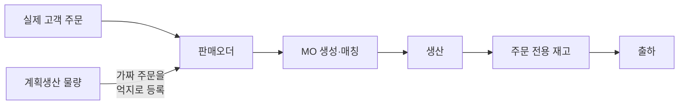
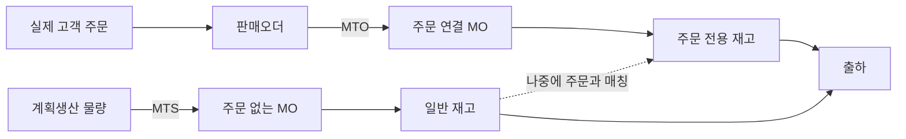
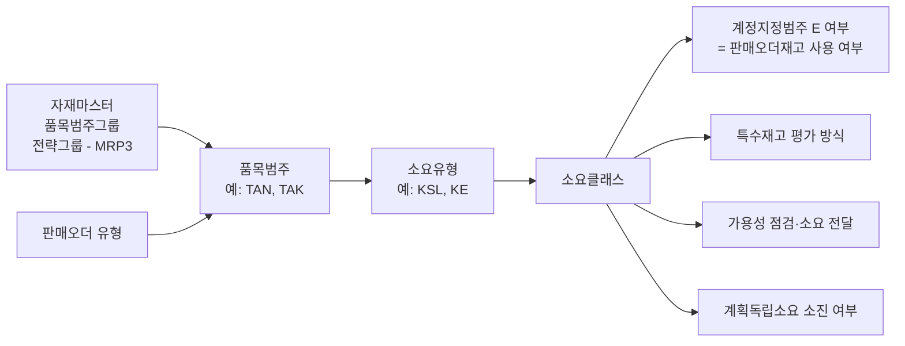
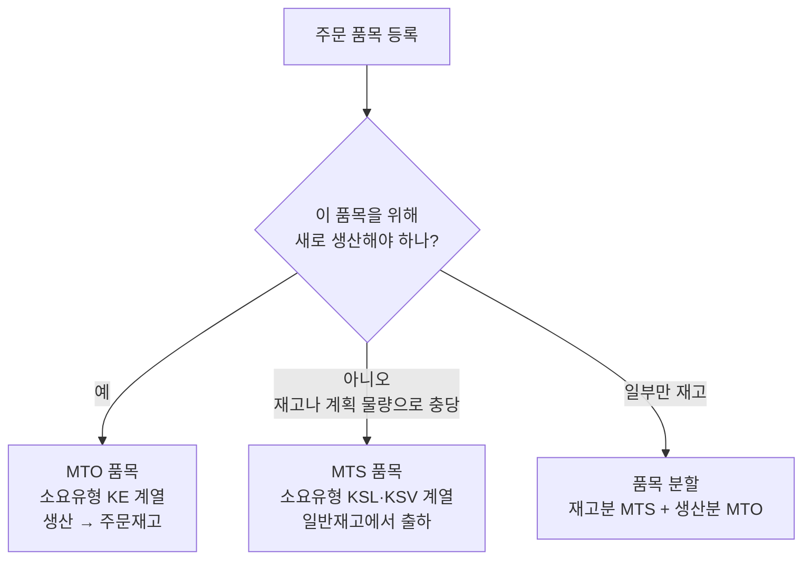
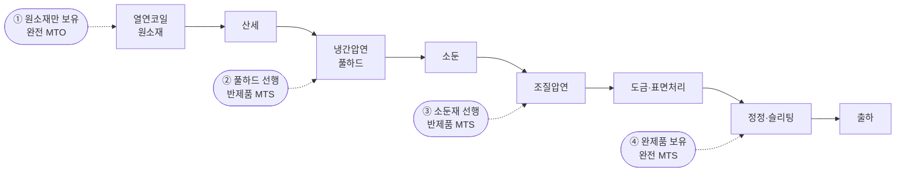
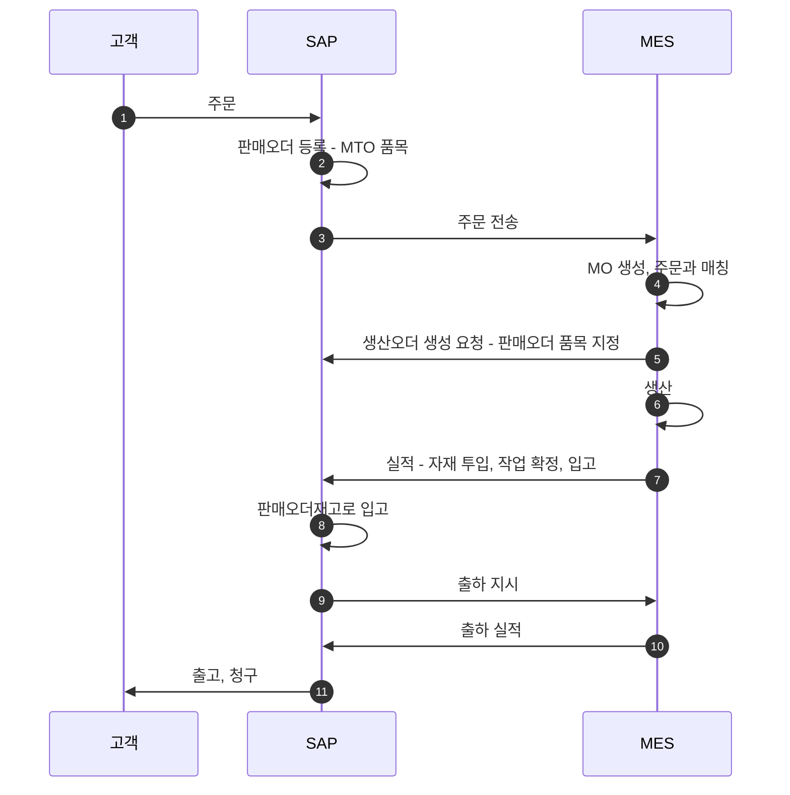
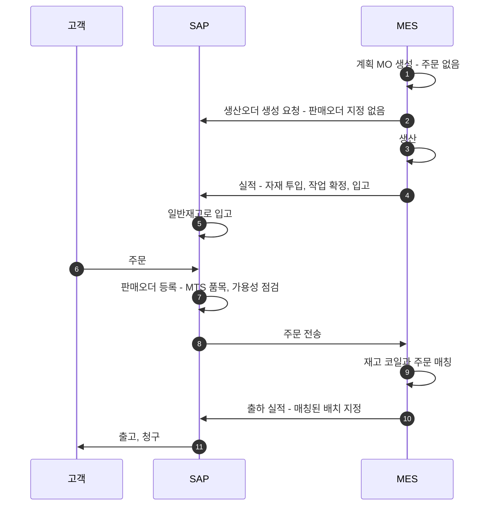
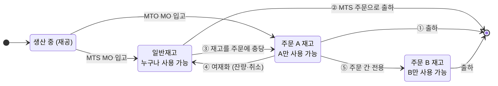
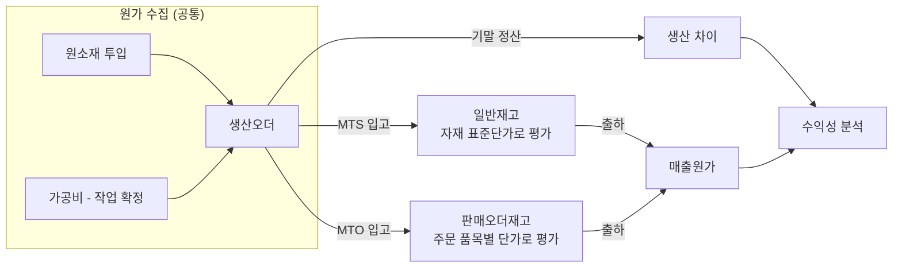
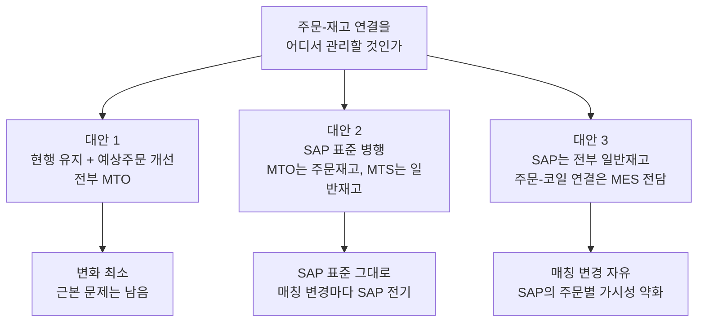

# MTO·MTS 병행 운영 분석서

> **대상** 냉연 제조 · SAP S/4HANA(ERP) + 자체 구축 MES 재구축
> **독자** 업무 분석가, 시스템 설계자, 의사결정자
> **목적** "주문생산(MTO)만 되는 현재 구조"를 "주문생산 + 계획생산(MTS) 병행 구조"로 바꿀 때 알아야 할 것과 결정해야 할 것을 정리

---

## 0. 한 장 요약

| 질문 | 결론 |
|---|---|
| MTO·MTS를 함께 SAP에 등록할 수 있나? | **가능하다. SAP 표준 기능이다.** 같은 자재코드로도 두 방식을 동시에 쓸 수 있다. |
| 자재코드를 따로 만들어야 하나? | **아니다.** MTO용·MTS용 코드를 나누면 오히려 문제가 된다. 다만 **자재코드를 얼마나 세분화할지(입도)** 는 반드시 다시 결정해야 한다. |
| 원가에 문제가 없나? | **구조적 문제는 없다.** 단, 결정 3가지가 필요하다. ① 주문재고의 평가 단가 기준 ② 실제원가 사용 여부 ③ 재고를 주문↔일반으로 옮길 때의 처리 |
| 주문은 어떻게 등록하나? | **MTO**: 지금처럼 주문 → 생산. **MTS**: 주문 없이 계획(또는 MO)으로 생산 → 재고 → 주문은 재고에서 출하. 더미 주문은 필요 없어진다. |
| 가장 어려운 설계 포인트는? | **MO–주문 매칭(충당)이 바뀔 때 SAP 재고를 어떻게 따라가게 할 것인가.** 자재코드나 원가보다 이 부분이 프로젝트 난이도를 좌우한다. |

**핵심 원리 한 줄**

> SAP에서 MTO/MTS는 "자재의 속성"이 아니라 **"판매오더 품목이 어떤 소요유형을 갖느냐"** 로 갈린다.
> 그 결과가 **재고의 주인**으로 나타난다. MTO 재고는 특정 주문의 것(판매오더재고), MTS 재고는 누구나 쓸 수 있는 것(일반재고)이다.

**권고안 요약** (상세는 [8장](#8-전체-구조-대안과-권고))

1. 같은 자재코드에서 **주문 품목 단위로 MTO/MTS를 선택**하는 구조로 간다.
2. MTO는 **평가된 판매오더재고**, MTS는 **일반재고**로 관리하고, MES의 매칭 변경을 SAP 재고전환 전기로 **자동 연계**한다.
3. 주문재고도 **자재 표준단가로 평가**해 재고 전환 시 가격차이가 생기지 않게 하고, 주문별 수익성은 실제원가·차이 정산으로 본다.
4. 계획생산은 **주문 없는 MO**(SAP에서는 판매오더 지정이 없는 생산오더)로 처리한다.

---

## 1. 지금의 문제는 무엇인가

**현재: 전부 MTO**

**목표: MTO와 MTS 병행**

더미 주문 방식의 부작용은 불편함에서 끝나지 않는다.

- 수주 실적·수주잔고·납기 준수율 같은 **영업 지표가 왜곡**된다.
- 가짜 주문에 묶인 재고는 SAP가 "이미 팔린 것"으로 본다. **실제 가용 재고가 보이지 않는다.**
- 실제 주문이 들어오면 더미 주문을 취소·변경하고 재고를 옮기는 **수작업**이 생긴다.

### 계획생산이 필요한 경우는 하나가 아니다

"계획생산"이라는 말 안에 성격이 다른 경우가 섞여 있고, 경우마다 SAP 해법이 다르다. **요구사항 정의 단계에서 어느 유형이 얼마나 있는지부터 파악해야 한다.**

| 유형 | 예시 | 맞는 방식 |
|---|---|---|
| **A. 표준 규격 상시 판매** | 유통향 범용 규격 | 완제품 MTS |
| **B. 고객 확정 전 선행 생산** | 장기 거래처의 월 내시·예상 물량 | 완제품 MTS + 판매계획(계획독립소요) 또는 납품일정계약 |
| **C. 반제품 선행 생산** | 풀하드·소둔재를 미리 만들어 납기 단축 | 반제품 MTS + 완제품 MTO |
| **D. LOT 채움·설비 효율** | 압연 LOT 최소량을 맞추려 추가 생산 | 주문 없는 MO → 일반재고 |
| **E. 주문 잔량·취소분(여재)** | 초과 생산, 주문 취소, 규격 이탈 | 주문재고 → 일반재고 전환 후 재판매 |

> E는 지금도 발생하고 있을 것이다. 현재 여재를 어떻게 처리하는지가 To-Be 설계의 출발점이 된다.

---

## 2. 기본 개념: SAP에서 MTO와 MTS는 무엇이 다른가

### 2.1 비교

| 구분 | MTO (주문생산) | MTS (계획생산) |
|---|---|---|
| 생산을 일으키는 것 | 판매오더 | 계획(계획독립소요) 또는 주문 없는 생산오더 |
| 생산오더 | 판매오더 품목이 **지정됨** | 판매오더 지정 **없음** |
| 입고되는 재고 | **판매오더재고** (특수재고 E) | **일반재고** (가용 재고) |
| 재고를 쓸 수 있는 주문 | 그 주문만 | 모든 주문 |
| 재고 평가 단위 | 주문 품목별 (평가 세그먼트 별도) | 자재·플랜트별 |
| 주문 등록 시 납기 확인 | 생산 리드타임 기준 | 재고·입고예정 기준 (가용성 점검) |
| 출하 | 해당 주문 재고에서만 | 일반재고에서 배치(코일)를 골라서 |
| 주문별 원가·이익 | 자연스럽게 추적됨 | 생산 시점에는 고객을 알 수 없음 |

### 2.2 MTO/MTS가 정해지는 경로

분석가와 설계자가 꼭 이해해야 하는 연결 고리다. **자재가 아니라 판매오더 품목이 최종 결정한다.**

- **소요클래스**가 실질적인 스위치다. 여기서 "이 주문은 전용 재고를 쓴다(E)"가 켜지면 MTO가 된다.
- 소요유형을 정하는 방법은 설정으로 고른다. ① 자재의 **전략그룹**에서 가져오거나 ② **품목범주 + MRP 유형** 조합에서 가져온다. 병행 운영에서는 ②가 핵심 수단이 된다([3.2절](#32-패턴-b의-구현-방법)).

### 2.3 꼭 알아야 할 계획전략

| 전략 | 이름 | 성격 | 표준 소요유형 (계획 / 주문) | 언제 쓰나 |
|---|---|---|---|---|
| **10** | 순 소요 계획 | MTS | LSF / KSL | 주문과 무관하게 계획대로만 생산. 주문은 재고에서 출하 |
| **40** | 최종조립 포함 계획 | MTS | VSF / KSV | 계획으로 미리 생산하고, 들어온 주문이 계획을 **소진**. 주문이 계획을 넘으면 추가 생산 |
| **20** | 주문생산 | MTO | – / KE | 주문이 들어와야 생산. 재고는 주문 전용 |
| **50** | 최종조립 제외 계획 | 혼합 | VSE / KEV | 하위 반제품까지만 계획으로 준비하고, 완제품은 주문이 와야 생산 |
| **70** | 반제품 계획 | MTS(반제품) | VSFB / – | 반제품에 직접 계획을 세움. 완제품 전략 20과 짝으로 사용 |

> 소요유형·소요클래스 코드는 SAP 표준 기본값이다. 실제 시스템의 설정(SPRO)에서 확인해야 한다.
> 특성 구성형 자재(KMAT)를 쓴다면 전략 25·26·55·65 계열이 따로 있다([6.2절](#62-자재코드-입도-3가지-안)).

---

## 3. Q1. MTO·MTS 병행 등록이 가능한가

**가능하다.** 구현 패턴은 세 가지이고, 서로 배타적이지 않다. 실제로는 B와 C를 함께 쓰는 경우가 많다.

### 3.1 세 가지 패턴

| 패턴 | 내용 | 장점 | 단점 |
|---|---|---|---|
| **A. 자재별 분리** | 자재마다 MTO 또는 MTS 하나로 고정 | 설정이 가장 단순 | 같은 제품을 두 방식으로 팔 수 없음. 냉연에는 맞지 않음 |
| **B. 주문 품목별 선택** | 같은 자재코드, 주문 품목마다 MTO/MTS 선택 | 유연함. 자재코드 증가 없음 | 품목범주·소요유형 설계 필요. 재고 전환 처리 필요 |
| **C. 반제품 MTS + 완제품 MTO** | 중간 공정까지 미리 생산, 마무리는 주문 후 | 납기 단축과 재고 위험 사이의 균형 | 반제품 자재코드와 계획 체계 필요 |

**권고: B를 기본으로, 유형 C가 있다면 C를 추가한다.**

### 3.2 패턴 B의 구현 방법

같은 자재에 두 방식을 허용하는 표준 수단은 다음과 같다.

1. **전략그룹에 전략을 여러 개 등록**한다. 주 전략 1개와 대체 전략들을 넣을 수 있다. 시스템은 주 전략의 소요유형을 제안하고, 대체 전략의 소요유형으로 바꿀 수 있다.
2. **품목범주로 갈라준다.** 소요유형 결정을 "품목범주 + MRP 유형" 기준으로 설정하면, 품목범주가 일반 품목(TAN 계열)이면 MTS 소요유형, 주문생산 품목(TAK 계열)이면 MTO 소요유형이 자동으로 붙는다.
3. **품목범주는 주문 유형이나 품목 수준에서 고르게** 한다.

> **실무 규칙으로 정리하면 단순하다.**
> "생산을 일으키는 주문 품목 = MTO, 이미 있는(또는 계획된) 재고를 파는 주문 품목 = MTS"
> 이 규칙을 누가(영업? 생산관리?), 언제(수주 시점? 매칭 시점?) 적용할지가 업무 설계 과제다.

### 3.3 패턴 C: 어디까지 미리 만들 것인가

"주문이 물리는 지점"(디커플링 포인트)을 공정의 어디에 둘지 정하는 문제다.

- 뒤로 갈수록 납기는 짧아지지만, 규격이 확정되므로 **안 팔릴 위험**이 커진다.
- 디커플링 지점의 반제품은 **독립된 자재코드**와 **재고 관리**가 필요하다.
- **중요 설정**: MTO 완제품 아래의 반제품·원소재는 기본적으로 주문별로 따로 계획된다. 공용으로 써야 하는 자재(열연코일, 선행 생산 반제품)는 자재마스터 MRP4의 **개별/일괄 지시자를 "2 (일괄소요만)"** 로 지정해야 일반재고를 쓴다. 빠뜨리면 MTO 주문이 이미 있는 반제품 재고를 무시하고 새로 생산을 요구한다.

---

## 4. Q3. 주문·생산·출하는 어떻게 흘러가나

### 4.1 MTO 흐름 (지금과 같은 구조)

### 4.2 MTS 흐름 (새로 추가되는 구조)

### 4.3 MTS 계획을 SAP에 넣는 세 가지 방법

| 방법 | 내용 | 적합한 경우 |
|---|---|---|
| **① 주문 없는 MO** | MES에서 계획 MO를 만들고, SAP에는 판매오더 지정 없는 생산오더로 전달 | 생산계획의 주체가 MES일 때. **현재 구조와 가장 가깝다** |
| **② 계획독립소요** | SAP에 판매계획 수량을 등록 → MRP → 계획오더 → 생산오더 → MES | SAP MRP로 생산·구매 계획을 돌릴 때 |
| **③ 예상 주문** | 지금처럼 별도 유형의 내부 주문을 등록 | 과도기 조치. 비권장 |

> **①을 쓰더라도 ②가 필요할 수 있다.** 열연코일처럼 조달 기간이 긴 원소재를 SAP MRP로 발주한다면, 생산오더가 만들어지기 전의 계획 수요를 SAP가 알아야 한다. 이때는 계획독립소요를 병행한다. **"원소재 구매 계획을 어디서 세우는가"** 를 확인해야 한다.

### 4.4 매칭이 바뀔 때: 가장 중요한 시나리오

MES의 MO–주문 매칭은 살아 움직인다. 그 변화를 SAP 재고에 어떻게 반영할지가 이 프로젝트의 핵심 설계다.

| # | 상황 | SAP 처리 | 비고 |
|---|---|---|---|
| ① | MTO로 생산해 그 주문으로 출하 | 추가 처리 없음 | 기본 흐름 |
| ② | 일반재고를 MTS 주문 품목으로 출하 | 추가 처리 없음 | **가장 단순. 가능하면 이 경로로 유도** |
| ③ | 일반재고를 MTO 주문에 충당 | 재고전환 전기 (일반 → 주문재고, 이동유형 412 E 계열) | 주문 품목을 MTS로 등록·분할하면 불필요 |
| ④ | 주문재고를 여재로 돌림 | 재고전환 전기 (주문재고 → 일반, 이동유형 411 E) | 초과 생산, 주문 취소·축소 |
| ⑤ | 주문 A 재고를 주문 B로 전용 | 재고전환 전기 (주문 → 주문, 이동유형 413 E) | 긴급 주문 대응 |
| ⑥ | **생산 중인 MO**의 주문을 변경 | **입고 후 ③④⑤로 처리**를 원칙으로 | 아래 설명 참조 |

**⑥에 대한 설계 원칙**
SAP 생산오더에 지정된 판매오더는 생성 이후 변경에 제약이 많다(릴리스·자재 이동 발생 후, 오더 네트워크 구성 시 등). 따라서 다음 원칙을 권한다.

> **재공 단계의 매칭 변경은 MES에서만 관리하고, SAP는 "입고 시점의 귀속"과 "입고 후 재고전환"만 처리한다.**
> MES가 매칭 변경 이벤트를 보내면 SAP 재고전환이 자동 전기되도록 인터페이스를 설계한다. 사람이 SAP 화면에서 손으로 옮기는 구조가 되면 재고 불일치가 반드시 생긴다.

이동유형 번호는 표준 기준이며, 정확한 사용법과 평가 동작은 구축 시 시스템에서 검증해야 한다.

---

## 5. MES의 MO와 SAP 오더는 어떻게 대응시키나

MO는 생산 LOT 단위다. SAP에서는 **생산오더**(또는 공정오더)가 대응 객체다.

### 5.1 대응 방식

| 방식 | 내용 | 평가 |
|---|---|---|
| **MO 1 : SAP 생산오더 1** | LOT마다 SAP 오더 하나 | **권고.** 실적·원가가 LOT 단위로 맞아떨어짐 |
| 주문 품목 1 : SAP 생산오더 1 | 한 오더 아래 여러 MO | 주문 원가 집계는 쉬우나, MTS MO와 구조가 달라짐 |
| 기간 단위 집계 오더 | 월·제품 단위로 묶어 실적만 올림 | 단순하지만 주문별·LOT별 원가 추적 불가 |

### 5.2 반드시 확인할 것: MO와 주문은 1:1인가

**SAP 생산오더 하나에는 판매오더 품목을 하나만 지정할 수 있다.** 그런데 철강에서는 다음이 흔하다.

- 한 LOT(코일)를 슬리팅해 **여러 주문**에 납품
- 한 주문을 **여러 LOT**로 나누어 생산
- 여러 주문을 **한 LOT로 묶어** 압연

| MO와 주문의 관계 | SAP 처리 |
|---|---|
| MO 1 : 주문 1 | 생산오더에 판매오더 지정 → 주문재고로 바로 입고 |
| MO 여러 개 : 주문 1 | 각 생산오더에 같은 판매오더 지정. 문제 없음 |
| **MO 1 : 주문 여러 개** | 생산오더에 주문을 지정할 수 없음. **무주문 생산오더로 만들고, 입고 후 산출 배치별로 주문재고에 배분**(재고전환)하는 방식이 현실적 |

> 세 번째 경우가 많다면 "MTO도 SAP 생산오더 단계에서는 무주문으로 처리하고, 귀속은 입고 이후 배치 단위로 한다"는 구조가 더 단순할 수 있다. [8장](#8-전체-구조-대안과-권고)의 대안 3과 이어지는 판단 기준이다.
> SAP에는 여러 오더를 묶어 생산하는 **오더 조합**(Mill Products 기능)도 있다. 자체 MES가 LOT 편성을 담당한다면 굳이 쓸 필요는 없다.

---

## 6. Q2-1. 자재코드는 어떻게 해야 하나

### 6.1 MTO용·MTS용 코드를 나누지 않는다

같은 제품에 코드를 둘로 나누면 다음 문제가 생긴다.

- 재고를 주문↔일반으로 옮길 때마다 **자재 간 이전**이 되어 원가 차이와 이력 단절이 생긴다.
- BOM·라우팅·표준원가를 **이중으로 관리**해야 한다.
- 같은 제품의 수요·재고·실적이 두 코드로 **쪼개져** 분석이 어려워진다.

MTO/MTS 구분은 2장에서 본 것처럼 **주문 품목과 재고 유형**이 담당한다. 자재코드에 넣을 정보가 아니다.

### 6.2 자재코드 입도: 3가지 안

병행 운영에서 진짜 쟁점은 **"자재코드 하나가 무엇을 가리키는가"** 다. 냉연 제품은 강종·두께·폭·표면·도금량·조질도 등 속성 조합이 사실상 무한하기 때문이다.

| 안 | 구조 | 장점 | 단점 |
|---|---|---|---|
| **1. 세분화 코드** | 규격 조합마다 코드 1개 | SAP만으로 규격별 재고·가용성 파악 | 코드가 폭증. 신규 규격마다 마스터·원가 작업 |
| **2. 그룹 코드 + 배치 특성** | 코드는 제품군 수준. 코일 = 배치, 실제 치수·품질은 배치 특성 | 코드 수 관리 가능. 철강에서 일반적 | 상세 규격 매칭은 SAP 밖(MES)에서 해야 함 |
| **3. 구성형 자재 + 자재 변형** | 특성으로 사양을 정의(KMAT). 자주 쓰는 사양은 재고 가능한 변형 코드로 등록 | SAP 표준의 MTO+MTS 해법. 주문 사양이 변형과 일치하면 재고로 자동 대체 | 설정·운영 난이도 높음. 자체 MES와 기능이 겹침 |

**권고: 안 2.** 자체 MES가 주문 사양과 매칭을 이미 담당하고 있으므로, SAP는 원가와 재고 가치를 관리할 수준까지만 코드를 가져가는 것이 역할 분담에 맞다.

### 6.3 안 2에서 코드에 넣을 것과 뺄 것

기준은 하나다. **"이 속성이 달라지면 표준원가나 판매 관리 단위가 달라지는가?"**

| 속성 | 자재코드 | 배치 특성 | 주문 사양 (MES) |
|---|:---:|:---:|:---:|
| 제품 종류 (CR, GI, EGI 등), 강종 그룹 | ● | | |
| 원가 차이를 만드는 두께대·도금 구분 | ● | | |
| 실제 두께·폭·중량 | | ● | ● |
| 품질 등급, 검사 결과 | | ● | |
| 고객별 허용 공차·포장·표면 요구 | | | ● |

표준원가는 자재코드 단위로만 계산된다. 원가가 다른 제품을 한 코드에 묶으면 원가 차이가 전부 "차이"로 빠져 분석할 수 없게 된다. 반대로 지나치게 쪼개면 유지보수가 불가능해진다. **원가팀과 함께 정해야 하는 결정이다.**

### 6.4 MTS가 추가되면서 새로 생기는 요구

| 항목 | 이유 |
|---|---|
| **재고 판매가 가능한 코드 체계** | MTS 재고는 주문 정보가 없다. 자재코드 + 배치 특성만으로 "무엇인지" 식별되어야 한다 |
| **자재 단위 BOM·라우팅·표준원가** | MTO만 할 때는 주문 기준으로 돌아갔더라도, MTS 재고는 자재의 표준원가추정이 반드시 있어야 평가된다 |
| **반제품 코드** | 패턴 C를 쓰면 디커플링 지점의 반제품이 재고 관리 대상이 된다 |
| **등급 구분** | 2급품·격외품을 다른 코드로 할지, 평가유형으로 나눌지 결정 필요 |
| **개별/일괄 지시자** | 공용 자재가 주문별로 묶이지 않도록 설정 ([3.3절](#33-패턴-c-어디까지-미리-만들-것인가)) |

---

## 7. Q2-2. 원가에는 문제가 없나

### 7.1 무엇이 같고 무엇이 다른가

- **원가를 모으는 방식은 같다.** 둘 다 생산오더에 투입 자재와 가공비가 쌓인다.
- **다른 점은 재고가 어느 평가 주머니에 들어가느냐**다. 일반재고는 자재·플랜트 단위, 판매오더재고는 주문 품목 단위로 평가 정보가 따로 관리된다.
- 따라서 원가에서 문제가 생긴다면 **두 주머니의 단가가 다를 때, 그리고 재고가 주머니를 옮겨 다닐 때**다.

### 7.2 결정 1: 주문재고를 평가할 것인가 → 평가한다

| 선택지 | 내용 | 평가 |
|---|---|---|
| **평가된 판매오더재고** | 주문재고도 수량과 금액을 함께 관리. 판매오더는 원가 대상이 아니고, 생산오더가 원가 대상 | **권고.** 재고 금액이 장부에 정확히 반영되고 구조가 단순 |
| 비평가 판매오더재고 | 주문재고는 수량만. 원가는 판매오더 품목에 쌓고 결과분석으로 정산 | 복잡한 수주 프로젝트형 사업용. 냉연에는 과함 |

현재 시스템이 어느 방식인지 먼저 확인해야 한다. 비평가 방식이라면 전환 자체가 큰 과제다.

### 7.3 결정 2: 주문재고의 단가를 무엇으로 할 것인가

평가된 판매오더재고는 **첫 입고 시점에 단가가 정해지고**, 이후에는 수동 변경 외에는 바뀌지 않는다. SAP는 정해진 순서로 단가를 찾는다.

1. 고객 확장(Exit)에서 정한 단가
2. 판매오더 원가추정 단가
3. 생산오더의 사전 원가(계획 원가)
4. 일반재고의 자재 표준단가

소요클래스의 **"평가 전략 없음" 지시자**를 설정하면 이 순서를 건너뛰고 **항상 일반재고의 자재 표준단가**로 평가한다.

| 선택지 | 결과 |
|---|---|
| **자재 표준단가로 통일** | 주문재고와 일반재고의 단가가 같다. **재고를 옮겨도 가격차이가 생기지 않는다.** 주문별 실제 원가는 생산 차이와 실제원가로 본다 |
| 주문별 단가 (원가추정·사전원가) | 주문마다 재고 단가가 다르다. 주문별 원가가 재고 단가에 바로 보이지만, **재고를 옮길 때마다 가격차이가 발생**한다 |

**권고: 자재 표준단가로 통일.** 병행 운영의 본질이 "재고가 주문↔일반을 오간다"는 것이므로, 오갈 때마다 손익이 흔들리지 않는 구조가 우선이다. 구성형 자재가 아니라 일반 자재를 쓰는 안 2와도 잘 맞는다.

### 7.4 결정 3: 실제원가를 쓸 것인가

S/4HANA에서 자재원장은 필수이고, **실제원가 계산은 선택**이다.

| 관점 | 표준원가만 | 실제원가 사용 |
|---|---|---|
| 재고 평가 | 표준단가 고정 | 기말에 실제 단가로 재평가 가능 |
| 원소재 가격 변동 | 차이 계정에 쌓임 | 재고와 매출원가에 배분됨 |
| MTS 제품의 수익성 | 매출원가가 표준 수준. 차이는 제품 단위까지만 | 실제 원가가 매출원가까지 반영됨 |
| 운영 부담 | 낮음 | 기말 실제원가 실행과 오류 처리 필요 |

열연코일 가격 변동이 크고 MTS가 추가되면 **MTS 제품의 실제 수익성**을 보기 위해 실제원가의 필요성이 커진다. 판매오더재고도 별도 평가 세그먼트로 실제원가가 계산된다. 현재 사용 여부를 확인하고, 미사용이라면 이번 재구축 범위에 넣을지 결정해야 한다.

### 7.5 주문별 수익성은 어떻게 달라지나

| | MTO | MTS |
|---|---|---|
| 생산 시점 | 고객·주문이 정해져 있음 | 고객을 모름 |
| 생산 차이의 귀속 | 주문·고객까지 내려갈 수 있음 | 제품 수준까지만 |
| 매출원가 | 주문재고 단가 | 자재 단가 |
| 보완 수단 | – | 실제원가, 배치(코일) 단위 원가 추적 |

MTS 비중이 커질수록 **"주문별 원가"에서 "제품별·배치별 원가"로 관리 관점이 이동**한다. 경영진이 보는 수익성 보고서의 기준이 바뀔 수 있으므로 원가·관리회계 담당과 미리 합의해야 한다.

### 7.6 원가 측면 위험 요소

| 위험 | 내용 | 대응 |
|---|---|---|
| 재고 전환 시 가격차이 | 주문재고와 일반재고의 단가가 다르면 전환마다 차이 발생 | 결정 2에서 단가 통일 |
| 표준원가 누락 | 주문 없이 입고되는 자재에 표준원가가 없으면 0원 또는 잘못된 단가로 입고 | 자재 생성 절차에 원가추정 포함 |
| 여재 평가 | 장기 체화 여재, 등급 하락 재고의 평가 | 등급 전환 절차, 재고 평가감 기준 수립 |
| 기말 재공 | MTS 생산오더도 재공·차이 계산 대상 | 오더 유형별 결산 절차 정리 |
| 초과 생산분 | MTO 주문량을 넘는 생산분의 원가 귀속 | 초과 납품 허용 범위, 잔량 여재화 규칙 |

---

## 8. 전체 구조 대안과 권고

세 질문의 답을 모으면 결국 **"주문과 재고의 연결을 SAP에서 얼마나 강하게 관리할 것인가"** 라는 하나의 구조 결정이 된다.

| 기준 | 대안 1 | 대안 2 | 대안 3 |
|---|---|---|---|
| 더미 주문 제거 | ✕ | ● | ● |
| SAP에서 주문별 재고 확인 | ● | ● | ✕ (MES에서 확인) |
| SAP에서 주문별 원가 | ● | ● | △ (배치 단위 추적 필요) |
| 매칭 변경의 부담 | 높음 | 중간 (자동 전기 필요) | 낮음 |
| MO 1개 : 주문 여러 개 대응 | 어려움 | 가능 (입고 후 배분) | 쉬움 |
| SAP 설정 변경량 | 작음 | 중간 | 중간 |
| 인터페이스 복잡도 | 낮음 | **높음** | 중간 |

### 권고: 대안 2

- 현재의 MTO 구조와 SAP 표준을 그대로 살리면서 MTS만 추가하므로 **변화의 폭이 가장 예측 가능**하다.
- 주문별 재고와 원가가 SAP에 남아 **영업·회계의 기존 업무 방식**을 유지할 수 있다.
- 전제 조건은 **매칭 변경 → SAP 재고전환 자동 연계**와 **주문재고 단가 통일**이다.

### 대안 3을 진지하게 검토해야 하는 경우

다음에 해당하면 대안 2의 재고전환 전기량이 감당하기 어려워진다.

- 매칭 변경(전용·충당 변경)이 **일상적으로 대량** 발생한다.
- **MO 1개가 여러 주문**에 걸치는 경우가 대부분이다.
- 주문별 원가를 SAP 재고 단가가 아니라 **배치 단위 실적**으로 봐도 충분하다.

> 이 판단을 위해 **최근 6~12개월의 매칭 변경 건수와 MO:주문 대응 비율**을 MES 데이터로 뽑아보기를 권한다. 구조 결정의 가장 객관적인 근거가 된다.

---

## 9. SAP와 MES의 역할 분담

| 영역 | SAP | MES |
|---|---|---|
| 주문 | 판매오더 원본, 가격·여신·납기 약속 | 주문 사양 상세, 생산 가능 여부 |
| 계획 | 판매계획, 원소재 소요·구매 | LOT 편성, 일정 계획, MO 생성 |
| 매칭 | 결과 반영 (재고 유형) | **매칭 로직과 이력의 원본** |
| 생산 | 생산오더 (원가 수집 단위) | 공정 진행, 실적 수집, 품질 판정 |
| 재고 | 수량·금액·재고 유형의 원본 | 코일별 위치·상태·상세 속성 |
| 원가 | 표준·실제 원가, 수익성 | 투입·산출 실적 제공 |
| 출하 | 납품 문서, 출고 전기, 청구 | 상차 지시와 실적 |

### 필요한 인터페이스

| # | 방향 | 내용 | 병행 운영으로 달라지는 점 |
|---|---|---|---|
| 1 | SAP → MES | 자재·고객 마스터 | 반제품·재고 판매용 코드 추가 |
| 2 | SAP → MES | 판매오더 | **MTO/MTS 구분** 전달 |
| 3 | MES → SAP | 생산오더 생성·변경 | **판매오더 지정 유무** 구분 |
| 4 | MES → SAP | 투입·작업 확정·입고 실적 | 입고 재고 유형이 오더에 따라 결정 |
| 5 | MES → SAP | **매칭 변경 → 재고전환** | **신규. 가장 중요** |
| 6 | MES → SAP | 등급 변경·규격 전환 | 여재 발생 경로 |
| 7 | 양방향 | 출하 지시와 실적 | MTS는 **배치 지정** 필요 |
| 8 | 양방향 | 재고 대사 | 재고 유형(일반·주문)까지 대사 |

---

## 10. 의사결정 체크리스트

| # | 결정 사항 | 선택지 | 권고 | 주관 |
|---|---|---|---|---|
| D1 | 계획생산 유형과 비중 | 1장의 A~E | 현황 조사 먼저 | 영업·생산관리 |
| D2 | 병행 단위 | 자재별 / **주문 품목별** | 주문 품목별 | 영업·SD |
| D3 | MTO/MTS 판단 주체와 시점 | 영업(수주 시) / 생산관리(매칭 시) | 업무 협의 필요 | 영업·생산관리 |
| D4 | 디커플링 지점 | 원소재 / 풀하드 / 소둔재 / 완제품 | 제품군별 결정 | 생산관리 |
| D5 | MTS 계획 등록 방식 | **주문 없는 MO** / 계획독립소요 / 병행 | 주문 없는 MO + 원소재용 계획 | 생산관리·PP |
| D6 | 전체 구조 | 대안 1 / **대안 2** / 대안 3 | 대안 2 (데이터로 검증) | PMO·전 모듈 |
| D7 | MO–SAP 오더 대응 | **1:1** / 주문 단위 / 집계 | 1:1 | PP·MES |
| D8 | MO 1 : 주문 여러 개 처리 | 입고 후 배분 / 오더 분할 | 입고 후 배분 | PP·MES |
| D9 | 자재코드 입도 | 세분화 / **그룹+배치 특성** / 구성형 | 그룹+배치 특성 | 기준정보·원가 |
| D10 | 주문재고 평가 | **평가** / 비평가 | 평가 | CO |
| D11 | 주문재고 단가 | **자재 표준단가** / 주문별 단가 | 자재 표준단가 | CO |
| D12 | 실제원가 | 사용 / 미사용 | 사용 검토 | CO·경영 |
| D13 | 재공 중 매칭 변경 | **MES만 관리** / SAP 오더 변경 | MES만 관리, 입고 후 전환 | PP·MES |
| D14 | 여재 관리 기준 | 발생 조건, 전환 시점, 재판매 절차 | 규칙 수립 필요 | 생산관리·영업 |
| D15 | MTS 주문의 납기 약속 | SAP 가용성 점검 / MES 매칭 결과 | 상세 규격은 MES 결과 기준 | 영업·SD·MES |
| D16 | 수익성 관리 기준 | 주문별 / 제품별 / 배치별 | 경영 요구 확인 | CO·경영 |

---

## 11. 먼저 확인해야 할 사실

결정에 앞서 현재 시스템과 업무에서 확인할 항목이다. 답에 따라 위 권고가 달라질 수 있다.

**현재 SAP**

1. 판매오더재고가 평가 방식인가, 비평가 방식인가?
2. 현재 자재코드는 어느 수준까지 세분화되어 있나? 구성형 자재를 쓰는가?
3. 실제원가를 쓰고 있나?
4. 생산오더는 MO와 1:1인가? 누가 만드는가?
5. 원소재 구매 계획은 SAP MRP로 세우나, 별도로 세우나?
6. 신규 구축인가, 기존 시스템 전환인가? (미결 주문·재고 이관 방식에 영향)

**현재 업무**

7. 계획생산 유형 A~E 각각의 물량 비중은?
8. MO 1개가 여러 주문에 걸치는 비율은?
9. 매칭 변경은 월 몇 건인가? 주로 어느 공정 단계에서 일어나나?
10. 여재는 현재 어떻게 처리하나? 여재 재고 규모는?
11. 더미 주문은 월 몇 건이며, 실제 주문으로 얼마나 전환되나?
12. 경영진이 보는 수익성 보고서의 기준은 주문인가, 제품인가?

---

## 12. 추진 순서 제안

- **2단계의 세 결정(전체 구조, 자재코드 입도, 원가 평가)은 서로 묶여 있다.** 한 번에, 영업·생산·원가·IT가 같은 자리에서 정해야 한다.
- **4단계 프로토타입을 건너뛰지 말 것.** 4.4절의 여섯 시나리오를 실제 시스템에서 전기해 보고 재고 금액과 차이 계정을 원가 담당이 직접 확인해야 한다. 재고전환의 평가 동작은 설정에 따라 달라지므로 문서만으로는 확정할 수 없다.

---

## 부록 A. 용어

| 용어 | 뜻 |
|---|---|
| MTO | Make-to-Order. 주문을 받은 뒤 생산 |
| MTS | Make-to-Stock. 계획에 따라 미리 생산해 재고로 보유 |
| MO | Manufacturing Order. 이 회사에서는 생산 LOT 단위 |
| 판매오더재고 | 특정 판매오더 품목에 귀속된 재고. SAP 특수재고 유형 E |
| 일반재고 | 어느 주문에도 묶이지 않은 가용 재고 |
| 소요유형·소요클래스 | 판매오더 품목이 MTO인지 MTS인지 정하는 SAP 설정 값 |
| 계획독립소요 | 주문과 무관하게 등록하는 계획 수량. PIR |
| 디커플링 포인트 | 계획생산이 끝나고 주문생산이 시작되는 공정상의 지점 |
| 여재 | 주문에 귀속되지 않고 남은 재고 |
| 충당·매칭 | 재고나 MO를 주문에 연결하는 일 |
| 배치 | SAP의 재고 식별 단위. 철강에서는 보통 코일 1개 |
| 자재원장 | 자재 평가를 관리하는 SAP 기능. S/4HANA에서 필수 |

## 부록 B. 검증 수준과 출처

이 문서는 SAP 표준 동작에 대한 지식과 공개 자료를 근거로 작성했다. 아래 사항은 공개 자료로 확인했다.

- 전략그룹에 주 전략과 대체 전략을 함께 둘 수 있고, 소요유형 결정 기준을 전략그룹 또는 품목범주+MRP 유형으로 설정할 수 있음
- 평가된 판매오더재고의 표준단가 결정 순서와 "평가 전략 없음" 지시자
- 판매오더재고 단가는 첫 입고 때 정해지고 이후 수동으로만 변경됨
- 개별/일괄 지시자 "2"의 동작
- 구성형 자재의 자재 변형과 변형 매칭
- S/4HANA에서 자재원장은 기본 활성, 실제원가는 별도 활성화
- S/4HANA에서 Mill Products 기능은 별도 활성화 없이 기본 포함

**다음은 구축 시 시스템에서 직접 검증해야 한다.**

- 이동유형 411 E·412 E·413 E의 정확한 사용법과 평가 결과 (공개 자료 간 설명이 엇갈림)
- 생산오더의 판매오더 지정을 변경할 수 있는 조건
- 사용 중인 S/4HANA 릴리스에서의 소요유형·소요클래스 기본값
- 실제원가 사용 시 판매오더재고의 재평가 동작

**참고 자료**

- [Standard Price with Valuated Sales Order Stocks (SAP Help)](https://help.sap.com/saphelp_470/helpdata/en/90/ba6cc7446711d189420000e829fbbd/content.htm)
- [Controlling Product Costs by Sales Order (SAP Learning)](https://learning.sap.com/courses/cost-object-controlling-in-sap-s-4hana/controlling-product-costs-by-sales-order)
- [Control of Requirements Type Determination (SAP Help)](https://help.sap.com/saphelp_470/helpdata/en/90/ba6d49446711d189420000e829fbbd/content.htm)
- [Table of Planning Strategy Assignments (SAP Help)](https://help.sap.com/saphelp_46c/helpdata/en/1e/bb3f966fa211d191820000e8a5f6e6/content.htm)
- [How to populate requirement type for MTO sales orders when using two planning strategies for same material (SAP Blogs)](https://blogs.sap.com/2014/09/17/how-to-populate-requirement-type-for-mto-sales-orders-when-using-two-planning-strategies-for-same-material/)
- [Planning at Assembly Level (70) (SAP Help)](https://help.sap.com/saphelp_46c/helpdata/EN/cb/7f940d43b711d189410000e829fbbd/content.htm)
- [Outlining Make-to-Order Production (SAP Learning)](https://learning.sap.com/courses/exploring-production-planning-in-sap-s-4hana/outlining-make-to-order-production)
- [MRP4 view: individual/collective requirements in MTO (SAP Blogs)](https://blogs.sap.com/2019/12/04/mrp4-view-raw-materials-individual-coll-requirements-unrestricted-stock-consideration-in-make-to-ordermto./)
- [KBA 3709815: 판매오더재고 전환 전기의 평가 (SAP Support)](https://userapps.support.sap.com/sap/support/knowledge/en/3709815)
- [MTO: re-assign production order to new sales order (SAP Community)](https://community.sap.com/t5/enterprise-resource-planning-q-a/mto-re-assign-production-order-to-new-sales-order/qaq-p/353707)
- [Explaining the Benefits of Material Variants (SAP Learning)](https://learning.sap.com/learning-journeys/implementing-variant-configuration-in-sap-s-4hana-cloud-private-edition/explaining-the-benefits-of-material-variants)
- [The mill products difference: dimensions and tolerances (SAP Blogs)](https://blogs.sap.com/2018/01/25/extending-fiori-apps-with-batch-classification-information-in-sap-s4-hana-1709/)
- [The long material number in SAP S/4HANA and DIMP (SAP Community)](https://community.sap.com/t5/enterprise-resource-planning-blogs-by-sap/the-long-material-number-in-sap-s-4hana-and-the-industry-specific-dimp-lama/ba-p/13308296)
- [ML and Actual Costing in SAP S/4HANA (SAP Blogs)](https://blogs.sap.com/2022/09/13/ml-and-actual-costing-in-sap-s-4-hana/)
