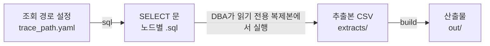

# order-trace: 주문 번호 추적 도구

출하가 끝난 주문 한 건을 주문 → MO → 작업지시 → 코일(분할 포함) → 판정 → 출하 → ERP 전기까지 번호로 따라간다. 착수 과제 P01(실제 주문 추적·메가프로세스 초안)에서 쓰고, 같은 추출본을 D10 논리 모델, D17 테스트 기대값, D18 교차 검토, B04 이행 대사의 기준 자료로 다시 쓴다.

요구사항 시트 '도구계획_클로드' 탭의 1번 도구다.

## 동작 방식

운영 DB에 직접 붙지 않는다. 두 단계로 나눈다.



1. `sql`: 설정에서 노드(테이블)마다 SELECT 문을 만든다. 모든 문장은 바인드 변수 `:order_no` 하나로 대상 주문을 고른다. 조회 전용이라 INSERT, UPDATE, DELETE, DDL, PL/SQL 블록이 설정에 있으면 거부한다.
2. DBA나 권한 있는 담당자가 읽기 전용 복제본에서 실행하고, 결과를 `extracts/<노드>.csv`로 내보낸다. 머리글을 포함하고 UTF-8로, 날짜는 `YYYY-MM-DD HH24:MI:SS` 형식으로 내보낸다.
3. `build`: 추출본으로 아래 산출물을 만든다.

| 파일 | 내용 |
|---|---|
| `links.csv` | 번호 연결표. 행마다 노드, 키, 부모 노드, 부모 키. 출하처럼 코일 여러 개가 모이는 경우 연결을 모두 남긴다 |
| `paths.csv` | 자식이 없는 행마다 주문까지 거슬러 올라간 번호 경로 |
| `timeline.csv` | `time_column`이 있는 노드의 이벤트를 시각 순으로 정렬. 진도코드·작업진행상태 변화가 여기서 보인다 |
| `lineage.mmd` | Mermaid 계보도(주문 → MO → 모·자코일 → 출하 LOT → 출하) |
| `checks.csv` | 부모를 찾지 못한 행, 시각이 빈 행, 추출본이 없거나 빈 노드 |
| `snapshot/` | 마스킹을 적용한 추출본 사본 |
| `manifest.json` | 입력 파일 해시와 행 수, 설정 해시, 실행 시각 |

## 사용법

Python 3.9 이상, 표준 라이브러리만 쓴다. YAML 설정을 쓰려면 PyYAML이 필요하고, 없으면 같은 내용을 JSON으로 저장해 쓴다.

1. 예시 설정을 복사해 실제 테이블·컬럼명으로 바꾼다. 예시의 `TODO_` 테이블명과 컬럼명은 모두 가정이다.

```bash
cp tools/order-trace/trace_path.example.yaml tools/order-trace/trace_path.yaml
```

2. 설정을 검사한다.

```bash
python3 tools/order-trace/order_trace.py check --config tools/order-trace/trace_path.yaml
```

3. SQL을 만든다. 변형 주문 후보 선정 쿼리도 `sql/variants/`에 함께 만들어진다.

```bash
python3 tools/order-trace/order_trace.py sql --config tools/order-trace/trace_path.yaml --out tools/order-trace/sql
```

4. 복제본에서 실행해 `extracts/`에 CSV로 받는다. 파일 이름은 노드 이름과 같아야 한다(`order.csv`, `coil.csv` 등).

5. 산출물을 만든다. hash 마스킹을 쓰므로 비밀값을 환경변수로 넣는다.

```bash
ORDER_TRACE_SALT='보안 담당에게 받은 값' python3 tools/order-trace/order_trace.py build --config tools/order-trace/trace_path.yaml --extracts tools/order-trace/extracts --out tools/order-trace/out
```

## 설정 작성법

노드 하나가 테이블 하나다. `parent`와 `join`(자기 컬럼: 부모 컬럼)으로 주문에서 아래로 이어진다. 항목 설명은 [trace_path.example.yaml](trace_path.example.yaml) 머리 주석에 있다.

- **코일 분할**: 코일 노드에 `lineage`(key_column, parent_column)를 주면, 부모 노드와 이어진 모코일에서 시작해 자코일을 모두 따라간다. Oracle은 `CONNECT BY NOCYCLE`, 시험용 `ansi`는 재귀 CTE로 만든다.
- **주문번호가 바뀌는 경로**: 주문 Match 변경(요구 3.20.2)이나 부적합 판정 후 MO 전환(3.14.7)이 있으면, MO가 처음 주문과 다른 주문에 붙어 있을 수 있다. Match 이력 테이블을 노드로 하나 더 두거나 `custom_sql`로 직접 쓴다.
- **I/F 이력**: EAI 송수신 테이블이 코일이나 MO 번호를 컬럼으로 갖고 있으면 그 컬럼으로 잇는다. 전문 본문 안에만 번호가 있으면 `custom_sql`로 쓴다.
- **변형 주문**: 시험 데이터를 지어내지 않는다. `variants`에 해당 사건(분할, 재판정, 칼라 라인 등)이 실제로 있었던 최근 출하 완료 주문을 찾는 쿼리를 둔다.

## 지킬 것

- **추출본과 산출물은 git에 올리지 않는다.** `extracts/`, `out/`, `sql/`, `trace_path.yaml`은 `.gitignore`에 있다. 접근 통제된 저장소에 두고, 필요하면 `manifest.json`의 해시만 기록한다.
- **마스킹 대상은 보안 담당이 승인한다.** 예시에는 고객명, 단가, 차량번호, 기사 이름·연락처가 있다. 개인정보가 있는 테이블은 `columns`로 필요한 컬럼만 뽑는다.
- **비밀값은 파일에 두지 않는다.** `ORDER_TRACE_SALT`는 환경변수로만 넣는다. 같은 비밀값을 쓰면 회차가 달라도 같은 값은 같은 해시가 되어 비교할 수 있다.
- **운영계에서 돌리지 않는다.** 복제본이 없어 운영계에서 실행해야 한다면 DBA 승인 아래 비조업 시간에 실행한다.

## 확인이 필요한 것 [검증 필요]

- 레거시 DB가 Oracle인지. 프로시저 이름(PROC_)으로 추정했다. 다른 DB라면 `dialect: ansi`로 바꾸고 재귀 CTE 문법을 확인한다.
- 실제 테이블 구조. 코일 분할이 모코일 컬럼으로 표현되는지, 분할 이력 테이블이 따로 있는지에 따라 `lineage`나 노드를 바꾼다.
- 출하 완료 상태 코드, CCL 라인 코드 등 `variants`의 `TODO_` 값.

## 시험

지어낸 데이터로 예시 설정 전체를 SQLite에서 실행해 본다.

```bash
python3 -m unittest discover -s tools/order-trace/tests
```
